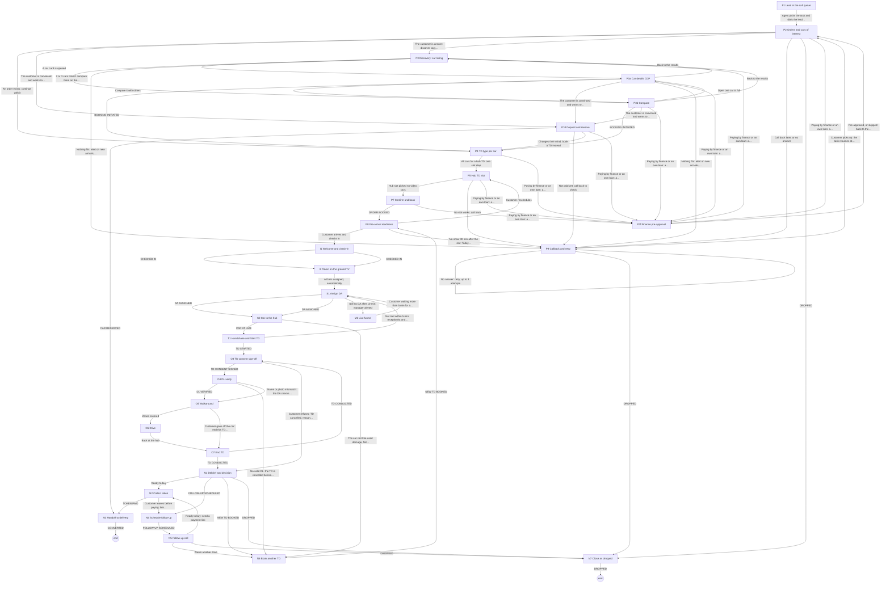
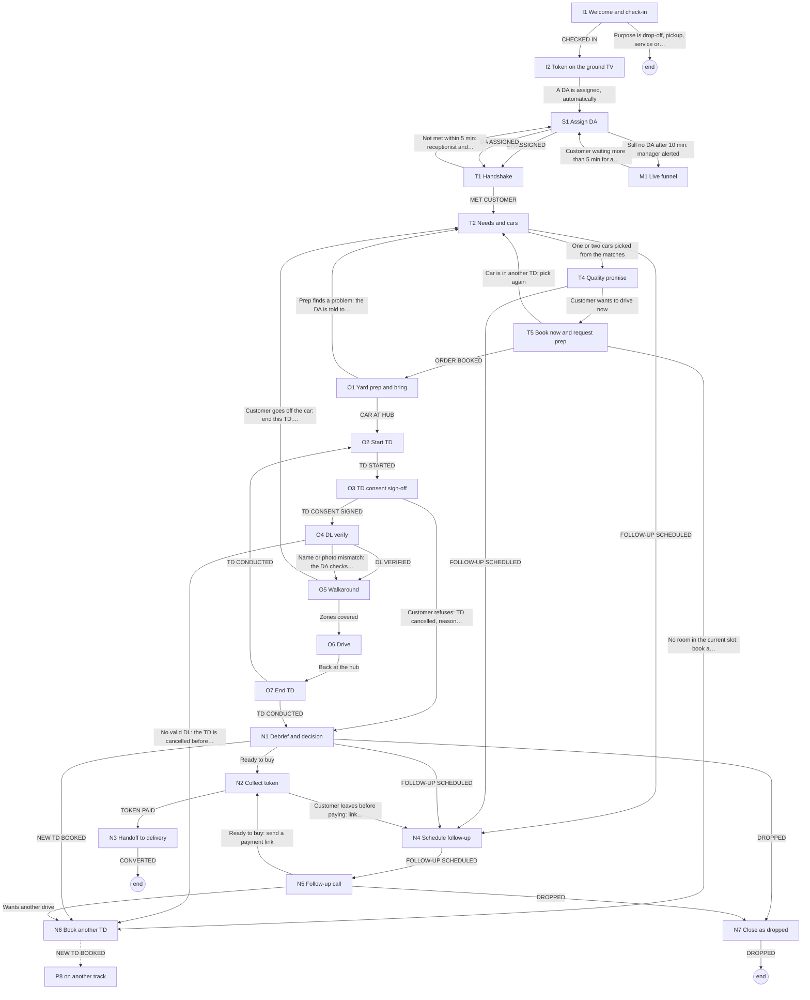
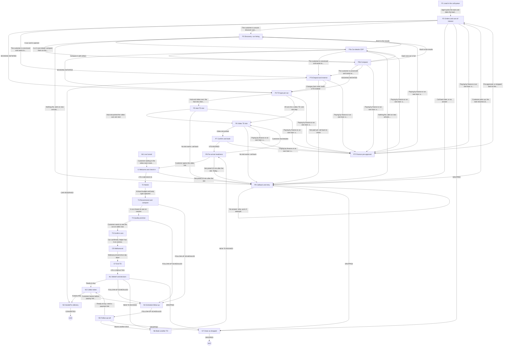

# PISTON v2: the ideal test-drive journey

The complete spec behind the PISTON prototype, for the UAE and Australia, on the Leadverse design. It covers every step of the booked, walk-in and video test drive, with the logic that moves a customer from one step to the next: entry and exit conditions, states, screens, fields, actions and the decisions still open.

- **Prototype:** https://claude.ai/artifact/TWiP1PVT2sEx7vsug4dbH5
- **Code:** https://github.com/kishor1-hue/piston-leadverse-proto
- **Source:** generated from the spec files (`piston-data.js`, `piston-anatomy.js`, `piston.js`) by `tools/gen-spec-md.js`; rerun it after any spec change
- **Steps:** 37, in 7 phases (P, I, S, T, O, N, M), across 3 tracks, 2 markets and 2 check-in ways

Examples use the UAE people and cars (Fatima, Ahmed, Khalid, Omar). Australia runs the same journey with its own people, places and copy (Emily, Jack, Liam, Josh): see [Markets](#9-markets-configured-not-rebuilt).

## Contents

1. [How to read this](#1-how-to-read-this)
2. [The three flows](#2-the-three-flows)
3. [Phases](#3-phases)
4. [Journey maps](#4-journey-maps)
5. [States](#5-states)
6. [Core logic](#6-core-logic)
7. [Finance pre-approval question sets](#7-finance-pre-approval-question-sets)
8. [Every step](#8-every-step)
9. [Markets: configured, not rebuilt](#9-markets-configured-not-rebuilt)
10. [What changed after review](#10-what-changed-after-review)

## 1. How to read this

**Tracks.** Every step belongs to one or more tracks.

| Track | Example customer | What it is |
| --- | --- | --- |
| Booked hub TD | Fatima Al Suwaidi | Booked on the TD booking call (or self-serve in the app), drives at the hub |
| Walk-in hub TD | Ahmed Saleh | Arrives at the hub with no booking |
| Video TD | Khalid Al Jaberi | A walkaround over video with an operator; can lead to a hub TD |

**Check-in ways.** Hub customers check in one of two ways, with the same form. The market sets the default; both work everywhere.

| Way | Who fills the form | Default in |
| --- | --- | --- |
| By staff | A receptionist or DA, with the customer | UAE (and India) |
| Seat QR | The customer, on their own phone, from the QR on their seat | Australia |

**Markets.** UAE (tenant `cars24-ae`) and Australia (tenant `cars24-au`). One build; the market changes defaults, documents and copy.

**Variants.** Where a value differs by track, check-in way or market, it is shown once per variant, labelled in italics (for example *Walk-in, seat QR:*). No label means it is the same everywhere.

**States** are written in capitals (CHECKED IN, TD STARTED). **Branch** steps are side trips off the main path. **Build** says whether a screen reuses, extends or is new to Leadverse.

## 2. The three flows

### Booked hub TD

**Sources**

- Leads from the consumer app or website
- Chatbot
- Ads and missed calls
- Self-serve booking in the app, which skips the call

**Entry conditions**

- A lead with a mobile number, booked on the TD booking call
- On the day: customer arrives at the booked hub

**How it can end**

| Outcome | Meaning |
| --- | --- |
| TOKEN PAID | handed to the delivery journey |
| CAR RESERVED | a deposit taken on the call, no TD needed |
| FOLLOW-UP SCHEDULED | date agreed, shortlist shared |
| NEW TD BOOKED | another car, restarts at Plan |
| DROPPED | reason recorded |
| No-show | back to the callback queue (P9) |

**Main path:** P1 → P2 → P4 → P5 → P7 → P8 → I1 → I2 → S1 → S2 → T1 → O3 → O4 → O5 → O6 → O7 → N1 → N2 → N3

### Walk-in hub TD

**Sources**

- Drive-by
- Referral
- Social or search ad
- Radio and outdoor

**Entry conditions**

- Customer at the hub without a booking
- A valid licence is needed to drive; car finding works without one

**How it can end**

| Outcome | Meaning |
| --- | --- |
| TOKEN PAID | handed to the delivery journey |
| FOLLOW-UP SCHEDULED | includes browse-only visits |
| NEW TD BOOKED | another day or another car |
| DROPPED | reason recorded |

**Main path:** I1 → I2 → S1 → T1 → T2 → T4 → T5 → O1 → O2 → O3 → O4 → O5 → O6 → O7 → N1 → N2 → N3

### Video TD

**Sources**

- Leads from the consumer app or website
- Chatbot
- Ads and missed calls
- Self-serve booking in the app, which skips the call

**Entry conditions**

- A lead with a mobile number, booked on a video TD
- On the day: customer joins the video link within 15 min of the slot

**How it can end**

| Outcome | Meaning |
| --- | --- |
| TOKEN PAID | by payment link |
| CAR RESERVED | a deposit taken on the call |
| NEW TD BOOKED | a hub TD after the video |
| FOLLOW-UP SCHEDULED | date agreed |
| DROPPED | reason recorded |

**Main path:** P1 → P2 → P4 → P5 → P6 → P7 → P8 → I1 → T2 → T3 → T4 → T5 → O5 → O7 → N1 → N2 → N3

## 3. Phases

### P · Plan

- **When:** Before arrival. The pitch decides what comes next: a TD booking or a deposit, with a finance pre-approval at any point
- **Owner:** Calling team, then the system
- **Entry:** An enquiry with a mobile number: an order, or a contact with cars of interest. Self-serve app bookings skip the call and start at P8
- **Exit:** Every TD from the call booked and the calling task closed, then ready for the visit. Or a deposit taken and the car reserved
- **Steps:** P1 Lead in the call queue, P2 Orders and cars of interest, P3 Discovery: car listing, P3a Car details (CDP), P3b Compare, P4 TD type per car, P5 Hub TD slot, P6 Video TD slot, P7 Confirm and book, P7d Deposit and reserve, P7f Finance pre-approval, P8 Pre-arrival readiness, P9 Callback and retry

### I · Introduce

- **When:** First 3 minutes: welcome and check-in in one gesture
- **Owner:** 
  - *Booked and walk-in, by staff:* Receptionist or DA, with the customer
  - *Booked and walk-in, seat QR:* Customer, from the QR on their seat
  - *Video TD:* VTD operator
- **Entry:** 
  - *Booked and walk-in:* Customer walks in and sits down
  - *Video TD:* Customer opens the video link
- **Exit:** 
  - *Booked and walk-in:* CHECKED IN, with a token on the ground TV. No handshake yet
  - *Video TD:* VTD CHECKED IN
- **Steps:** I1 Welcome and check-in, I2 Token on the ground TV

### S · Set up

- **When:** While the customer waits
- **Owner:** System, then the Yardie
- **Entry:** CHECKED IN
- **Exit:** 
  - *Booked:* DA ASSIGNED, and the booked car at the hub
  - *Walk-in:* DA ASSIGNED
- **Steps:** S1 Assign DA, S2 Car to the hub

### T · Tailor

- **When:** 
  - *Booked:* The handshake, which starts the TD: the car was chosen on the call
  - *Walk-in:* Handshake, then car finding and booking the current slot
  - *Video TD:* Car finding over screen share
- **Owner:** 
  - *Booked and walk-in:* DA, from the handshake to the close
  - *Video TD:* VTD operator
- **Entry:** 
  - *Booked:* DA ASSIGNED and CAR AT HUB
  - *Walk-in:* DA ASSIGNED
  - *Video TD:* VTD CHECKED IN
- **Exit:** 
  - *Booked:* TD STARTED, recording on
  - *Walk-in:* ORDER BOOKED for the current slot and yard prep requested, or a follow-up
  - *Video TD:* Car confirmed for the video walkaround
- **Steps:** T1 Handshake and Start TD / Handshake, T2 Needs and cars / Needs, T3 Recommend and compare, T4 Quality promise, T5 Book now and request prep / Confirm cars

### O · On the road

- **When:** 
  - *Booked:* Consent, DL, walkaround, drive
  - *Walk-in:* Car to the hub, then Start TD, consent, DL, walkaround, drive
  - *Video TD:* Walkaround on video
- **Owner:** 
  - *Booked:* DA
  - *Walk-in:* Yardie, then the DA
  - *Video TD:* VTD operator
- **Entry:** 
  - *Booked:* TD STARTED at the handshake
  - *Walk-in:* ORDER BOOKED, yard prep requested
  - *Video TD:* Car on camera
- **Exit:** 
  - *Booked and walk-in:* TD CONDUCTED for every car
  - *Video TD:* VTD CONDUCTED
- **Steps:** O1 Yard prep and bring, O2 Start TD, O3 TD consent sign-off, O4 DL verify, O5 Walkaround, O6 Drive, O7 End TD

### N · Next step

- **When:** No visit ends without one
- **Owner:** DA, then RM
- **Entry:** TD conducted, or a visit with no drive
- **Exit:** TOKEN PAID, FOLLOW-UP SCHEDULED, NEW TD BOOKED or DROPPED
- **Steps:** N1 Debrief and decision, N2 Collect token, N3 Handoff to delivery, N4 Schedule follow-up, N5 Follow-up call, N6 Book another TD, N7 Close as dropped

### M · Oversight

- **When:** All day
- **Owner:** Manager (DATL)
- **Entry:** Manager role
- **Exit:** Late steps caught and reassigned
- **Steps:** M1 Live funnel

## 4. Journey maps

Each map shows every step on the track and every exit between them, by staff for hub check-in (the seat QR exits are listed under I1 in [Every step](#8-every-step)). Edge labels name the state reached, or a short form of the condition.

### Booked hub TD

### Walk-in hub TD

### Video TD

## 5. States

A state is set by one exit of one step. Statuses on the ground TV and the token page are derived from these, never typed.

| State | Set at | When | Tracks |
| --- | --- | --- | --- |
| DROPPED | P2 Orders and cars of interest | Wrong number or not interested: disposition | Booked, Video TD |
| DROPPED | P9 Callback and retry | 3 attempts used, or not interested | Booked, Video TD |
| DROPPED | N1 Debrief and decision | Not interested | Booked, Walk-in, Video TD |
| DROPPED | N5 Follow-up call | No answer after 3 attempts, or not interested | Booked, Walk-in, Video TD |
| DROPPED | N7 Close as dropped | Reason saved | Booked, Walk-in, Video TD |
| BOOKING INITIATED | P2 Orders and cars of interest | The customer picks cars from their interest; with mobile and email, one order is created per car | Video TD |
| BOOKING INITIATED | P3a Car details (CDP) | Customer wants to drive it: an order is created if none exists | Booked, Video TD |
| BOOKING INITIATED | P3b Compare | Cars picked to drive: orders created if none exist | Booked, Video TD |
| ORDER BOOKED | P7 Confirm and book | Hub TD booked; the calling task closes | Booked |
| ORDER BOOKED | T5 Book now and request prep / Confirm cars | Current slot booked, order created, prep requested; the customer waits on their token until the car is at the hub | Walk-in |
| VTD BOOKED | P7 Confirm and book | Hub TD and video TD booked; the calling task closes | Video TD |
| CAR RESERVED | P7d Deposit and reserve | Confirmation uploaded and the car set to Reserved: complete. The order goes to the delivery journey | Booked, Video TD |
| CHECKED IN | I1 Welcome and check-in | OTP verified, Yes to an existing order: today's order is found and checked in at once. A token is issued, a DA is assigned and the Yardie is told to bring the booked car | Booked |
| CHECKED IN | I1 Welcome and check-in | OTP fails 3 times: the receptionist checks Emirates ID, then finishes the check-in | Booked |
| CHECKED IN | I1 Welcome and check-in | Mobile verified, Yes to an existing order: today's order found and checked in at once, token issued with the DA's name | Booked |
| CHECKED IN | I1 Welcome and check-in | OTP verified, purpose buy or test drive, No to an existing order: the details form creates the lead and the visit, token issued | Walk-in |
| CHECKED IN | I1 Welcome and check-in | Customer submits the details form (no existing order) with purpose buy or test drive: lead and visit created, token issued | Walk-in |
| VTD CHECKED IN | I1 Welcome and check-in | OTP verified on the call, recording consent answered | Video TD |
| DA ASSIGNED | S1 Assign DA | A DA is free: assigned automatically, pushed to the DA, shown on the TV. Meanwhile the Yardie brings the car | Booked |
| DA ASSIGNED | S1 Assign DA | Every DA is busy or at their cap: the receptionist picks the next free DA by hand | Booked, Walk-in |
| DA ASSIGNED | S1 Assign DA | A DA is free: assigned automatically, pushed to the DA, shown on the TV | Walk-in |
| CAR AT HUB | S2 Car to the hub | Car parked at the hub: the DA is told and the TV shows Car ready. The DA goes to the customer: the handshake starts the TD | Booked |
| CAR AT HUB | O1 Yard prep and bring | Prepped and parked at the hub: the DA is told to go back to the customer; the TV shows Car ready | Walk-in |
| TD STARTED | T1 Handshake and Start TD / Handshake | DA meets the customer and taps Start TD: TD record created, recording on; the TV shows On test drive | Booked |
| TD STARTED | O2 Start TD | TD record created and the recording on; the TV shows On test drive | Walk-in |
| MET CUSTOMER | T1 Handshake and Start TD / Handshake | DA taps Met customer; the TV shows them together | Walk-in |
| FOLLOW-UP SCHEDULED | T2 Needs and cars / Needs | Nothing fits today: shortlist shared | Walk-in |
| FOLLOW-UP SCHEDULED | T3 Recommend and compare | Nothing fits today: shortlist shared | Video TD |
| FOLLOW-UP SCHEDULED | T4 Quality promise | Wants to think: shortlist shared | Walk-in, Video TD |
| FOLLOW-UP SCHEDULED | N1 Debrief and decision | Needs time | Booked, Walk-in, Video TD |
| FOLLOW-UP SCHEDULED | N4 Schedule follow-up | Date agreed, shortlist sent, RM task created | Booked, Walk-in, Video TD |
| TD CONSENT SIGNED | O3 TD consent sign-off | Signed: on to the licence check | Booked, Walk-in |
| DL VERIFIED | O4 DL verify | DL valid, name matches, not expired | Booked, Walk-in |
| TD CONDUCTED | O7 End TD | Another car on the booking is at the hub: start it here, then its own consent. The licence is already verified | Booked |
| TD CONDUCTED | O7 End TD | Done driving | Booked, Walk-in |
| TD CONDUCTED | O7 End TD | Another car is queued: start its TD, with its own consent. The licence is already verified | Walk-in |
| VTD CONDUCTED | O7 End TD | Call wrapped up | Video TD |
| NEW TD BOOKED | N1 Debrief and decision | Wants another car | Booked, Walk-in |
| NEW TD BOOKED | N1 Debrief and decision | Wants to drive it at a hub | Video TD |
| NEW TD BOOKED | N6 Book another TD | Slot confirmed | Booked, Walk-in, Video TD |
| TOKEN PAID | N2 Collect token | Gateway confirms the payment | Booked, Walk-in, Video TD |
| CONVERTED | N3 Handoff to delivery | Delivery tasks created, RM assigned. The TD journey closes | Booked, Walk-in, Video TD |

## 6. Core logic

The rules that span several steps. Each step's own entry and exit conditions are in [Every step](#8-every-step).

### 6.1 The TD booking call (P1 to P9)

- **A task, not a lead page.** Every enquiry with a mobile number becomes a task in the TD booking call persona (`b2c-lead-td-booking-by-cc`). Queue tabs: All, Queue, Callbacks, Closed today, Today missed TD.
- **Order or contact.** A mobile and an email means an order already exists (booked track): the agent confirms it. A mobile only means the cars of interest sit on the contact by appointment ID; picking cars creates one order per car once the email is added in the lead pane.
- **Discovery is a branch.** P3 listing (search by appointment ID, market filters), P3a car page, P3b compare (2 or 3 cars). Pick for TD sends the cars on to P4.
- **TD type per car (P4).** Each car is hub or video. All hub: P5 hub slot. All video: P6 video slot. Mixed: P5, then P6, then one read-back at P7 that books both. Australia: an interstate car is video only.
- **Payment mode and trade-in on P4.** Payment mode (Cash, In-house finance, BYOF) and Trade-in opted (Yes / No). The payment mode is one value shared with the lead pane select; it starts from what the customer said in the app or chatbot. Trade-in opted starts from the same source and shows on the lead view's Trade-in tile.
- **Booking closes the task (P7).** Booked: ORDER BOOKED. Video or mixed: VTD BOOKED. Then P8 pre-arrival readiness: reminders at T-24h and T-2h with a licence upload link, yard prep, DA pre-assigned by capacity.
- **Callbacks (P9).** No slot works, no answer, or busy: the task moves to Callbacks and resumes where the call stopped. After 3 attempts it closes as dropped. A missed TD shows in Today missed TD.
- **The pitch decides, not a fixed path.** Each Next posts the step's answers to the journey's next-step API; the response names the next step and the stages to show. That is how the call branches to a TD or a deposit.

### 6.2 Deposit instead of a TD (P7d)

- Offered from the Next menu (*Customer wants to pay a deposit*) on P2, P3a and P3b, only once a car is picked. The call's stages switch to Interest, Discovery, Deposit, Reserved.
- Three blocks, one gate: send the bank details from the CRM (WhatsApp, email or SMS, order as the reference); the customer pays and emails a screenshot; the agent uploads it as the confirmation. Only then can the car be set to Reserved.
- Exits: confirmation uploaded and car reserved → N3, CAR RESERVED. Not paid yet → P9. Changes their mind → P4 (book a TD).

### 6.3 Finance pre-approval on the call (P7f)

- **Gate:** the payment mode. With In-house finance or BYOF, the Next menu on every call step (P2, P3, P3a, P3b, P4, P5, P6, P7, P7d) offers *Run a finance pre-approval*. With Cash it is off.
- **A side trip, not a stage.** The stage bar stays on the step it was opened from (marked Pre-approval open). Next reads Skip until it runs, then Done; both return to that step.
- **Score first.** Result tiles on top: status, cohort, credit score (a soft check on name, date of birth and the ID number or address), expiry.
- **Two forms, one goal.** *Partial* asks the listing page's quick questions and returns a cohort and an interest-rate range. *Full* adds loan, employment and personal details plus the consent, and returns the amount they can borrow and the repayment. Run stays off for Full until the consent is ticked.
- **Kept on the lead.** The latest run (partial or full) lives on the lead, so the call, the hub and delivery read the same one. Question sets are market config from the finance service (see [section 7](#7-finance-pre-approval-question-sets)).

### 6.4 Check-in (I1): welcome and check-in in one gesture

Checking in is the arrival: there is no Mark arrived. The seat QR page and the staff form are the same form, so either way gives the same answers.

1. **Mobile, purpose and OTP (one screen).** Mobile number with the market's dial code (+971, +61). Purpose of visit: buy or test drive, drop off a car, pick up a car, a booked service, sell my car, something else. Only buy or test drive goes on to a DA; the rest are routed to that desk. Send code → the code appears under the form → Verify. 3 tries; resend after 30 s. After 3 failures a receptionist checks ID by hand (Emirates ID in the UAE, photo ID in Australia) and finishes the check-in.
2. **Existing order? Yes or No.**
   - **Yes, order found** (by the mobile): today's order shows with *Checked in*, at once. CHECKED IN.
   - **Yes, nothing found:** the page says nothing is booked on that mobile today and offers the details form.
   - **No:** the basic details form: phone (already verified), email, first and last name, post code (UAE: emirate and area), *Do you need financing after the test drive?*, *Where did you hear about us?* (market list), and the driving licence photos, front and back, optional. Check in creates the lead (dedupe on mobile) and the visit. CHECKED IN.
3. **The last screen: the token with the DA.** Token number, seat and the DA's name (*Your sales associate (DA)*), on the phone and in the staff form.

**What one check-in fires:** a queue token, DA auto-assignment (S1), the Yardie's task for a booked car (S2), the token on the ground TV, and the token page link on WhatsApp.

**No recording question at check-in.** The DA asks for the recording consent at Start TD (T1 for a booking, O2 for a walk-in), when the recording would start.

**Seat QR specifics:** the QR is the same on every seat, so the mobile and OTP prove who is checking in. The receptionist's Today list shows the check-in live, with each answer landing in a side panel. No answer for 3 min: the receptionist gets a nudge. *Finish it for them* opens the staff form with what was already filled. Each part autosaves.

**Video TD:** check-in is an OTP read out on the call, in the same step as the welcome. Not joined 10 min after the slot → P9.

### 6.5 Finance next step after check-in

The financing answer on the details form, plus the pre-approval status, picks one card with a QR on the token page and the staff form:

| Financing answer | Pre-approved? | Card shown |
| --- | --- | --- |
| I might need finance from CARS24 | No | The 2-minute pre-approval |
| I might need finance from CARS24 | Yes | You're already pre-approved: take a seat, browse our cars |
| I have already arranged my own loan | Either | The 2-minute beat-your-lender check |
| I don't need finance | Either | Take a seat, browse our cars |

### 6.6 The token and the ground TV (I2)

- **One token per check-in:** hub, day, B for bookings or W for walk-ins, and a number (B-07, W-12). Bookings are served at their slot time, then tokens in order. Not the payment token (TOKEN PAID).
- **The ground TV** shows token, first name and initial, status, DA, car and waiting time. A QR on the TV catches anyone who missed the one on their seat.
- **Statuses:** Waiting for a DA, DA coming to you, With your DA, Car ready, On test drive. They change only on staff actions, never typed.
- **The customer's token page** shows the same token, the DA, the car and live progress, and updates by itself.
- **What moves them.** Booked: Yardie picks up the car → car parked at the hub → DA meets the customer, TD starts. Walk-in: DA meets the customer → slot booked, Yardie preps the car → car parked at the hub → DA comes back and starts the TD.

### 6.7 DA assignment (S1)

- **Automatic, at check-in.** That is why the last check-in screen can name the DA.
- **Rule, in order:** free now (not on a drive or a break), under today's cap, a free slot for the next hour. Then, for a booking, the booking's pre-assigned DA first; for a walk-in, the best language match. Ties go to the fewest drives today.
- **Every DA busy or at cap:** the receptionist picks the next free DA by hand. Still no DA after 10 min: the manager is alerted.
- **The handshake comes after assignment,** at the customer's seat, never at check-in. Not met within 5 min: the receptionist and the manager are alerted, and the DA can be reassigned.

### 6.8 The Yardie and the car (S2, O1)

- Cars wait in the yard, about 500 m from the hub. The Yardie works a mobile task list.
- **Booked:** the car was prepped before the day (P8). Check-in calls it to the hub: Picked up, driving over → Parked at the hub. CAR AT HUB tells the DA and moves the TV.
- **Walk-in:** once the DA books the current slot (T5), the Yardie preps the car (quick wash, wipe the inside, fuel at least half, tyre pressure), then brings it. At the hub, the DA is told to go back to the customer.
- Prep finds a problem: the DA is told to pick another car.

### 6.9 On the road (T1/O2 to O7)

- **Start TD.** Booked: the handshake is the start (T1). The car was chosen on the call and is at the hub, so there is no car finding. Walk-in: the DA goes back to the customer once the car is at the hub (O2). Starting creates the TD record (car, plate, time, odometer, fuel, route).
- **Recording consent, at Start TD.** The DA asks *can we record the drive?* and sets the toggle. Yes: live notes and transcription run from Start TD to End TD. No: the drive goes ahead and only the objection tags are kept.
- **TD consent (O3).** One per car, signed on the DA's tablet: terms, signature and tick. Declines → the TD is cancelled. The signed PDF goes to Documents and to the customer on WhatsApp.
- **DL verify (O4).** The last check before the car moves. Car finding does not need a licence; driving does.
- **Walkaround (O5), drive (O6), end (O7).** The drive shows a LIVE badge, live transcription and one-tap objection tags. End records the odometer, duration and the customer's reaction.

### 6.10 Next step (N1 to N7)

No visit ends without one. The DA records the decision at N1:

| Decision | Goes to | Result |
| --- | --- | --- |
| Ready to buy | N2 Collect token | Payment by the gateway → TOKEN PAID → N3 handoff to delivery (RM assigned) |
| Needs time | N4 Schedule follow-up | FOLLOW-UP SCHEDULED, then N5 follow-up call |
| Wants another car (video TD: drive it at a hub) | N6 Book another TD | NEW TD BOOKED, restarts at Plan |
| Not interested | N7 Close as dropped | DROPPED, with the reason |

At N2, a customer who leaves before paying keeps a live payment link and gets a follow-up (N4). TOKEN PAID comes from the payment webhook only.

### 6.11 Oversight (M1)

The manager (DATL) sees a live funnel all day: one row per state (checked in, DA assigned, met, car at the hub, DL verified, and on), with time between states. Late steps are caught and reassigned.

### 6.12 Example people, per market

| Role | UAE | Australia |
| --- | --- | --- |
| Customer, Booked | Fatima Al Suwaidi | Emily Carter |
| Customer, Walk-in | Ahmed Saleh | Jack Thompson |
| Customer, Video TD | Khalid Al Jaberi | Liam Walsh |
| Staff, RECEPTIONIST | Kishor | Kishor |
| Staff, COMMON_DA | Omar Hassan | Josh Miller |
| Staff, VIRTUAL_DA | Sara Ibrahim | Priya Sharma |
| Staff, DATL | Aaliya Patel | Aaliya Patel |
| Staff, Call centre | Reem Khalifa | Chloe Davis |
| Staff, RM | Rania Haddad | Grace Lee |
| Staff, PREP_USER | Bilal Raza | Tom Nguyen |

## 7. Finance pre-approval question sets

From the finance service's market config (`PREQ`). Both forms lead to the same goal: a pre-approval kept on the lead.

### UAE

Credit bureau: **AECB**. Example results: cohort Prime, partial rate 2.99% to 4.49% flat p.a., full rate 2.99% to 3.75% flat p.a., expires 6 Nov 2026.

**Identity, for the soft check**

- Full name *(text)*
- Date of birth *(date)*
- Emirates ID number *(text)*

A soft check against these details. The full AECB report is pulled at Stage 2.

**Partial (cohort and rate range)**

- Amount to finance (AED) *(number)*
- Preferred term (years) *(select: 1 / 2 / 3 / 4 / 5)*
- Employment type *(select: Salaried / Self employed / Business owner / Unemployed / Retired)*
- Months with the employer *(number)*
- Monthly salary (AED) *(number)*
- Monthly loan and card payments (AED) *(number)*
- Date of birth *(date)*
- Dependents *(number)*
- Residency *(select: UAE National / Resident visa / GCC national)*

**Full (amount they can borrow)**

**Loan details**

- Is the loan in your own name? *(choice: Yes / No, my company's)*. A loan in a company's name needs a trade licence and the company's documents
- What is your preferred loan term (years)? *(choice: 1 / 2 / 3 / 4 / 5)*. Up to 5 years for a car loan in the UAE
- Down payment *(slider 20–50)*. At least 20% of the car's price for a car loan. A bigger down payment, a smaller monthly instalment.
- Amount to finance (AED) *(number)*. From the order where there is one.

**Employment details**

- What is your employment type? *(choice: Salaried / Self employed / Business owner / Unemployed / Retired)*. Salaried means a fixed monthly salary from an employer
- Employer *(text)*
- When did you join? *(month and year)*
- What is your monthly salary? *(number)*. Fixed salary and allowances, as on the salary certificate
- Is your salary transferred to a UAE bank? *(choice: Yes / No)*. Most lenders ask for a salary transfer; without one the rate is higher
- How much do you pay each month on loans and cards? *(number)*. Existing EMIs, plus 5% of each credit card limit

**Personal details**

- First name *(text)*
- Last name *(text)*
- Date of birth *(date)*
- Email *(text)*
- *As on the Emirates ID*
- What is your residency status? *(choice: UAE National / Resident visa / GCC national)*. A residence visa must be valid for the loan term
- What is your current living situation? *(choice: Own home / Renting / Company accommodation / Living with family)*. Helps map lenders
- Number of dependents *(number)*. Non-earning spouse, children and other family members
- Current address *(text)*. As on the tenancy contract (Ejari) or a utility bill.
- Shown when relevant: They have lived in the UAE less than 2 years

**Consent**

- Consent: Customer accepted the privacy notice and the **key facts statement**, and consented to the AECB credit check

### Australia

Credit bureau: **Equifax**. Example results: cohort Prime, partial rate 8.95% to 12.4% p.a., full rate 8.95% to 10.9% p.a., expires 6 Nov 2026.

**Identity, for the soft check**

- Full name *(text)*
- Date of birth *(date)*
- Address *(text)*

A soft check against these details. The full file is pulled at Stage 2.

**Partial (cohort and rate range)**

- Amount to finance *(number)*
- Preferred term *(select: 3 / 4 / 5 / 7)*
- Employment status *(select: Full Time / Part Time / Self Employed / Casual / Contractor / Unemployed / Pension)*
- Months in the role *(number)*
- Net income *(amount and how often: Weekly / Fortnightly / Monthly / Annually)*
- Rent or mortgage *(amount and how often: Weekly / Fortnightly / Monthly / Annually)*
- Date of birth *(date)*
- Dependents *(number)*
- Residency *(select: Australian Citizen / Permanent Resident / New Zealand Citizen / Temporary Visa / Bridging Visa)*

**Full (amount they can borrow)**

**Loan details**

- Will you use the car for business purposes? *(choice: Yes / No)*. Select yes if you have an ABN and will use the car for business for more than 50% of the time. Driving to work is not business use.
- What is your preferred loan term (years)? *(choice: 3 / 4 / 5 / 7)*. You can change it later if you wish
- Balloon amount *(slider 0–50)*. 0 to 50% of the loan. A lump sum at the end of the term: lower repayments, more interest overall.
- Amount to finance *(number)*. From the order where there is one.

**Employment details**

- What is your current employment status? *(choice: Full Time / Part Time / Self Employed / Casual / Contractor / Unemployed / Pension)*. Select full-time or part-time for permanent employment only
- When did you start your current job? *(month and year)*
- What is your gross income? *(amount and how often: Weekly / Fortnightly / Monthly / Annually)*. Salary and bonuses, excluding super, before tax
- How much do you spend on house mortgage or rent? *(amount and how often: Weekly / Fortnightly / Monthly / Annually)*. Your share only, if you split payments with someone
- Checkbox: I have my own house with no mortgage

**Personal details**

- First name *(text)*
- Last name *(text)*
- Date of birth *(date)*
- Email *(text)*
- *As it appears on their ID*
- What is your current living situation? *(choice: Owner without Mortgage / Owner with Mortgage / Renting / Living with parents / Boarding)*. Helps map lenders based on whether they own a home
- Number of dependents *(number)*. Non-earning spouse, children and other family members
- What is your relationship status? *(choice: Single / Married / De-facto / Divorced / Widowed)*
- What is your residency status? *(choice: Australian Citizen / Permanent Resident / New Zealand Citizen / Temporary Visa / Bridging Visa)*. Lender and loan policies differ by residency category
- Current address *(text)*. As it appears on their ID. Used for verification, so it must match the primary ID; delivery can go elsewhere.
- Shown when relevant: They have lived here less than 2 years

**Consent**

- Consent: Customer accepted the privacy policy, the fee disclosure guide and the **credit code**, and consented to the credit check

## 8. Every step

Grouped by phase. Each step lists its tracks, owner and device, purpose, trigger and data, entry conditions, exits, state, screen, what DAP does today, what changed, and its anatomy: the screen's numbered parts, the fields it captures, the actions it fires and the states it can be in.

### Phase P · Plan

#### P1 · Lead in the call queue

- **Tracks:** Booked, Video TD
- **Owner:** System, then the calling agent
- **Device:** Leadverse web

**Purpose**

Every enquiry with a mobile number lands as a task in the TD booking call queue. Tabs filter it: all, the queue, callbacks, closed today, and today's missed test drives.

**Trigger:** A customer shows interest in a car: consumer app, website, chatbot, ad or missed call

**Data it reads and writes**

- Lead: mobile, source, and the cars of interest (appointment IDs)
- OMS: the order, when mobile and email were both given
- Task allocation: queue, priority, agent load
- Today's TDs that were missed (no-shows)

**Entry conditions**

- A mobile number
- No open TD booking for this enquiry

**Exits**

| When | Goes to | State |
| --- | --- | --- |
| Agent picks the task and dials; the lead view opens | P2 Orders and cars of interest | — |

**Screen**

- **Screen:** Tasks › Lead › TD booking call
- **Build:** Extend
- **Pattern:** The existing Tasks queue with a new persona, b2c-lead-td-booking-by-cc, and saved-filter tabs: All, Queue, Callbacks, Closed today, Today missed TD
- **Route:** `/tasks?entity=lead&persona=td-booking-call`

**What changed:** New tabs: All, Queue, Callbacks, Closed today, Today missed TD. Each row says whether there is an order or only cars of interest.

**Anatomy**

*Parts of the screen*

| Part | Widget | What it does |
| --- | --- | --- |
| Tabs | FILTER_TABS | All, Queue, Callbacks, Closed today, Today missed TD: saved filters over the same tasks |
| Call queue | TABLE | One row per enquiry: source, intent (an order, or cars of interest only), waiting time, attempts |
| Call now | ROW_ACTION | Opens the lead view and dials through click-to-call |

*Fields*

| Field | Type | Required | Source | Rule |
| --- | --- | --- | --- | --- |
| Lead | Name and email | Read only | Lead service | Mobile only when nothing else is known |
| Source | Chip | Read only | Lead service | App, website, chatbot, ad, missed call |
| Intent | Chip | Read only | OMS and lead | Order (mobile and email given) or cars of interest on the contact |
| Cars | Text | Read only | Appointment IDs | The car, or how many |
| Waiting | Duration | Read only | Task created time | Amber after the first-call target |
| Attempts | Count | Read only | Task | 3, then closed as dropped |

*Actions*

| Action | Calls / event | Result |
| --- | --- | --- |
| Call now | Proposed: task to IN_PROGRESS, click-to-call | P2 |
| Call to rebook (Today missed TD) | Click-to-call; the task reopens at the slot steps | P5 or P6 |

*Screen states*

| State | Meaning |
| --- | --- |
| Empty | No enquiries waiting. New ones arrive in real time |
| Late | Waiting time turns amber past the target |
| Missed TD | A no-show from today moves to its own tab for a rebooking call |

#### P2 · Orders and cars of interest

- **Tracks:** Booked, Video TD
- **Owner:** Calling agent
- **Device:** Leadverse web

**Purpose**

*Booked:*

Everything CARS24 knows before the agent speaks, as context on top and detail below. Context: orders, finance, wishlist and what was viewed. Detail, in tabs: current and past orders with their cars (appointment IDs), the wishlist and recently viewed cars, and the finance picture (pre-approval, amount, repayment). Mobile and email were both given, so an order already exists: a clear intent to take forward.

*Video TD:*

Everything CARS24 knows before the agent speaks, as context on top and detail below. Only a mobile was given, so no order exists: the cars of interest (appointment IDs) sit on the contact, next to the wishlist and the finance picture. Ask which cars to drive. Picking them creates the orders, once the email is added on the left.

**Trigger:** Call connected

**Data it reads and writes**

*Booked:*

- OMS: current and previous orders for this mobile
- Listing: each order's car, by appointment ID, with availability and price changes
- Consumer app: wishlist and cars viewed
- Finance service: pre-approval status, amount, validity and repayment
- Lead: mobile and email (editable in the left pane)
- CarGPT: the opening line and the CARS24 pitch

*Video TD:*

- Lead: the contact and its cars of interest (appointment IDs), no order
- Consumer app: wishlist and cars viewed
- Finance service: pre-approval status, amount, validity and repayment
- Lead: mobile only; the email is added on the call, in the left pane
- OMS: create one order per car picked
- CarGPT: the opening line and the CARS24 pitch

**Entry conditions**

- Call connected

**Exits**

*Booked:*

| When | Goes to | State |
| --- | --- | --- |
| An order exists: continue with it | P4 TD type per car | — |
| The customer is convinced and wants to pay a deposit now (a car is picked) | P7d Deposit and reserve | — |
| The customer is unsure: discover cars together | P3 Discovery: car listing | — |
| Call back later, or no answer | P9 Callback and retry | — |
| Wrong number or not interested: disposition | N7 Close as dropped | DROPPED |
| Paying by finance or an own loan: a pre-approval, then back here | P7f Finance pre-approval | — |

*Video TD:*

| When | Goes to | State |
| --- | --- | --- |
| The customer picks cars from their interest; with mobile and email, one order is created per car | P4 TD type per car | BOOKING INITIATED |
| The customer is convinced and wants to pay a deposit now (a car is picked) | P7d Deposit and reserve | — |
| The customer is unsure: discover cars together | P3 Discovery: car listing | — |
| Call back later, or no answer | P9 Callback and retry | — |
| Wrong number or not interested: disposition | N7 Close as dropped | DROPPED |
| Paying by finance or an own loan: a pre-approval, then back here | P7f Finance pre-approval | — |

**State reached:** 
  - *Video TD:* BOOKING INITIATED

**Screen**

- **Screen:** TD booking call › Orders and interest
- **Build:** New
- **Pattern:** 
  - *Booked:* Context and detail: four context tiles (orders, finance, wishlist, viewed), then tabs for Orders, Cars and Finance. Opens on Orders, the current order selected. Script and pitch in CarGPT
  - *Video TD:* Context and detail: four context tiles, then tabs for Orders, Cars and Finance. Opens on Cars: the cars of interest as selectable rows, wishlisted ones marked. Script and pitch in CarGPT
- **Route:** 
  - *Booked:* `/tasks/TK-6120?step=interest`
  - *Video TD:* `/tasks/TK-6127?step=interest`

**What changed:** Replaces Welcome, Contact and Pitch. Now the customer's whole picture before the pitch: orders, finance (pre-approved or not), wishlist and viewed cars, as context tiles and detail tabs.

**Anatomy**

*Parts of the screen*

*Booked:*

| Part | Widget | What it does |
| --- | --- | --- |
| Call bar | TELEPHONY | Live call with recording, mute, hold and end. Click-to-call through the telephony provider |
| Stage bar | STAGE_STEPPER | The call's steps: Interest, Discovery, TD type, Slots, Book |
| Lead pane | LEFT_PANE | Contact details are edited here, on the call: there is no contact step |
| Context tiles | STAT_TILES | Orders, finance, wishlist, viewed: the whole picture at a glance. Each opens its tab |
| Detail tabs | TABS | Orders, Wishlist and viewed, Finance. Opens on Orders |
| Orders | ORDER_HISTORY | Current and past orders, each with its car and appointment ID |
| Current order | CAR_ROW | Selected to continue; Car page opens the car on the consumer website |
| Past order | HISTORY_ROW | What happened last time |
| Payment mode | SELECT | In the lead pane: Cash, In-house finance or BYOF. The two finance ones offer the pre-approval under the arrow next to Next |
| CarGPT | CARGPT_PANEL | Say this: the opening line. Use the context: pre-approval and price drops. Why CARS24: the pitch, once |
| Footer actions | SHELL_CTAS | The standard two: Previous, and Next for the main exit. The arrow next to Next holds every other exit, including the customer dropping off (to the disposition) |

*Video TD:*

| Part | Widget | What it does |
| --- | --- | --- |
| Call bar | TELEPHONY | Live call with recording, mute, hold and end. Click-to-call through the telephony provider |
| Stage bar | STAGE_STEPPER | The call's steps: Interest, Discovery, TD type, Slots, Book |
| Email, added on the call | INLINE_EDIT | The contact had a mobile only; the agent adds the email right here |
| Context tiles | STAT_TILES | Orders (none yet), finance, wishlist, viewed |
| Detail tabs | TABS | Orders, Cars of interest, Finance. Opens on Cars of interest |
| Cars of interest | CAR_LIST | Each appointment ID the customer showed interest in, wishlisted ones marked, with a link to its page |
| Car row | CAR_ROW | Tick to drive; Car page opens the consumer website |
| Order rule | STATUS | With a mobile and an email, one order per ticked car |
| Payment mode | SELECT | In the lead pane: Cash, In-house finance or BYOF. The two finance ones offer the pre-approval under the arrow next to Next |
| Run the pre-approval | BUTTON | In the Finance tab while there is none; off while the payment mode is Cash |
| CarGPT | CARGPT_PANEL | Say this: the opening line. Use the context: no pre-approval yet, offer it. Why CARS24: the pitch, once |
| Footer actions | SHELL_CTAS | The standard two: Previous, and Next for the main exit. The arrow next to Next holds every other exit, including the customer dropping off (to the disposition) |

*Fields*

*Booked:*

| Field | Type | Required | Source | Rule |
| --- | --- | --- | --- | --- |
| Order | Single select | Yes | OMS | The current order is preselected |
| Add a wishlist car | Multi select | No | Consumer app wishlist | Creates an order per car |
| Pre-approval | Status | Read only | Finance service | Pre-approved, in progress, declined or none |
| Approved amount | Money | Read only | Finance service | With the date it is valid until |
| Est. repayment | Money | Read only | Finance calculator | Per month in the UAE, per week in Australia |
| Wishlist | Cars | Read only | Consumer app | With price drops |
| Viewed | Count | Read only | Consumer app events | This week, and the most viewed car |
| Trade-in | Text | No | Chatbot or app | — |
| Payment mode | Single select | Yes | Said in the app; changed on the call | Cash, In-house finance or BYOF |

*Video TD:*

| Field | Type | Required | Source | Rule |
| --- | --- | --- | --- | --- |
| Email | Email | Yes, for an order | Typed on the call | Valid format; no order without it |
| Cars to drive | Multi select | Yes | Cars of interest (appointment IDs) | At least one |
| Pre-approval | Status | Read only | Finance service | Pre-approved, in progress, declined or none |
| Approved amount | Money | Read only | Finance service | With the date it is valid until |
| Est. repayment | Money | Read only | Finance calculator | Per month in the UAE, per week in Australia |
| Wishlist | Cars | Read only | Consumer app | With price drops |
| Viewed | Count | Read only | Consumer app events | This week, and the most viewed car |
| Trade-in | Text | No | Chatbot or app | — |
| Payment mode | Single select | Yes | Said to the chatbot; changed on the call | Cash, In-house finance or BYOF |

*Actions*

*Booked:*

| Action | Calls / event | Result |
| --- | --- | --- |
| Next: TD type | None: the order is already BOOKING INITIATED | P4 |
| Not sure: discover cars together | None | P3 |
| Send the pre-approval summary | WhatsApp template | Stays here |
| Call back later | Callback time on the task | P9 |
| Wrong number or not interested | Closes with a reason | N7 |
| Run a finance pre-approval | None | P7f, then back here |

*Video TD:*

| Action | Calls / event | Result |
| --- | --- | --- |
| Create 4 orders: TD type | OMS booking-initiate, one order per car; the appointment IDs move from the contact to the orders | BOOKING INITIATED; P4 |
| Not sure: discover cars together | None | P3 |
| Call back later | Callback time on the task | P9 |
| Run the pre-approval (Finance tab, or under the arrow) | None | P7f, then back here |

*Screen states*

*Booked:*

| State | Meaning |
| --- | --- |
| Pre-approved | Finance tile in green with the amount; cars up to it fit |
| Not pre-approved | The Finance tab offers the 2-minute pre-approval link |
| Price drop | A wishlist car shows how much it dropped |
| Call dropped | Task stays open; a retry is offered |

*Video TD:*

| State | Meaning |
| --- | --- |
| Email missing | Create orders stays disabled until a mobile and an email are on the contact |
| Car sold | Row greys out with Sold |
| Not run yet | The Finance tile says so; the Finance tab offers Run the pre-approval |
| Rate range | After a partial run: the rate range, no amount |

#### P3 · Discovery: car listing

- **Tracks:** Booked, Video TD (a branch off the main path)
- **Owner:** Calling agent
- **Device:** Leadverse web

**Purpose**

Only when the customer is unsure: browse live stock together, the way the website does. Search by make, model or appointment ID, filter, and read the car cards. The filters start from what the customer said and wanted. Open a car for its full page, or tick 2 or 3 cars to compare them on the same page.

**Trigger:** Customer is unsure which car

**Data it reads and writes**

- Listing service: live stock, the same as the consumer listing
- Search: make, model or appointment ID
- Filters prefilled from the needs, the wishlist and the budget
- Consumer app: wishlist and cars viewed
- Recommendation model: best match first

**Entry conditions**

- Customer is unsure

**Exits**

| When | Goes to | State |
| --- | --- | --- |
| A car card is opened | P3a Car details (CDP) | — |
| 2 or 3 cars ticked: compare them on the same page | P3b Compare | — |
| Nothing fits: alert on new arrivals, call back | P9 Callback and retry | — |
| Paying by finance or an own loan: a pre-approval, then back here | P7f Finance pre-approval | — |

**Screen**

- **Screen:** TD booking call › Discovery › Listing
- **Build:** Extend
- **Pattern:** The consumer listing inside the call task: a search that takes an appointment ID, filter pills, tabs (best for the customer, wishlist, price drops), and car cards with a Compare tick in the corner. CarGPT folds to a strip to give the cars room
- **Route:** 
  - *Booked:* `/tasks/TK-6120/discovery`
  - *Video TD:* `/tasks/TK-6127/discovery`

**What changed:** Discovery is now the website's listing, its car page and a compare, instead of a stepper of questions.

**Anatomy**

*Parts of the screen*

| Part | Widget | What it does |
| --- | --- | --- |
| Call bar | TELEPHONY | Live call with recording, mute, hold and end. Click-to-call through the telephony provider |
| Stage bar | STAGE_STEPPER | Discovery shows Listing |
| Search | SEARCH | Make, model or appointment ID, as you type |
| Filter pills | FILTER_PILLS | As on the website, per market |
| Applied filters | CHIPS | Prefilled from what the customer said; each can be removed |
| Tabs | SEGMENTED | Best for the customer, Wishlist, Price drops |
| Live stock | TAG | The same listing the website shows |
| Car card | CAR_CARD | As on the website: photo and badge, title, variant, chips, repayment and price, where it is, and the customer's context. Opens the car page |
| Compare tick | CHECKBOX | In the photo's corner; 2 or 3 cars |
| CarGPT | CARGPT_PANEL | Folded to a strip to give the cars room; its tips open from it |
| Footer actions | SHELL_CTAS | Next is Compare, live with the count; it stays off below 2 |

*Fields*

| Field | Type | Required | Source | Rule |
| --- | --- | --- | --- | --- |
| Search | Text | No | Typed | Make, model or an 8-digit appointment ID |
| Filters | Multi select | No | Needs, prefilled | Body type, budget or EMI, gearbox and the market's own filters |
| Compare | Ticks | No | Agent | 2 or 3 cars |

*Actions*

| Action | Calls / event | Result |
| --- | --- | --- |
| Open a car | Listing service: the car page | P3a |
| Compare N cars | None | P3b, with the ticked cars |
| Wishlist heart | Consumer app: wishlist add or remove | Stays here |
| Nothing fits | Alert on new arrivals; callback | P9 |

*Screen states*

| State | Meaning |
| --- | --- |
| No match | Loosen a filter, or set an alert |
| A 4th tick | Refused: up to 3 cars in a compare |
| Car reserved | Card greys out with Reserved |

#### P3a · Car details (CDP)

- **Tracks:** Booked, Video TD (a branch off the main path)
- **Owner:** Calling agent
- **Device:** Leadverse web

**Purpose**

One car in full, as on the website's car page, without leaving the call: gallery, price and repayment, why this car, overview and specs, condition and imperfections, service history, finance, and the CARS24 promises. On top of it, what only the agent sees: the customer's own context for this car (wishlist, views, price drop, pre-approval, where they live).

**Trigger:** A car card is opened

**Data it reads and writes**

- Listing service: the car page data (photos, specs, features)
- Inspection report: condition, imperfections, the checks passed
- Service history
- Finance: calculator and the customer's pre-approval
- Consumer app: wishlist and views for this car
- Similar cars (recommendation model)

**Entry conditions**

- A car opened from the listing, the compare or the similar cars

**Exits**

| When | Goes to | State |
| --- | --- | --- |
| Customer wants to drive it: an order is created if none exists | P4 TD type per car | BOOKING INITIATED |
| Compare it with others | P3b Compare | — |
| The customer is convinced and wants to pay a deposit now (a car is picked) | P7d Deposit and reserve | — |
| Back to the results | P3 Discovery: car listing | — |
| Nothing fits: alert on new arrivals, call back | P9 Callback and retry | — |
| Paying by finance or an own loan: a pre-approval, then back here | P7f Finance pre-approval | — |

**Screen**

- **Screen:** TD booking call › Discovery › Car details
- **Build:** Extend
- **Pattern:** The consumer car page (CDP) sections in the call task, with a sticky price card on the right and the customer's context for this car above it
- **Route:** 
  - *Booked:* `/tasks/TK-6120/discovery/car/10213456`
  - *Video TD:* `/tasks/TK-6127/discovery/car/10198762`

**What changed:** New: the car page inside the call, with the customer's own context for the car.

**Anatomy**

*Parts of the screen*

| Part | Widget | What it does |
| --- | --- | --- |
| Call bar | TELEPHONY | Live call with recording, mute, hold and end. Click-to-call through the telephony provider |
| Stage bar | STAGE_STEPPER | Discovery shows Car details |
| Back to results | BUTTON | Back to the listing, filters kept |
| Gallery | GALLERY | Photos with Exterior, Interior and Imperfections, and Similar cars |
| Why choose this car? | INFO_TILES | Service history, tyre life, safety, premium features |
| Overview | KEY_VALUES | Odometer, gearbox, engine, fuel use, colour, drive, body, seats, then every spec |
| Car condition | INSPECTION | The inspection result and the imperfections, with the full report |
| Service history | HISTORY_LIST | Date, workshop, odometer |
| Finance | CALCULATOR | Price, term, deposit, repayment, against the customer's pre-approval |
| The CARS24 edge | CHECKLIST | The market's promises and checks |
| Similar cars | CAR_STRIP | Each opens its own car page |
| For the customer | CONTEXT | Only the agent sees it: wishlist, views, price drop, fits the pre-approval |
| Price card | PRICE_CARD | Price options (with extended warranty), repayment, where the car is, the appointment ID |
| Compare | BUTTON | Adds this car to the compare |
| Send on WhatsApp | BUTTON | Sends the car's page to the customer |
| CarGPT | CARGPT_PANEL | Suggestions for this step, chat with / to mention a record, and live transcription from Start TD |
| Footer actions | SHELL_CTAS | The standard two: Previous, and Next for the main exit. The arrow next to Next holds every other exit, including the customer dropping off (to the disposition) |

*Fields*

| Field | Type | Required | Source | Rule |
| --- | --- | --- | --- | --- |
| Price option | Single select | No | Agent, with the customer | Standard or with extended warranty |

*Actions*

| Action | Calls / event | Result |
| --- | --- | --- |
| Book a TD for this car | OMS booking-initiate if no order exists | BOOKING INITIATED; P4 |
| Compare | None | P3b |
| Send on WhatsApp | WhatsApp template with the car's page | Stays here |
| Similar car | None | P3a, that car |

*Screen states*

| State | Meaning |
| --- | --- |
| Over the pre-approval | The finance note turns amber |
| Far from the hub | The price card offers a video TD |
| Reserved | Book disabled, with when it may be free |

#### P3b · Compare

- **Tracks:** Booked, Video TD (a branch off the main path)
- **Owner:** Calling agent
- **Device:** Leadverse web

**Purpose**

The cars ticked on the listing, side by side on the same page: 2 or 3 columns with the same sections as the car page, row by row. The best value in each row is marked, and the grid scrolls as one. Pick the cars to drive, or open one in full.

**Trigger:** 2 or 3 cars ticked on the listing

**Data it reads and writes**

- Listing service: the car page data for each car
- Inspection reports
- Finance: repayment per car against the pre-approval
- Consumer app: wishlist and views

**Entry conditions**

- 2 or 3 cars ticked

**Exits**

| When | Goes to | State |
| --- | --- | --- |
| Cars picked to drive: orders created if none exist | P4 TD type per car | BOOKING INITIATED |
| Open one car in full | P3a Car details (CDP) | — |
| The customer is convinced and wants to pay a deposit now (a car is picked) | P7d Deposit and reserve | — |
| Back to the results | P3 Discovery: car listing | — |
| Paying by finance or an own loan: a pre-approval, then back here | P7f Finance pre-approval | — |

**Screen**

- **Screen:** TD booking call › Discovery › Compare
- **Build:** New
- **Pattern:** The same listing page with the results swapped for a compare grid: a label column and 2 or 3 car columns, a sticky car header, sections row by row, Best marks, and Pick for TD on each car
- **Route:** 
  - *Booked:* `/tasks/TK-6120/discovery?compare=c1,c3,c5`
  - *Video TD:* `/tasks/TK-6127/discovery?compare=c2,c1,c3`

**What changed:** New: compare on the same page as the listing, in 2 or 3 columns.

**Anatomy**

*Parts of the screen*

| Part | Widget | What it does |
| --- | --- | --- |
| Call bar | TELEPHONY | Live call with recording, mute, hold and end. Click-to-call through the telephony provider |
| Stage bar | STAGE_STEPPER | Discovery shows Comparing |
| Search | SEARCH | Still there: the same page as the listing |
| Filter pills | FILTER_PILLS | Kept from the listing |
| Compare bar | TOOLBAR | How many cars, only differences, back to the results |
| Car columns | STICKY_HEADER | Photo, title, price and repayment, Car details and Pick for TD; stays on top while scrolling |
| Pick for TD | TOGGLE | The cars that go on to the TD type |
| Rows | COMPARE_GRID | The car page's sections row by row: price and finance, overview, condition, for the customer. Best marks the best value |
| Compare grid | COMPARE_GRID | 2 or 3 columns, one scroll |
| CarGPT | CARGPT_PANEL | Suggestions for this step, chat with / to mention a record, and live transcription from Start TD |
| Footer actions | SHELL_CTAS | The standard two: Previous, and Next for the main exit. The arrow next to Next holds every other exit, including the customer dropping off (to the disposition) |

*Fields*

| Field | Type | Required | Source | Rule |
| --- | --- | --- | --- | --- |
| Pick for TD | Multi select | Yes | Agent, with the customer | At least one |
| Only differences | Toggle | No | Agent | Hides rows that are the same for every car |

*Actions*

| Action | Calls / event | Result |
| --- | --- | --- |
| Book TD for the picked cars | OMS booking-initiate per picked car if no order exists | BOOKING INITIATED; P4 |
| Car details | None | P3a, that car |
| Back to results | None | P3 |

*Screen states*

| State | Meaning |
| --- | --- |
| 2 cars | Two columns |
| 3 cars | Three columns |
| Same everywhere | No Best mark on that row |

#### P4 · TD type per car

- **Tracks:** Booked, Video TD
- **Owner:** Calling agent
- **Device:** Leadverse web

**Purpose**

For each car, a hub TD or a video TD. The mix decides the next steps: one slot step if all cars share a type, two (hub, then video) if not. Two more answers here: the payment mode (Cash, In-house finance or BYOF) and whether a trade-in is opted.

**Trigger:** Cars picked

**Data it reads and writes**

- Listing: where each car is, and whether it can be shown on video
- OMS: the orders for these cars
- Lead: the payment mode (the same value as in the lead pane) and trade-in opted, saved on each order

**Entry conditions**

*Booked:*

- At least one car picked
- Order exists

*Video TD:*

- At least one car picked
- Orders created

**Exits**

*Booked:*

| When | Goes to | State |
| --- | --- | --- |
| All cars for a hub TD: one slot step | P5 Hub TD slot | — |
| Paying by finance or an own loan: a pre-approval, then back here | P7f Finance pre-approval | — |

*Video TD:*

| When | Goes to | State |
| --- | --- | --- |
| Hub and video cars: the hub slot, then the video slot | P5 Hub TD slot | — |
| All cars for a video TD: one slot step | P6 Video TD slot | — |
| Paying by finance or an own loan: a pre-approval, then back here | P7f Finance pre-approval | — |

**Screen**

- **Screen:** TD booking call › TD type
- **Build:** New
- **Pattern:** One row per car with Hub TD or Video TD; video-only cars say why
- **Route:** 
  - *Booked:* `/tasks/TK-6120?step=td-type`
  - *Video TD:* `/tasks/TK-6127?step=td-type`

**What changed:** TD type is now picked per car, so one call can book a hub TD and a video TD.

**Anatomy**

*Parts of the screen*

| Part | Widget | What it does |
| --- | --- | --- |
| Call bar | TELEPHONY | Live call with recording, mute, hold and end. Click-to-call through the telephony provider |
| Stage bar | STAGE_STEPPER | Done stages in green, the current one in violet; the second line shows progress |
| TD type per car | SEGMENTED_PER_ROW | Hub TD or Video TD for each car; a car only on video says why |
| Payment mode | SELECT | Cash, In-house finance or BYOF (bring your own finance). The same value as the lead pane; either finance offers the pre-approval |
| Trade-in opted | SELECT | Yes or No, with what the customer told the app or the chatbot about their car |
| What comes next | INFO | One slot step if all share a type; hub then video if mixed |
| CarGPT | CARGPT_PANEL | Suggestions for this step, chat with / to mention a record, and live transcription from Start TD |
| Footer actions | SHELL_CTAS | The standard two: Previous, and Next for the main exit. The arrow next to Next holds every other exit, including the customer dropping off (to the disposition) |

*Fields*

| Field | Type | Required | Source | Rule |
| --- | --- | --- | --- | --- |
| TD type | Hub or video, per car | Yes | Asked | Video only for cars at another hub or interstate |
| Payment mode | Single select | Yes | Lead, from the app; confirmed here | Cash, In-house finance, BYOF |
| Trade-in opted | Yes or no | Yes | Lead, from the app or chatbot; confirmed here | Yes adds the trade-in to each order |

*Actions*

| Action | Calls / event | Result |
| --- | --- | --- |
| Next: hub slot | Save the TD type, the payment mode and trade-in opted on each order | P5, or P6 when every car is for a video TD |

*Screen states*

| State | Meaning |
| --- | --- |
| All hub | Only the hub slot step follows |
| All video | Only the video slot step follows |
| Mixed | Hub slot, then video slot |

#### P5 · Hub TD slot

- **Tracks:** Booked, Video TD
- **Owner:** Calling agent
- **Device:** Leadverse web

**Purpose**

One hub visit for every hub car: pick the day and the slot.

**Trigger:** At least one car for a hub TD

**Data it reads and writes**

- Slot planner capacity (moving to the central Appointment Service): a DA and the cars free together

**Entry conditions**

- At least one car for a hub TD

**Exits**

*Booked:*

| When | Goes to | State |
| --- | --- | --- |
| Hub slot picked; no video cars | P7 Confirm and book | — |
| No slot works: call back | P9 Callback and retry | — |
| Paying by finance or an own loan: a pre-approval, then back here | P7f Finance pre-approval | — |

*Video TD:*

| When | Goes to | State |
| --- | --- | --- |
| Hub slot picked; the video cars are next | P6 Video TD slot | — |
| No slot works: call back | P9 Callback and retry | — |
| Paying by finance or an own loan: a pre-approval, then back here | P7f Finance pre-approval | — |

**Screen**

- **Screen:** TD booking call › Hub slot
- **Build:** New
- **Pattern:** Day chips + slot grid for the hub, for all hub cars at once
- **Route:** 
  - *Booked:* `/tasks/TK-6120?step=hub-slot`
  - *Video TD:* `/tasks/TK-6127?step=hub-slot`

**What changed:** Shown only when at least one car is for a hub TD.

**Anatomy**

*Parts of the screen*

| Part | Widget | What it does |
| --- | --- | --- |
| Call bar | TELEPHONY | Live call with recording, mute, hold and end. Click-to-call through the telephony provider |
| Stage bar | STAGE_STEPPER | Done stages in green, the current one in violet; the second line shows progress |
| Hub cars | CHIPS | Every car for a hub TD, in one visit |
| Day | CHIPS | Today plus the next three days |
| Slots | SLOT_GRID | Only slots with a free DA and every car free |
| Footer actions | SHELL_CTAS | The standard two: Previous, and Next for the main exit. The arrow next to Next holds every other exit, including the customer dropping off (to the disposition) |

*Fields*

| Field | Type | Required | Source | Rule |
| --- | --- | --- | --- | --- |
| Day | Date | Yes | Slot planner | Next 4 days |
| Slot | Time | Yes | Slot planner capacity | Full slots disabled; 1 left in amber |

*Actions*

| Action | Calls / event | Result |
| --- | --- | --- |
| Next | Hold the slot | P6 if there are video cars, else P7 |
| No slot works | Callback on the task | P9 |

*Screen states*

| State | Meaning |
| --- | --- |
| Full | Slot disabled |
| Low | 1 left in amber |

#### P6 · Video TD slot

- **Tracks:** Video TD
- **Owner:** Calling agent
- **Device:** Leadverse web

**Purpose**

One video call for every video car: pick the day and the slot.

**Trigger:** At least one car for a video TD

**Data it reads and writes**

- Slot planner capacity: a video operator, and the cars at the studio

**Entry conditions**

- At least one car for a video TD

**Exits**

| When | Goes to | State |
| --- | --- | --- |
| Video slot picked | P7 Confirm and book | — |
| No slot works: call back | P9 Callback and retry | — |
| Paying by finance or an own loan: a pre-approval, then back here | P7f Finance pre-approval | — |

**Screen**

- **Screen:** TD booking call › Video slot
- **Build:** New
- **Pattern:** Day chips + slot grid for video, for all video cars at once
- **Route:** `/tasks/TK-6127?step=video-slot`

**What changed:** Shown only when at least one car is for a video TD; after the hub slot when there are both.

**Anatomy**

*Parts of the screen*

| Part | Widget | What it does |
| --- | --- | --- |
| Call bar | TELEPHONY | Live call with recording, mute, hold and end. Click-to-call through the telephony provider |
| Stage bar | STAGE_STEPPER | Done stages in green, the current one in violet; the second line shows progress |
| Video cars | CHIPS | Every car for a video TD, in one call |
| Day | CHIPS | — |
| Slots | SLOT_GRID | Only slots with a free video operator |
| Footer actions | SHELL_CTAS | The standard two: Previous, and Next for the main exit. The arrow next to Next holds every other exit, including the customer dropping off (to the disposition) |

*Fields*

| Field | Type | Required | Source | Rule |
| --- | --- | --- | --- | --- |
| Day | Date | Yes | Slot planner | — |
| Slot | Time | Yes | Video operator capacity | — |

*Actions*

| Action | Calls / event | Result |
| --- | --- | --- |
| Next: confirm | Hold the slot | P7 |
| No slot works | Callback on the task | P9 |

*Screen states*

| State | Meaning |
| --- | --- |
| Full | Slot disabled |

#### P7 · Confirm and book

- **Tracks:** Booked, Video TD
- **Owner:** Calling agent
- **Device:** Leadverse web

**Purpose**

Read back each booking, book it, and close the calling task.

**Trigger:** Slots picked

**Data it reads and writes**

- OMS: book each order
- Slot planner: hold each slot
- Notification engine: confirmation, and the video link for a video TD

**Entry conditions**

- A slot for every TD type picked

**Exits**

*Booked:*

| When | Goes to | State |
| --- | --- | --- |
| Hub TD booked; the calling task closes | P8 Pre-arrival readiness | ORDER BOOKED |
| Paying by finance or an own loan: a pre-approval, then back here | P7f Finance pre-approval | — |

*Video TD:*

| When | Goes to | State |
| --- | --- | --- |
| Hub TD and video TD booked; the calling task closes | P8 Pre-arrival readiness | VTD BOOKED |
| Paying by finance or an own loan: a pre-approval, then back here | P7f Finance pre-approval | — |

**State reached:** 
  - *Booked:* ORDER BOOKED
  - *Video TD:* VTD BOOKED

**Screen**

- **Screen:** TD booking call › Book
- **Build:** New
- **Pattern:** Summary card per booking: TD type, slot, cars and order IDs
- **Route:** 
  - *Booked:* `/tasks/TK-6120?step=book`
  - *Video TD:* `/tasks/TK-6127?step=book`

**What changed:** Books every TD from the call at once, then closes the calling task.

**Anatomy**

*Parts of the screen*

| Part | Widget | What it does |
| --- | --- | --- |
| Call bar | TELEPHONY | Live call with recording, mute, hold and end. Click-to-call through the telephony provider |
| Stage bar | STAGE_STEPPER | Done stages in green, the current one in violet; the second line shows progress |
| Bookings | SUMMARY_CARDS | One card per TD type: slot, place, cars and order IDs |
| Footer actions | SHELL_CTAS | The standard two: Previous, and Next for the main exit. The arrow next to Next holds every other exit, including the customer dropping off (to the disposition) |

*Fields*

| Field | Type | Required | Source | Rule |
| --- | --- | --- | --- | --- |
| Bookings | List | Read only | P5 and P6 | — |

*Actions*

| Action | Calls / event | Result |
| --- | --- | --- |
| Book and close the task | OMS booking-confirm for each order; slots held; WhatsApp and SMS confirmation; video link for a video TD | ORDER BOOKED or VTD BOOKED; task closed; P8 |

*Screen states*

| State | Meaning |
| --- | --- |
| Booked | The task closes; the bookings appear in Test Drives |

#### P7d · Deposit and reserve

- **Tracks:** Booked, Video TD (a branch off the main path)
- **Owner:** Calling agent
- **Device:** Leadverse web

**Purpose**

A lead does not always need a TD: when the pitch lands and the customer wants the car now, the agent takes a deposit instead. The journey is not fixed: the agent's choice is sent with Next, and the next-step API answers with this step and the deposit stages. Send the bank details from the CRM (WhatsApp, email or SMS). The customer pays and emails a screenshot of the payment to the agent. The agent downloads it, uploads it here as the deposit confirmation, sets the car to Reserved, and completes the step.

**Trigger:** Pay a deposit, from the Next menu, once at least one car is picked (P2, P3a or P3b)

**Data it reads and writes**

- OMS: the order for the picked car, created if none exists
- Bank details for deposits, per market, with the order as the reference
- CRM templates: WhatsApp, email and SMS
- The agent's mailbox: the customer's payment screenshot
- Docs: the deposit confirmation, stored on the order
- Listing: the car's status (Available, Reserved)

**Entry conditions**

- A car picked
- The customer wants to pay a deposit

**Exits**

| When | Goes to | State |
| --- | --- | --- |
| Confirmation uploaded and the car set to Reserved: complete. The order goes to the delivery journey | N3 Handoff to delivery | CAR RESERVED |
| Not paid yet: call back to check | P9 Callback and retry | — |
| Changes their mind: book a TD instead | P4 TD type per car | — |
| Paying by finance or an own loan: a pre-approval, then back here | P7f Finance pre-approval | — |

**State reached:** CAR RESERVED

**Screen**

- **Screen:** TD booking call › Deposit
- **Build:** New
- **Pattern:** The call task with its stages switched to Interest, Discovery, Deposit, Reserved. Three blocks: send the bank details (WhatsApp, email, SMS), upload the deposit confirmation, set the car status. Complete stays off until the upload and Reserved are both done
- **Route:** 
  - *Booked:* `/tasks/TK-6120/deposit`
  - *Video TD:* `/tasks/TK-6127/deposit`

**DAP today:** No deposit on the call today. The token is collected at the hub after the TD (N2).

**What changed:** New: a customer convinced on the call can pay a deposit and reserve the car without a TD.

**Anatomy**

*Parts of the screen*

| Part | Widget | What it does |
| --- | --- | --- |
| Call bar | TELEPHONY | Live call with recording, mute, hold and end. Click-to-call through the telephony provider |
| Stage bar | STAGE_STEPPER | Switched for a deposit: Interest, Discovery, Deposit, Reserved |
| Lead pane | LEFT_PANE | Status pill, AI summary, contact actions (call, WhatsApp, chat, email), finance and documents. The same pane on every step |
| Deposit amount | @cspl/badge, warning | Set per market; the token amount |
| Car card | @cspl/car-context-card + @cspl/badge | The car with its status as it is now: Available in green, Reserved in violet; follows the select |
| 1 · Send the bank details | @cspl/section-card | Badge Sent once a channel is sent. The bank details as @cspl/payment-details-card rows (amount, reference, account; copy on the reference and the account), the channels as @cspl/chip: WhatsApp, email or SMS, green once sent from the CRM |
| 2 · Deposit confirmation | @cspl/section-card + @cspl/file-upload-card | Badge Not uploaded, then Uploaded. The customer emails a screenshot of the payment; the agent downloads it and uploads it here. Uploaded: the file, its size, Saved to Documents and Replace |
| Upload | @cspl/file-upload-card, upload button | JPG, PNG or PDF, saved to the order's documents |
| 3 · Car status | @cspl/section-card + @cspl/dropdown | Available or Reserved. Reserved takes the car off the website |
| Payments | @cspl/table | The order's payment entries: type and source, reference and transaction ID, amount, when and by whom, and the status. The deposit by bank transfer is Not paid until the confirmation is uploaded, then Paid |
| Price breakup | @cspl/table | As on the RM's order screen. Australia: DAP = EGC + government charges (motor vehicle duty, 3 months registration, CTP, transfer and handling fees) + interstate and home delivery charges + VAS, less any discount. The UAE: the car price. Total paid and the outstanding balance move when the deposit is paid |
| CarGPT | CARGPT_PANEL | Suggestions for this step, chat with / to mention a record, and live transcription from Start TD |
| Footer actions | SHELL_CTAS | Complete stays off until the confirmation is uploaded and the car is Reserved. Book a TD instead and Not paid yet are under the arrow |

*Fields*

| Field | Type | Required | Source | Rule |
| --- | --- | --- | --- | --- |
| Sent by | Multi select | Yes, at least one | Agent | WhatsApp, email, SMS |
| Deposit confirmation | File | Yes | Downloaded from the agent's email | JPG, PNG or PDF under 10 MB; amount and reference checked by the agent |
| Car status | Single select | Yes | Agent | Available or Reserved |
| Deposit | Money | Read only | Market setting | The token amount |
| Reference | Text | Read only | OMS | The order ID |
| Payment status | Status | Read only | OMS payments | Not paid, then Paid when the deposit confirmation is recorded |
| Transaction ID | Text | No | The bank transfer | From the payment confirmation, when it shows one |
| Total amount paid, outstanding balance | Money | Read only | OMS: the order total less its payments | The deposit counts toward the price |

*Actions*

| Action | Calls / event | Result |
| --- | --- | --- |
| Send (WhatsApp, email, SMS) | CRM templates with the bank details | Stays here |
| Upload | Docs: deposit confirmation on the order; OMS: the deposit payment entry, Paid | Stays here |
| Complete: car reserved | OMS: deposit recorded; Listing: the car to Reserved; the call task closes | CAR RESERVED; N3 |
| Book a TD instead | None | P4 |
| Not paid yet: call back | Callback time on the task | P9 |

*Screen states*

| State | Meaning |
| --- | --- |
| Awaiting payment | Bank details Sent, the confirmation Not uploaded, the deposit Not paid in Payments |
| Deposit paid | The confirmation is Uploaded and saved to Documents; Payments shows it Paid and the breakup's paid and outstanding rows move |
| Reserved | The car's badge turns Reserved; Complete is on |

#### P7f · Finance pre-approval

- **Tracks:** Booked, Video TD (a branch off the main path)
- **Owner:** Calling agent
- **Device:** Leadverse web

**Purpose**

When the payment mode is In-house finance or BYOF, the agent can run a pre-approval at any point of the call, from the Next menu, and comes back to the same step. It is skippable. First the credit score: a soft check that matches on identity. Then the questions, as the customer is asked them, in one of two forms with the same goal: Partial, on the fly, gives a cohort and an interest rate range, as on the car listing page; Full also gives the amount they can borrow. The questions come from the market.

**Trigger:** Run a finance pre-approval, from the Next menu of any call step, when the payment mode is In-house finance or BYOF

**Data it reads and writes**

- Lead: the payment mode, set in the lead pane
- Credit bureau: a soft check on name, date of birth and the market's ID or address
- Finance service: the pre-approval (status, cohort, rate range, amount, expiry)
- OMS: the amount to finance, from the order's car
- Market config: the partial and full question sets

**Entry conditions**

- Payment mode is In-house finance or BYOF
- Opened from any step of the call

**Exits**

| When | Goes to | State |
| --- | --- | --- |
| Pre-approved, or skipped: back to the step it was opened from (the lead view here) | P2 Orders and cars of interest | — |

**Screen**

- **Screen:** TD booking call › Pre-approval
- **Build:** New
- **Pattern:** The call task, still on the stage it was opened from. Three folding sections: Result, Credit score, Pre-approval questions (Partial on the fly, or Full). Next reads Skip until it runs, then Done; both go back
- **Route:** 
  - *Booked:* `/tasks/TK-6120/pre-approval`
  - *Video TD:* `/tasks/TK-6127/pre-approval`

**What changed:** New: a finance pre-approval inside the call, from any step, when the customer pays by finance or an own loan.

**Anatomy**

*Parts of the screen*

| Part | Widget | What it does |
| --- | --- | --- |
| Call bar | TELEPHONY | Live call with recording, mute, hold and end. Click-to-call through the telephony provider |
| Stage bar | STAGE_STEPPER | The stage it was opened from, marked Pre-approval open: a side trip, not a stage of its own |
| Lead pane | LEFT_PANE | Status pill, AI summary, contact actions (call, WhatsApp, chat, email), finance and documents. The same pane on every step |
| Payment mode | SELECT | In-house finance or BYOF opened this; the score and the pre-approval below it update after a run |
| Status | STATUS_CHIP | Not run yet, Rate range or Pre-approved |
| Result | STAT_TILES | Status, cohort, credit score and expiry; once it runs, the rate range (Partial) or the amount and the repayment (Full) |
| Credit score | SECTION | Score, cohort, last fetched and the bureau, with the identity the bureau matches on: name, date of birth, and the market's ID or address |
| Fetch the credit score | BUTTON | A soft check against these details; the full file comes at Stage 2 |
| Pre-approval questions | SECTION | As the customer is asked them |
| Partial or Full | SEGMENTED | Two forms, one goal. Partial, on the fly: a rate range, as on the listing page. Full: the amount too |
| Partial | FORM | Amount, term, employment, income, rent or mortgage, date of birth, dependents, residency |
| Full | FORM | Loan, employment and personal details, then the consent. The questions come from the market |
| Run pre-approval | BUTTON | Off for Full until the consent is ticked |
| CarGPT | CARGPT_PANEL | Folded to a strip; the line to say and when to go Full |
| Footer actions | SHELL_CTAS | Next reads Skip until it runs, then Done; both go back to the step it was opened from. Send the link instead is under the arrow |

*Fields*

*Booked and video td (UAE):*

| Field | Type | Required | Source | Rule |
| --- | --- | --- | --- | --- |
| Full name, date of birth | Text, date | Yes, to fetch | Lead, checked with the customer | As on the Emirates ID |
| Emirates ID number | Text | Yes, to fetch | Asked on the call | 784 and 15 digits |
| Amount to finance | Money | Yes | The order's car, or asked | AED |
| Term | Single select | Yes | Asked | 1 to 5 years |
| Down payment | Percent | Full only | Asked | 20 to 50% |
| Employment type, employer, joined | Select, text, month | Yes | Asked | — |
| Monthly salary | Money | Yes | Asked | As on the salary certificate |
| Salary transfer | Yes or no | Full only | Asked | — |
| Monthly loan and card payments | Money | Yes | Asked | Existing EMIs and 5% of card limits |
| Residency, living situation, dependents | Single select, count | Yes | Asked | — |
| Current address | Text | Full only | Asked | As on the tenancy contract |
| Consent | Checkbox | Yes, for Full | The customer, read out on the call | Privacy notice, key facts statement, AECB check |

*Booked and video td (Australia):*

| Field | Type | Required | Source | Rule |
| --- | --- | --- | --- | --- |
| Full name, date of birth, address | Text, date | Yes, to fetch | Lead, checked with the customer | As it appears on their ID |
| Amount to finance | Money | Yes | The order's car, or asked | — |
| Term | Single select | Yes | Asked | 3, 4, 5 or 7 years |
| Business use | Yes or no | Full only | Asked | ABN and over 50% business use |
| Balloon | Percent | Full only | Asked | 0 to 50% of the loan |
| Employment status, start date | Single select, month | Yes | Asked | — |
| Income | Money and how often | Yes | Asked | Net for Partial; gross for Full, before tax, without super |
| Rent or mortgage | Money and how often | Yes | Asked | Their share; none if they own outright |
| Living situation, relationship, residency, dependents | Single select, count | Yes | Asked | — |
| Current and previous address | Address | Full only | Asked | 3 years of history |
| Consent | Checkbox | Yes, for Full | The customer, read out on the call | Privacy policy, fee disclosure guide, credit code, credit check |

*Actions*

| Action | Calls / event | Result |
| --- | --- | --- |
| Fetch the credit score | Proposed: credit bureau soft check through the finance service | Stays here; score, cohort and Last fetched fill in |
| Run pre-approval | Proposed: finance service pre-approval (partial or full) | Stays here; the result, the lead pane and every call screen update |
| Done or Skip | None | Back to the step it was opened from |
| Send the pre-approval link instead | WhatsApp template with the consumer pre-approval page | Back to the step it was opened from |

*Screen states*

| State | Meaning |
| --- | --- |
| Not run yet | Empty tiles; Next reads Skip |
| Already pre-approved | The result shows; run it again only if something changed |
| Rate range | After Partial: a cohort and a rate range, no amount |
| Pre-approved | After Full: the amount and the repayment; Next reads Done |
| Cash | Not offered: the menu item stays off |

#### P8 · Pre-arrival readiness

- **Tracks:** Booked, Video TD
- **Owner:** System; receptionist watches the list
- **Device:** Leadverse web

**Purpose**

Customer, car and DA are all ready before the slot starts.

**Trigger:** Order booked for the next 24 hours

**Data it reads and writes**

- Notification engine: reminders at T-24h and T-2h, with a DL upload link
- Docs: DL uploaded by the customer
- Yard task: the Yardie preps the car and parks it in the yard, ready to bring over
- DA roster: pre-assigned by daily capacity

**Entry conditions**

*Booked:*

- ORDER BOOKED
- Slot within the next 24 hours

*Video TD:*

- VTD BOOKED
- Slot within the next 24 hours

**Exits**

*Booked:*

| When | Goes to | State |
| --- | --- | --- |
| Customer arrives and checks in | I1 Welcome and check-in | — |
| Customer reschedules | P5 Hub TD slot | — |
| No-show 30 min after the slot: Today missed TD | P9 Callback and retry | — |

*Video TD:*

| When | Goes to | State |
| --- | --- | --- |
| Customer opens the video link | I1 Welcome and check-in | — |
| Customer reschedules | P6 Video TD slot | — |
| Not joined 10 min after the slot: Today missed TD | P9 Callback and retry | — |

**Screen**

- **Screen:** Test Drives › Upcoming
- **Build:** Extend
- **Pattern:** Test Drives queue with readiness columns: DL, car prepped by the Yardie, DA, reminder
- **Route:** `/test-drives?view=upcoming`

**Anatomy**

*Parts of the screen*

| Part | Widget | What it does |
| --- | --- | --- |
| Open today's arrivals | BUTTON | Switches to the Today view (I1) |
| Upcoming visits | TABLE | Visits in the next 24 hours |
| Readiness | STATUS_ICONS | DL, car prep, DA, reminder. Amber means a task for someone |
| Row action | ROW_ACTION | The fix for the first amber item |

*Fields*

| Field | Type | Required | Source | Rule |
| --- | --- | --- | --- | --- |
| DL | Status | Read only | Docs | Uploaded, or link sent |
| Car prep | Status | Read only | Prep task | Ready at a bay |
| DA | Status | Read only | DA roster | Pre-assigned by capacity |
| Reminder | Status | Read only | Notification engine | T-24h and T-2h sent |

*Actions*

| Action | Calls / event | Result |
| --- | --- | --- |
| Raise prep | Proposed: prep task for the yard | Prep turns green when done |
| Resend DL link | Notification engine | DL turns green on upload |
| Assign DA | Assign DA modal | DA turns green |

*Screen states*

| State | Meaning |
| --- | --- |
| All green | Ready for the visit |
| No-show | 30 min after the slot it moves to callbacks (P9) |

#### P9 · Callback and retry

- **Tracks:** Booked, Video TD (a branch off the main path)
- **Owner:** Calling agent
- **Device:** Leadverse web

**Purpose**

Bring the customer back: a callback at an agreed time, a retry after no answer, or a call about today's missed TD.

**Trigger:** No answer, call back later, nothing fits, no slot, or a no-show

**Data it reads and writes**

- Tasks: the same TD booking call task, back in the queue
- Call history and attempt count

**Entry conditions**

- Callback time reached, or a retry is due

**Exits**

| When | Goes to | State |
| --- | --- | --- |
| Customer picks up: the task resumes at the step where the last call stopped | P2 Orders and cars of interest | — |
| No answer: retry, up to 3 attempts | P9 Callback and retry | — |
| 3 attempts used, or not interested | N7 Close as dropped | DROPPED |

**Screen**

- **Screen:** Tasks › TD booking call › Callbacks
- **Build:** Reuse
- **Pattern:** The same task back in the queue, on the Callbacks or Today missed TD tab, with a callback time and attempt count
- **Route:** `/tasks?entity=lead&persona=td-booking-call&view=callbacks`

**Anatomy**

*Parts of the screen*

| Part | Widget | What it does |
| --- | --- | --- |
| Tabs | FILTER_TABS | The same tabs as the queue, on Callbacks |
| Callbacks | TABLE | Leads to call back, with the reason and attempts |
| Resumes at | TEXT | The step where the last call stopped |
| Move the callback | CHIPS | New callback time agreed with the customer |
| Call now | BUTTON | Dials and reopens the task at the saved step |

*Fields*

| Field | Type | Required | Source | Rule |
| --- | --- | --- | --- | --- |
| Callback time | Date and time | Yes | Agreed on the call | Within working hours |
| Attempts | Count | Read only | Task | 3, then closed as dropped |
| Resumes at | Step | Read only | Task journey | Last step reached |

*Actions*

| Action | Calls / event | Result |
| --- | --- | --- |
| Call now | Click-to-call; the task reopens | Resumes at the saved step (P2 shown) |
| No answer: try later | Attempt count +1, callback moved | Stays in P9 |
| Not interested | Closed with a reason | N7 |

*Screen states*

| State | Meaning |
| --- | --- |
| Due now | Row moves to the top |
| Last attempt | Amber attempt chip |
| Closed | Dropped with reason No response |

### Phase I · Introduce

#### I1 · Welcome and check-in

- **Tracks:** Booked, Walk-in, Video TD
- **Owner:** 
  - *Booked and walk-in, by staff:* Receptionist or DA, filling the form with the customer
  - *Booked and walk-in, seat QR:* Customer, on their own phone, from the QR on the seat
  - *Video TD:* VTD operator
- **Device:** 
  - *Booked and walk-in, by staff:* Leadverse web
  - *Booked and walk-in, seat QR:* Customer's phone + Leadverse web
  - *Video TD:* Leadverse web with a video panel

**Purpose**

*Booked and walk-in:*

Welcome and check-in are one gesture: greet the customer, seat them, and check them in on the spot. They scan the QR on their seat, or a receptionist or DA fills the same form for them. Checking in is the arrival: it starts the clock, issues a token for the ground TV, and tells the DA roster and the Yardie.

*Video TD:*

Admit the customer, welcome them on camera and check them in on the call, in one go.

**Trigger:** 
  - *Booked and walk-in, by staff:* A receptionist or DA starts the check-in with the customer
  - *Booked and walk-in, seat QR:* Customer scans the QR on their seat
  - *Video TD:* Customer opens the video link

**Data it reads and writes**

*Booked, by staff:*

- The check-in form: the same one the seat QR opens. Mobile and purpose of visit first
- User auth: OTP to that mobile
- Existing order? Yes: today's order (OMS + slot planner) is found by the mobile and checked in at once

*Booked, seat QR:*

- Seat QR: one link per hub, the same for everyone
- Mobile and purpose of visit, then User auth: OTP
- Existing order? Yes: today's order is found by the mobile and checked in at once
- Optional: an I'm here link in the day-of reminder opens the same form, already signed in

*Walk-in, by staff:*

- Mobile and purpose of visit first, then User auth: OTP
- Existing order? No: the basic details form (email, first and last name, post code or area, financing after the TD, where they heard about us). This is Add lead
- DA auto-assignment: the token shows the DA's name

*Walk-in, seat QR:*

- Seat QR: the same hub link
- Mobile and purpose of visit, then User auth: OTP
- Existing order? No: the basic details form, the same as the staff one. This is Add lead
- Licence (optional), at the end of the details form
- DA auto-assignment: the token page shows the DA's name

*Video TD:*

- Video provider: join event
- OMS order, prefilled
- OTP read out on the call

**Entry conditions**

*Booked:*

- ORDER BOOKED for today at this hub
- Customer at the hub

*Walk-in:*

- None. Anyone can walk in

*Video TD:*

- VTD BOOKED
- Within 15 min of the slot

**Exits**

*Booked, by staff:*

| When | Goes to | State |
| --- | --- | --- |
| OTP verified, Yes to an existing order: today's order is found and checked in at once. A token is issued, a DA is assigned and the Yardie is told to bring the booked car | I2 Token on the ground TV | CHECKED IN |
| OTP fails 3 times: the receptionist checks Emirates ID, then finishes the check-in | I2 Token on the ground TV | CHECKED IN |

*Booked, seat QR:*

| When | Goes to | State |
| --- | --- | --- |
| Mobile verified, Yes to an existing order: today's order found and checked in at once, token issued with the DA's name | I2 Token on the ground TV | CHECKED IN |
| Customer is stuck or has no phone: a receptionist or DA finishes it for them, and what was filled carries over | I1 Welcome and check-in (by staff) | — |

*Walk-in, by staff:*

| When | Goes to | State |
| --- | --- | --- |
| OTP verified, purpose buy or test drive, No to an existing order: the details form creates the lead and the visit, token issued | I2 Token on the ground TV | CHECKED IN |
| Purpose is drop-off, pickup, service or selling: routed to that desk | End | — |

*Walk-in, seat QR:*

| When | Goes to | State |
| --- | --- | --- |
| Customer submits the details form (no existing order) with purpose buy or test drive: lead and visit created, token issued | I2 Token on the ground TV | CHECKED IN |
| Purpose is drop-off, pickup, service or selling: the page points them to that desk | End | — |
| Customer is stuck or has no phone: a receptionist or DA finishes it for them | I1 Welcome and check-in (by staff) | — |

*Video TD:*

| When | Goes to | State |
| --- | --- | --- |
| OTP verified on the call, recording consent answered | T2 Needs | VTD CHECKED IN |
| Not joined 10 min after the slot | P9 Callback and retry | — |

**State reached:** 
  - *Booked and walk-in:* CHECKED IN
  - *Video TD:* VTD CHECKED IN

**Screen**

- **Screen:** 
  - *Booked and walk-in, by staff:* Test Drives › Today › Check-in
  - *Booked and walk-in, seat QR:* Seat QR check-in page + Test Drives › Today (live)
  - *Video TD:* VTD console › Welcome and check-in
- **Build:** 
  - *Booked and walk-in, by staff; Video TD:* Extend
  - *Booked and walk-in, seat QR:* New
- **Pattern:** 
  - *Booked and walk-in, by staff:* The Today list, where Check in is the row action (there is no separate Mark arrived). One form for booked and walk-in. Step 1: mobile, purpose of visit, Send OTP and verify. Step 2: Existing order? Yes shows today's order, already checked in; No opens the basic details form, then Check in. Then the token, with the DA's name.
  - *Booked and walk-in, seat QR:* A public, form-only page opened from the seat QR: no Leadverse, no login. The same steps as the staff form: mobile, purpose and OTP; Existing order? Yes: today's order, checked in at once; No: the details form, licence optional, then Check in. The last screen is the token with the DA's name; no recording question. The Today list shows the check-in live, with the answers in a side panel.
  - *Video TD:* Video panel + OTP widget + recording consent
- **Route:** 
  - *Booked:* `/test-drives?view=today&visit=BK-88213`
  - *Walk-in:* `/test-drives?view=today&visit=VS-2041`
  - *Video TD:* `/test-drives/BK-88190?stage=video&step=check-in`
- **Customer's phone:** 
  - *Booked and walk-in, seat QR (UAE):* `cars24.ae/check-in/AQZ`
  - *Booked and walk-in, seat QR (Australia):* `cars24.com.au/check-in/MEL`

**DAP today:** 
  - *Booked and walk-in (UAE):* DAP has no arrival event and no self check-in. The receptionist checks the customer in; POST /customer-check-in creates the work order.
  - *Booked and walk-in, seat QR (Australia):* Customers already check themselves in with a form today. Here that form opens from the seat QR, and its answers land on the visit.
  - *Video TD (UAE):* VTD work orders already move ASSIGNED, then CUSTOMER_JOINED_CALL.

**What changed:** 
  - *Booked and walk-in:* Arrival, welcome and check-in are now one step: checking in is the arrival, so there is no Mark arrived. The same form serves booked and walk-in customers, from the seat QR or filled by a receptionist or DA: mobile, purpose and OTP first, then Existing order? Yes checks today's order in at once; No opens the basic details form. It issues a token for the ground TV, and the last screen names the DA, auto-assigned at that moment. No recording question here: the DA asks at Start TD. No handshake here.
  - *Video TD:* Join, welcome and check-in are now one step on the call.

**Anatomy**

*Parts of the screen*

*Booked, by staff:*

| Part | Widget | What it does |
| --- | --- | --- |
| Today's visits | TABLE | Bookings and walk-ins at this hub today, with each token. Check in is the row action; there is no Mark arrived |
| Check in | ROW_ACTION | Opens the check-in form |
| Step 1: mobile and purpose | MODAL_FORM | The same form the seat QR opens. Mobile number with the market's dial code, then the purpose of the visit |
| Purpose of visit | CHIPS | Only buy or test drive goes on to a DA; the rest go to that desk |
| OTP | OTP_INPUT | Appears under the form after Send OTP; Send OTP turns into Verify OTP |
| Step 2: existing order? | YES_NO | Yes finds today's order by the mobile and checks it in at once. No opens the basic details form |
| Today's order, checked in | INFO | Found by the mobile: order, slot and car, with the Checked in pill. Licence already on file |
| Token | TOKEN_CARD | B for bookings, W for walk-ins, numbered in order; on the TV and on WhatsApp |
| Their DA | INFO | The DA's name in the token card: auto-assigned the moment the customer checks in (the booking's pre-assigned DA first) |
| Finance next step | QR_CARD | Picked from the financing answer and pre-approval: the 2-minute pre-approval, a beat-your-lender check, or take a seat with the listing page |

*Booked, seat QR:*

| Part | Widget | What it does |
| --- | --- | --- |
| Today's visits, live | TABLE | The row moves from Expected to Checking in by QR to Checked in, with the token |
| Live check-in | SIDE_PANEL | Who is checking in from which seat; each answer lands here as it is given |
| Seat QR | QR_STICKER | One code per hub, on every seat; it opens the check-in page |
| Mobile, purpose and OTP | PUBLIC_FORM | The QR is the same for everyone, so the mobile proves who is checking in. Send code, then the code and Verify |
| Purpose of visit | OPTION_CARDS | Only buy or test drive goes on to a DA |
| Existing order? | YES_NO | Yes: today's order, checked in at once. No: the basic details form |
| Your order, checked in | PUBLIC_PAGE | Checked in, today's order and the token, as soon as they say Yes |
| Your token | TOKEN_PAGE | Token, live status and car: the same page as I2 |
| Your DA | INFO | The DA's name in the token card, auto-assigned at check-in |
| Finance next step | QR_CARD | Pre-approved, or no finance: take a seat, with the listing page. Might need finance: the 2-minute pre-approval. Own loan: a beat-your-lender check |

*Walk-in, by staff:*

| Part | Widget | What it does |
| --- | --- | --- |
| Today's visits | TABLE | The new walk-in sits at the top |
| Check in | ROW_ACTION | Opens the form for a new walk-in |
| Step 1: mobile and purpose | MODAL_FORM | Mobile number with the market's dial code, then the purpose of the visit |
| Purpose of visit | CHIPS | Only buy or test drive goes on to a DA |
| OTP | OTP_INPUT | Appears after Send OTP; Send OTP turns into Verify OTP |
| Step 2: existing order? | YES_NO | No for a walk-in: the basic details form. Yes with nothing found falls back to it |
| Basic details | MODAL_FORM | Phone (verified), email, first and last name, post code or area: this is Add lead |
| Financing after the TD | RADIO | I might need finance from CARS24, I don't need finance, I have already arranged my own loan |
| Where did you hear about us? | SELECT | The market's list: radio, billboards, YouTube, social media, Google, news and more |
| Checked in | SUCCESS | Where to sit, and who their DA is |
| Their DA | INFO | The DA's name in the token card: auto-assigned the moment the walk-in checks in |
| Token | TOKEN_CARD | W for walk-ins, numbered in order |
| Finance next step | QR_CARD | Not pre-approved and might need finance: the 2-minute pre-approval, with a QR |

*Walk-in, seat QR:*

| Part | Widget | What it does |
| --- | --- | --- |
| Today's visits, live | TABLE | A new row appears as the walk-in scans the seat QR |
| Live check-in | SIDE_PANEL | Purpose, order answer, details and the rest land here as they are given |
| Seat QR | QR_STICKER | The same code on every seat |
| Mobile, purpose and OTP | PUBLIC_FORM | Send code, then the code and Verify |
| Purpose of visit | OPTION_CARDS | Only buy or test drive goes on to a DA |
| Existing order? | YES_NO | No for a walk-in. Yes with nothing found says so and offers the details form |
| Tell us about you | PUBLIC_FORM | Phone (verified), email, first and last name, post code or area, and the licence photos (optional): this creates the lead |
| Financing after the TD | RADIO | Picks the next step on the token page |
| Where did you hear about us? | SELECT | The market's list |
| Your token | TOKEN_PAGE | The same page as I2 |
| Your DA | INFO | The DA's name in the token card, auto-assigned at check-in |
| Finance next step | QR_CARD | Might need finance and not pre-approved: the 2-minute pre-approval. Own loan: beat-your-lender. No finance: take a seat |

*Video TD:*

| Part | Widget | What it does |
| --- | --- | --- |
| Video panel | IFRAME_RENDERER | The video call, recorded and transcribed |
| Stage bar | STAGE_STEPPER | Done stages in green, the current one in violet; the second line shows progress |
| Waiting room | CARD | Booking details while the customer joins |
| OTP | OTP_INPUT | Read out on the call |
| Recording consent | TOGGLE | Asked on camera |
| Footer actions | SHELL_CTAS | The standard two: Previous, and Next for the main exit. The arrow next to Next holds every other exit, including the customer dropping off (to the disposition) |

*Fields*

*Booked, by staff:*

| Field | Type | Required | Source | Rule |
| --- | --- | --- | --- | --- |
| Mobile number | Phone | Yes | Typed, with the dial code | Today's order is looked up by it |
| Purpose of visit | Chips | Yes | Asked | Only buy or test drive continues to a DA |
| OTP | 6 digits | Yes | User auth | 3 tries; resend after 30 s |
| Existing order | Yes or no | Yes | Asked | Yes: today's order by the mobile; none found falls back to the details form |
| Token | Text | Read only | Token service, at check-in | Hub queue, in order |
| DA | Text | Read only | DA auto-assignment (S1), at check-in | Shown with the token |

*Booked, seat QR:*

| Field | Type | Required | Source | Rule |
| --- | --- | --- | --- | --- |
| Mobile number | Phone | Yes | Typed, with the dial code | Today's order is looked up by it |
| Purpose of visit | Option cards | Yes | Customer | Only buy or test drive continues to a DA |
| OTP | 6 digits | Yes | SMS, autofilled | 3 tries |
| Existing order | Yes or no | Yes | Customer | Yes: today's order by the mobile |
| Token | Text | Read only | Token service | Shown on check-in, and on the TV |
| DA | Text | Read only | DA auto-assignment (S1), at check-in | Shown with the token |

*Walk-in, by staff:*

| Field | Type | Required | Source | Rule |
| --- | --- | --- | --- | --- |
| Mobile number | Phone | Yes | Typed, with the dial code | Checked for an existing lead and order |
| Purpose of visit | Chips | Yes | Asked | Only buy or test drive continues to a DA |
| OTP | 6 digits | Yes | User auth | 3 tries |
| Existing order | Yes or no | Yes | Asked | — |
| Email | Email | Yes | Typed | Valid format |
| First name | Text | Yes | Typed | — |
| Last name | Text | Yes | Typed | — |
| Post code or area | Text | Yes | Typed | The market's address field: post code, or emirate and area |
| Financing after the TD | Radio | No | Asked | Might need finance from CARS24, don't need finance, own loan arranged |
| Where did you hear about us? | Select | No | Asked | Market list |
| Token | Text | Read only | Token service | Hub queue, in order |
| DA | Text | Read only | DA auto-assignment (S1), at check-in | Shown with the token |

*Walk-in, seat QR:*

| Field | Type | Required | Source | Rule |
| --- | --- | --- | --- | --- |
| Mobile number | Phone | Yes | Typed, with the dial code | Checked for an existing lead and order |
| Purpose of visit | Option cards | Yes | Customer | Only buy or test drive continues to a DA |
| OTP | 6 digits | Yes | SMS, autofilled | 3 tries |
| Existing order | Yes or no | Yes | Customer | — |
| Email | Email | Yes | Customer | Valid format |
| First name | Text | Yes | Customer | — |
| Last name | Text | Yes | Customer | — |
| Post code or area | Text | Yes | Customer | The market's address field |
| Financing after the TD | Radio | No | Customer | Might need finance from CARS24, don't need finance, own loan arranged |
| Where did you hear about us? | Select | No | Customer | Market list |
| Licence front and back | Image | No | Phone camera, saved to Docs | Or shown to the DA at the car |
| Token | Text | Read only | Token service | — |
| DA | Text | Read only | DA auto-assignment (S1), at check-in | Shown with the token |

*Video TD:*

| Field | Type | Required | Source | Rule |
| --- | --- | --- | --- | --- |
| OTP | 6 digits | Yes | User auth | 3 tries |
| Recording consent | Toggle | Yes | Asked | No turns AI notes off |

*Actions*

*Booked, by staff:*

| Action | Calls / event | Result |
| --- | --- | --- |
| Check in | Opens the form | Step 1 |
| Send OTP | User auth: OTP to the mobile typed | The OTP appears; Verify OTP replaces Send OTP |
| Verify OTP | User auth verify | Step 2: existing order? |
| Yes | Today's order found by the mobile. Proposed: visit.checked_in with channel = staff; token issued; DA auto-assignment and the Yardie's task start. DAP today: POST /customer-check-in/{customerId} | CHECKED IN, at once; I2 |
| No | Opens the basic details form | Details, then Check in |

*Booked, seat QR:*

| Action | Calls / event | Result |
| --- | --- | --- |
| Scan the seat QR | Opens the hub's check-in page. Proposed: checkin.started | Mobile step |
| Send code | User auth: OTP to the mobile | The code appears |
| Verify and continue | User auth verify | Existing order? |
| Yes | Today's order found by the mobile. Proposed: visit.checked_in with channel = qr; token issued; DA auto-assigned | CHECKED IN, at once |
| No | Opens the basic details form | Details, then Check in |
| See my token | Opens the live token page | Token page |
| Finish it for them | Opens the staff form with what the customer already filled | I1 by staff |

*Walk-in, by staff:*

| Action | Calls / event | Result |
| --- | --- | --- |
| Check in | Opens the form | Step 1 |
| Send OTP | User auth: OTP to the mobile typed | The OTP appears |
| Verify OTP | User auth verify | Existing order? |
| No | Opens the basic details form | Details |
| Check in (details) | Lead service: create the lead (dedupe on mobile); visit created; token issued; DA auto-assigned | CHECKED IN; I2 |

*Walk-in, seat QR:*

| Action | Calls / event | Result |
| --- | --- | --- |
| Scan the seat QR | Opens the hub's check-in page | Mobile step |
| Send code, then Verify and continue | User auth: OTP and verify | Existing order? |
| No | Opens the details form | Tell us about you |
| Check in (details) | Lead service: create the lead (dedupe on mobile); visit created. Proposed: visit.checked_in with channel = qr; token issued; DA auto-assigned | CHECKED IN; I2 |
| Finish it for them | Opens the staff form with what was filled | I1 by staff |

*Video TD:*

| Action | Calls / event | Result |
| --- | --- | --- |
| Admit, then Verify OTP | Video provider: admit; user auth verify. DAP today: CUSTOMER_JOINED_CALL | VTD CHECKED IN; T2 |

*Screen states*

*Booked, by staff:*

| State | Meaning |
| --- | --- |
| Expected | Booked for today, not checked in |
| Wrong OTP | Tries left shown; after 3, an Emirates ID check |
| Checked in | Order shown with the Checked in pill; token and DA on the TV and WhatsApp |
| Every DA busy | The token card says a DA is being assigned until the receptionist picks one (S1) |

*Booked, seat QR:*

| State | Meaning |
| --- | --- |
| Scanning | The row shows Checking in by QR |
| Stuck | No answer for 3 min: the receptionist gets a nudge |
| Checked in | The row turns green with the token as soon as they say Yes |

*Walk-in, by staff:*

| State | Meaning |
| --- | --- |
| Duplicate | The mobile already has a lead: that lead is used |
| Other purpose | Drop-off, pickup, service or selling: routed to that desk |
| Yes, but no order | Nothing booked on the mobile today: the details form instead |
| Wrong OTP | Tries left shown |

*Walk-in, seat QR:*

| State | Meaning |
| --- | --- |
| Other purpose | The page points them to that desk |
| Yes, but no order | The page says nothing is booked and offers the details form |
| Stuck | No answer for 3 min: the receptionist gets a nudge |

*Video TD:*

| State | Meaning |
| --- | --- |
| Not joined | 10 min after the slot: callback (P9) |
| Wrong OTP | Tries left shown |

#### I2 · Token on the ground TV

- **Tracks:** Booked, Walk-in
- **Owner:** Customer, waiting. The screens change only when staff act
- **Device:** Ground TV + the customer's phone

**Purpose**

Hospital logic. Every check-in gets a token. The ground TV and the customer's phone show where each token is: who the DA is, where the car is, what happens next. Nobody types a status. Each one comes from a staff action: the system assigns a DA, the Yardie moves the car, the DA meets the customer and starts the drive.

**Trigger:** CHECKED IN (I1)

**Data it reads and writes**

- Token: one queue per hub and day, B for bookings and W for walk-ins, numbered in order
- State events from the DA, the Yardie and the system
- WhatsApp: the token and a live tracker link, for customers checked in by staff

**Entry conditions**

- CHECKED IN
- Token issued

**Exits**

| When | Goes to | State |
| --- | --- | --- |
| A DA is assigned, automatically | S1 Assign DA | — |

**Screen**

- **Screen:** Ground TV + the customer's token page
- **Build:** New
- **Pattern:** A full-screen hub board (token, name, status, DA, car, waiting) and the same token on the customer's phone. Both are read-only and live; they change when staff act
- **Route:** `/test-drives/board?view=tv`
- **Customer's phone:** 
  - *Booked and walk-in (UAE):* `cars24.ae/t/7Kq2Xw`
  - *Booked and walk-in (Australia):* `cars24.com.au/t/7Kq2Xw`

**DAP today:** DAP has no token and no ground display.

**What changed:** New. A token for every check-in, on a ground TV and on the customer's phone. Every status on them comes from a staff action.

**Anatomy**

*Parts of the screen*

| Part | Widget | What it does |
| --- | --- | --- |
| Ground TV | HUB_BOARD | Full-screen board for everyone in the hub; read-only |
| This customer's token | BOARD_ROW | Status, DA, car and wait time. Each changes only when staff act |
| Check-in QR | QR | For anyone who missed the one on their seat |
| What the statuses mean | LEGEND | Waiting, DA coming, with your DA, car ready, on test drive |
| Token page | TOKEN_PAGE | The same token on the customer's phone, with their car. Opened from the check-in, or the WhatsApp link |
| Your DA | INFO | Named from check-in, when the DA is auto-assigned |
| Finance next step | QR_CARD | From the financing answer at check-in and the pre-approval status |

*Fields*

| Field | Type | Required | Source | Rule |
| --- | --- | --- | --- | --- |
| Token | Text | Read only | Token service | B for bookings, W for walk-ins, in order per hub and day |
| Name | Text | Read only | Visit | First name and initial only |
| Status | Chip | Read only | State events | Waiting, DA coming, with your DA, car ready, on test drive, wrapping up |
| DA | Text | Read only | Auto-assignment (S1), at check-in | First name |
| Car | Text | Read only | Yard tasks (S2, O1) | In the yard, being prepped, on its way, at the hub, on the road |
| Waiting | Minutes | Read only | Since check-in | Until the handshake; amber past 5 min |

*Actions*

| Action | Calls / event | Result |
| --- | --- | --- |
| None on the TV or the page | Both are read-only. Staff actions move them: Yardie picks up and parks the car (S2, O1), handshake (T1), car chosen (T5), Start TD (O2) | — |

*Screen states*

| State | Meaning |
| --- | --- |
| Late | Wait time turns amber past the target |
| Off the board | 5 min after the visit ends |
| Several cars | The car cell shows the next car to drive |

### Phase S · Set up

#### S1 · Assign DA

- **Tracks:** Booked, Walk-in
- **Owner:** System. The receptionist steps in only when every DA is busy
- **Device:** Leadverse web

**Purpose**

Give the customer one DA, automatically, the moment they check in. The rule picks a DA who is free now and has room in today's slots. Only when every DA is busy or at their cap does a person assign one.

**Trigger:** CHECKED IN

**Data it reads and writes**

*Booked:*

- Pre-assigned DA from P8, if still free
- DA roster: live status and today's slots
- Daily TD capacity per DA
- Token order: bookings at their slot time first, then tokens in order

*Walk-in:*

- DA roster: live status and today's slots
- Daily TD capacity per DA
- Language match
- Token order

**Entry conditions**

- CHECKED IN
- Token issued

**Exits**

*Booked:*

| When | Goes to | State |
| --- | --- | --- |
| A DA is free: assigned automatically, pushed to the DA, shown on the TV. Meanwhile the Yardie brings the car | S2 Car to the hub | DA ASSIGNED |
| Every DA is busy or at their cap: the receptionist picks the next free DA by hand | S2 Car to the hub | DA ASSIGNED |
| Still no DA after 10 min: manager alerted | M1 Live funnel | — |

*Walk-in:*

| When | Goes to | State |
| --- | --- | --- |
| A DA is free: assigned automatically, pushed to the DA, shown on the TV | T1 Handshake | DA ASSIGNED |
| Every DA is busy or at their cap: the receptionist picks the next free DA by hand | T1 Handshake | DA ASSIGNED |
| Still no DA after 10 min: manager alerted | M1 Live funnel | — |

**State reached:** DA ASSIGNED

**Screen**

- **Screen:** Visit › DA assignment
- **Build:** Extend
- **Pattern:** Auto-assignment card with the reason. When every DA is busy, a pick list (ManualAssignmentModal) with today's load and the queue position
- **Route:** 
  - *Booked:* `/test-drives/BK-88213?stage=assign-da`
  - *Walk-in:* `/test-drives/VS-2041?stage=assign-da`

**DAP today:** Manual assignment with BI-advisory ranking. Nothing blocks a DA who is at capacity.

**What changed:** Now automatic, by availability and today's slots, straight after check-in. Manual only when every DA is busy. DL verify no longer comes first.

**Anatomy**

*Parts of the screen*

| Part | Widget | What it does |
| --- | --- | --- |
| Lead pane | LEFT_PANE | Status pill, AI summary, contact actions (call, WhatsApp, chat, email), finance and documents. The same pane on every step |
| Stage bar | STAGE_STEPPER | Car finding shows Assigning DA |
| State | SEGMENTED | Prototype only: the automatic case and the every-DA-busy case |
| Auto-assigned DA | ASSIGNMENT_CARD | Who, when and why; Change DA reopens the pick list |
| The rule | INFO_LIST | Free now, under today's cap, a free slot for the next hour, then pre-assignment or language |
| TV and push | INFO | The TV and the DA's tablet update on assignment |
| Every DA busy | ALERT | Queue position and the expected wait |
| Pick a DA | ASSIGN_LIST | ManualAssignmentModal; DAs at their cap or on a break can't be picked |
| CarGPT | CARGPT_PANEL | Suggestions for this step, chat with / to mention a record, and live transcription from Start TD |
| Footer actions | SHELL_CTAS | The standard two: Previous, and Next for the main exit. The arrow next to Next holds every other exit, including the customer dropping off (to the disposition) |

*Fields*

| Field | Type | Required | Source | Rule |
| --- | --- | --- | --- | --- |
| DA | Single select | Yes | The rule, or the receptionist when every DA is busy | At-cap and on-break DAs disabled |
| Daily load | Count | Read only | DA roster | For example 6/10 today |
| Queue position | Number | Read only | Token order | Bookings at their slot time first, then tokens in order |

*Actions*

| Action | Calls / event | Result |
| --- | --- | --- |
| Auto-assign (system) | Proposed: on visit.checked_in, pick by the rule; Leadverse assign-direct; push to the DA | DA ASSIGNED |
| Pick a DA, when every DA is busy | Leadverse: POST .../tasks/{taskId}/assign-direct. DAP today: PUT work-order/assign-da | DA ASSIGNED |
| Change DA | Reopens the pick list | DA ASSIGNED |

*Screen states*

| State | Meaning |
| --- | --- |
| Auto-assigned | Nobody had to do anything |
| Every DA busy | The token waits in line; the receptionist can pick the next free DA |
| Nobody in 10 min | Manager alerted (M1) |

#### S2 · Car to the hub

- **Tracks:** Booked
- **Owner:** Yardie
- **Device:** Ground TV + the customer's phone

**Purpose**

The booked car was prepped before the day and waits in the yard, about 500 m away. The moment the customer checks in, the Yardie gets a task to bring it to the hub. Once it is parked, the DA meets the customer, and that handshake starts the TD.

**Trigger:** CHECKED IN (booked)

**Data it reads and writes**

- Yard task: car, plate, yard spot, target bay
- Prep done before the day (P8)
- Token and DA, for the TV and the push

**Entry conditions**

- CHECKED IN
- Car prepped (P8)

**Exits**

| When | Goes to | State |
| --- | --- | --- |
| Car parked at the hub: the DA is told and the TV shows Car ready. The DA goes to the customer: the handshake starts the TD | T1 Handshake and Start TD | CAR AT HUB |
| The car can't be used (damage, flat battery): the DA offers another car or another day | N6 Book another TD | — |

**State reached:** CAR AT HUB

**Screen**

- **Screen:** Yard tasks (Yardie's phone) + ground TV
- **Build:** New
- **Pattern:** A Leadverse mobile task list for the Yardie: Picked up, then At the hub. Each tap updates the TV's car column and notifies the DA
- **Route:** `/yard/tasks`

**DAP today:** DAP has a prep user role for getting cars ready. Bringing a car from the yard, and its arrival at the hub, are not tracked.

**What changed:** New persona: the Yardie. For a booking, the car is called from the yard the moment the customer checks in.

**Anatomy**

*Parts of the screen*

| Part | Widget | What it does |
| --- | --- | --- |
| Ground TV | HUB_BOARD | Its car column follows the Yardie's taps |
| This customer's token | BOARD_ROW | Car: in the yard, on its way, at the hub |
| Yard task | TASK_CARD | Bring to the hub: car, plate, from the yard spot to a bay, with the token and the DA |

*Fields*

| Field | Type | Required | Source | Rule |
| --- | --- | --- | --- | --- |
| Task | Type | Read only | Created at check-in | Bring to the hub |
| Car and plate | Text | Read only | Order | — |
| From | Yard spot | Read only | Yard map | — |
| To | Bay | Read only | Hub bays | A free bay |
| Picked up | Time | Yes | Yardie's tap | — |
| At the hub | Time | Yes | Yardie's tap | Tells the DA and updates the TV |

*Actions*

| Action | Calls / event | Result |
| --- | --- | --- |
| Picked up, driving over | Proposed: yard.car_picked_up | TV: on its way |
| Parked at the hub | Proposed: yard.car_at_hub; push to the DA | CAR AT HUB |

*Screen states*

| State | Meaning |
| --- | --- |
| Waiting for the Yardie | The task sits in To do |
| On its way | About 3 min from the yard |
| At the hub | The bay is shown to the DA and on the TV |
| Can't be used | The DA is told to offer another car |

### Phase T · Tailor

#### T1 · Handshake and Start TD / Handshake

- **Tracks:** Booked, Walk-in
- **Owner:** DA
- **Device:** Leadverse on the DA's tablet

**Purpose**

*Booked:*

For a booking, the handshake is the start of the test drive. The car was chosen on the call and is already at the hub, so there is no car finding. The DA meets the customer at their seat, walks them to the car and taps Start TD: this creates the TD record and turns the recording on. The TD consent and the licence check follow.

*Walk-in:*

Only after a DA is assigned: the DA walks to the customer's seat, introduces themself and takes over. There is no handshake at check-in. Car finding starts here.

**Trigger:** 
  - *Booked:* DA ASSIGNED and CAR AT HUB, both pushed to the DA's tablet
  - *Walk-in:* DA ASSIGNED push on the DA's tablet

**Data it reads and writes**

*Booked:*

- Visit context: token, seat, booking, language
- Car and bay from the Yardie's task (S2)
- Test-drive service: START_TEST_DRIVE
- Odometer and fuel, entered by the DA
- Recording consent, asked by the DA at the start

*Walk-in:*

- Visit context: token, seat, language
- Finance answer from check-in

**Entry conditions**

*Booked:*

- DA ASSIGNED
- CAR AT HUB
- Car not in another active TD

*Walk-in:*

- DA ASSIGNED
- DA status is Available

**Exits**

*Booked:*

| When | Goes to | State |
| --- | --- | --- |
| DA meets the customer and taps Start TD: TD record created, recording on; the TV shows On test drive | O3 TD consent sign-off | TD STARTED |
| Not met within 5 min: receptionist and manager alerted, DA reassigned | S1 Assign DA | — |

*Walk-in:*

| When | Goes to | State |
| --- | --- | --- |
| DA taps Met customer; the TV shows them together | T2 Needs and cars | MET CUSTOMER |
| Not met within 5 min: receptionist and manager alerted, DA reassigned | S1 Assign DA | — |

**State reached:** 
  - *Booked:* TD STARTED
  - *Walk-in:* MET CUSTOMER

**Screen**

- **Screen:** 
  - *Booked:* Test drive › Handshake and start
  - *Walk-in:* Test Drives › My queue (DA)
- **Build:** Extend
- **Pattern:** 
  - *Booked:* The visit page: the waiting customer and the car at the hub, then the start form (odometer, fuel, route, recording). One tap is the handshake and the start
  - *Walk-in:* DA's My queue with a waiting card (token, seat, car status) and a Met customer action
- **Route:** 
  - *Booked:* `/test-drives/BK-88213?stage=test-drive&step=start`
  - *Walk-in:* `/test-drives?view=my-queue`

**DAP today:** 
  - *Booked:* Hub work orders have MET_CUSTOMER; Start Test Drive sends START_TEST_DRIVE. Here one tap does both.
  - *Walk-in:* Hub work orders already have MET_CUSTOMER (ASSIGNED, then MET_CUSTOMER).

**What changed:** 
  - *Booked:* For a booking, the handshake is the start of the TD. No car finding: the car was chosen on the call and is already at the hub. Consent, licence and walkaround follow.
  - *Walk-in:* Always after DA assignment, at the customer's seat. Never at check-in.

**Anatomy**

*Parts of the screen*

*Booked:*

| Part | Widget | What it does |
| --- | --- | --- |
| Lead pane | LEFT_PANE | Status pill, AI summary, contact actions (call, WhatsApp, chat, email), finance and documents. The same pane on every step |
| Stage bar | STAGE_STEPPER | TD live starts here: Handshake, starting |
| Waiting customer | CARD | Who, which seat and token, and the booked car parked at the hub by the Yardie |
| Car and driver | KEY_VALUES | The TD record's subject |
| Odometer and fuel | DYNAMIC_FORM | Start reading |
| Route | CHIPS | City or highway loop |
| Recording consent | TOGGLE | Asked by the DA as the TD starts; switches AI notes and transcription on or off for the drive |
| CarGPT | CARGPT_PANEL | Suggestions for this step, chat with / to mention a record, and live transcription from Start TD |
| Footer actions | SHELL_CTAS | The standard two: Previous, and Next for the main exit. The arrow next to Next holds every other exit, including the customer dropping off (to the disposition) |

*Walk-in:*

| Part | Widget | What it does |
| --- | --- | --- |
| Waiting customer | CARD | Who, which seat and token, walk-in, AI context |
| I've met the customer | BUTTON | The handshake, at the customer's seat |
| Later today | TABLE | The DA's other visits |
| The rule | INFO | Only after assignment, never at check-in. 5 minutes, then the receptionist and the manager are alerted |

*Fields*

*Booked:*

| Field | Type | Required | Source | Rule |
| --- | --- | --- | --- | --- |
| Odometer at start | Number (km) | Yes | Typed or photo | Not lower than the last reading |
| Fuel | Single select | Yes | DA | 1/4, 1/2, 3/4, full |
| Route | Single select | No | DA | City or highway loop |
| Recording consent | Toggle | Yes | Asked by the DA at Start TD | Off if the customer says no; then only the tags are kept |

*Walk-in:*

| Field | Type | Required | Source | Rule |
| --- | --- | --- | --- | --- |
| Waiting | Timer | Read only | Since DA assigned | Red at 5 min |

*Actions*

*Booked:*

| Action | Calls / event | Result |
| --- | --- | --- |
| Met: start TD and recording | DAP today: MET_CUSTOMER, then START_TEST_DRIVE, in one tap. Proposed: recording and live transcription start; the TV shows On test drive | TD STARTED; O3 |

*Walk-in:*

| Action | Calls / event | Result |
| --- | --- | --- |
| I've met the customer | DAP today: work order to MET_CUSTOMER; the TV shows them together | MET CUSTOMER; T2 |

*Screen states*

*Booked:*

| State | Meaning |
| --- | --- |
| Car not at the hub | Start disabled until CAR AT HUB |
| Late | Not met within 5 min: the receptionist and the manager are alerted |
| Customer said no to recording | The drive starts without it |

*Walk-in:*

| State | Meaning |
| --- | --- |
| Waiting | Card with a running timer |
| Late | At 5 min the receptionist and the manager are alerted |

#### T2 · Needs and cars / Needs

- **Tracks:** Walk-in, Video TD
- **Owner:** 
  - *Walk-in:* DA
  - *Video TD:* VTD operator
- **Device:** 
  - *Walk-in:* Leadverse on the DA's tablet
  - *Video TD:* Leadverse web with a video panel

**Purpose**

*Walk-in:*

Find the car together, the same way as Discovery on the call: stepper pills for who it's for, budget, body type, fuel and gearbox, and must-haves, then the cars that match. Pick one or two to drive.

*Video TD:*

Understand what the customer needs before showing any car.

**Trigger:** 
  - *Walk-in:* Met customer
  - *Video TD:* Checked in on the call

**Data it reads and writes**

*Walk-in:*

- Asked in conversation. Nothing to prefill
- Listing service: live stock at this hub, not reserved
- Recommendation model (BI)

*Video TD:*

- Prefilled from the booked car (CDP)

**Entry conditions**

*Walk-in:*

- MET CUSTOMER

*Video TD:*

- VTD CHECKED IN

**Exits**

*Walk-in:*

| When | Goes to | State |
| --- | --- | --- |
| One or two cars picked from the matches | T4 Quality promise | — |
| Nothing fits today: shortlist shared | N4 Schedule follow-up | FOLLOW-UP SCHEDULED |

*Video TD:*

| When | Goes to | State |
| --- | --- | --- |
| At least budget and body type captured | T3 Recommend and compare | — |

**Screen**

- **Screen:** 
  - *Walk-in:* Car finding › Needs and cars
  - *Video TD:* Car finding › Needs
- **Build:** New
- **Pattern:** 
  - *Walk-in:* Stepper pills, one filter each, ending in the matching cars with select and a link to each car's page. The same component as P3 Discovery
  - *Video TD:* Journey stage Car finding, step Needs: DYNAMIC_FORM with chips
- **Route:** 
  - *Walk-in:* `/test-drives/VS-2041?stage=car-finding&step=needs`
  - *Video TD:* `/test-drives/BK-88190?stage=video&step=needs`

**DAP today:** No needs capture in DAP. A walk-in's car is picked at the desk.

**What changed:** 
  - *Walk-in:* Needs are now stepper pills, like Discovery on the call, and end in the matching cars: recommend and compare are part of this step.

**Anatomy**

*Parts of the screen*

*Walk-in:*

| Part | Widget | What it does |
| --- | --- | --- |
| Lead pane | LEFT_PANE | Status pill, AI summary, contact actions (call, WhatsApp, chat, email), finance and documents. The same pane on every step |
| Stage bar | STAGE_STEPPER | Done stages in green, the current one in violet; the second line shows progress |
| Source tag | TAG | Captured in conversation: nothing to prefill for a walk-in |
| Stepper pills | STEPPER_PILLS | Who it's for, budget, body type, fuel and gearbox, must-haves, matches. The same component as P3 Discovery |
| Filter step | CHIPS | One question per pill, with Next |
| Matching cars | CAR_LIST | Live stock at this hub that fits, with a match score, select and a link to the car's page |
| Compare | COMPARE_MODAL | Side by side for the matches |
| CarGPT | CARGPT_PANEL | Suggestions for this step, chat with / to mention a record, and live transcription from Start TD |
| Footer actions | SHELL_CTAS | The standard two: Previous, and Next for the main exit. The arrow next to Next holds every other exit, including the customer dropping off (to the disposition) |

*Video TD:*

| Part | Widget | What it does |
| --- | --- | --- |
| Video panel | IFRAME_RENDERER | The operator shares the screen while asking |
| Stage bar | STAGE_STEPPER | Done stages in green, the current one in violet; the second line shows progress |
| Prefill tag | TAG | Answers from the booking |
| Needs | DYNAMIC_FORM | Chips |
| Footer actions | SHELL_CTAS | The standard two: Previous, and Next for the main exit. The arrow next to Next holds every other exit, including the customer dropping off (to the disposition) |

*Fields*

*Walk-in:*

| Field | Type | Required | Source | Rule |
| --- | --- | --- | --- | --- |
| Who it's for | Single select | No | Asked | — |
| Mostly for | Multi select | No | Asked | — |
| Budget | Single select | Yes | Asked | AED bands |
| Paying by | Single select | No | Asked | Cash, finance, not sure |
| Body type | Multi select | Yes | Asked | — |
| Fuel and gearbox | Single select | No | Asked | — |
| Must-haves | Multi select | No | Asked | — |
| Cars picked | Multi select | Yes | Matches | One or two, live stock at this hub |

*Video TD:*

| Field | Type | Required | Source | Rule |
| --- | --- | --- | --- | --- |
| Budget | Single select | Yes | Booking or CDP | AED bands |
| Body type | Multi select | Yes | Same | Sedan, SUV, hatchback, pickup |
| Transmission | Single select | No | Same | — |
| Drive | Single select | No | Asked | 2WD, 4WD |
| Mostly for | Multi select | No | Asked | — |
| Must-haves | Multi select | No | Asked | — |
| Paying by | Single select | No | Asked | Cash, finance, not sure |

*Actions*

*Walk-in:*

| Action | Calls / event | Result |
| --- | --- | --- |
| Next (in each pill) | Recommendation model with the filters so far | The next pill |
| Car page | Opens the car on the consumer website, in a new tab | Stays here |
| Compare | Compare modal | Stays here |
| Next: why this car | Hold the picked cars | T4 |
| Nothing fits: share shortlist | Notification engine | N4 |

*Video TD:*

| Action | Calls / event | Result |
| --- | --- | --- |
| Show matching cars | Recommendation model with these needs | T3 |

*Screen states*

*Walk-in:*

| State | Meaning |
| --- | --- |
| No match | Loosen a filter |
| Car busy | A car in another TD shows when it is free |

*Video TD:*

| State | Meaning |
| --- | --- |
| Prefilled | Starts from the booking |
| Missing | Show matching cars stays disabled until budget and body type are set |

#### T3 · Recommend and compare

- **Tracks:** Video TD
- **Owner:** VTD operator, sharing their screen
- **Device:** Leadverse web with a video panel

**Purpose**

Show the cars that fit, side by side, over screen share.

**Trigger:** Needs captured

**Data it reads and writes**

- Listing service: live stock, not reserved
- Recommendation model (BI)
- CDP: cars viewed

**Entry conditions**

- Needs captured, or the booked car is known

**Exits**

| When | Goes to | State |
| --- | --- | --- |
| A car chosen to see on camera | T4 Quality promise | — |
| Nothing fits today: shortlist shared | N4 Schedule follow-up | FOLLOW-UP SCHEDULED |

**Screen**

- **Screen:** Car finding › Cars
- **Build:** Extend
- **Pattern:** Car rows with order ID and match reason, like the TD Journey booked list
- **Route:** `/test-drives/BK-88190?stage=video&step=cars`

**DAP today:** DAP's compare-car tool, used at the desk.

**Anatomy**

*Parts of the screen*

| Part | Widget | What it does |
| --- | --- | --- |
| Video panel | IFRAME_RENDERER | Shown to the customer over screen share |
| Stage bar | STAGE_STEPPER | Done stages in green, the current one in violet; the second line shows progress |
| Car rows | CAR_LIST | Booked car and matches |
| Compare | COMPARE_MODAL | Side by side |
| Footer actions | SHELL_CTAS | The standard two: Previous, and Next for the main exit. The arrow next to Next holds every other exit, including the customer dropping off (to the disposition) |

*Fields*

| Field | Type | Required | Source | Rule |
| --- | --- | --- | --- | --- |
| To see | Tick | Yes | Operator | One car on camera at a time |
| Match | Percent | Read only | Recommendation model | With the reason |

*Actions*

| Action | Calls / event | Result |
| --- | --- | --- |
| Compare | Compare modal | Stays on T3 |
| Next: why this car | None | T4 |
| Nothing fits: share shortlist | Notification engine | N4 |

*Screen states*

| State | Meaning |
| --- | --- |
| Booked car pinned | Booked tag on the booked car |

#### T4 · Quality promise

- **Tracks:** Walk-in, Video TD
- **Owner:** 
  - *Walk-in:* DA, with the customer
  - *Video TD:* VTD operator, sharing their screen
- **Device:** 
  - *Walk-in:* Leadverse on the DA's tablet
  - *Video TD:* Leadverse web with a video panel

**Purpose**

Give the customer reasons to trust this car before the drive.

**Trigger:** Car chosen

**Data it reads and writes**

- Inspection report of the chosen car
- Warranty and return policy settings
- Finance calculator
- Finance answer from check-in

**Entry conditions**

- At least one car chosen

**Exits**

*Walk-in:*

| When | Goes to | State |
| --- | --- | --- |
| Customer wants to drive now | T5 Book now and request prep | — |
| Wants to think: shortlist shared | N4 Schedule follow-up | FOLLOW-UP SCHEDULED |

*Video TD:*

| When | Goes to | State |
| --- | --- | --- |
| Customer wants to see the car on video now | T5 Confirm cars | — |
| Wants to think: shortlist shared | N4 Schedule follow-up | FOLLOW-UP SCHEDULED |

**Screen**

- **Screen:** Car finding › Quality promise
- **Build:** New
- **Pattern:** 
  - *Walk-in:* The visit layout: lead pane, the promise in the middle column (the car, then inspection, warranty and return, finance in three columns), CarGPT on the right
  - *Video TD:* Shared on screen: info cards
- **Route:** 
  - *Walk-in:* `/test-drives/VS-2041?stage=car-finding&step=promise`
  - *Video TD:* `/test-drives/BK-88190?stage=video&step=promise`

**What changed:** 
  - *Walk-in:* Now in the visit layout, in the middle column, instead of a separate customer screen.

**Anatomy**

*Parts of the screen*

*Walk-in:*

| Part | Widget | What it does |
| --- | --- | --- |
| Lead pane | LEFT_PANE | Status pill, AI summary, contact actions (call, WhatsApp, chat, email), finance and documents. The same pane on every step |
| Stage bar | STAGE_STEPPER | Done stages in green, the current one in violet; the second line shows progress |
| The car | CAR_HEADER | Title, price, odometer, body, where it will be, and the inspection score |
| Inspected | INFO_COLUMN | This car's own inspection, check by check, with the full report |
| Warranty and return | INFO_COLUMN | Warranty, return window, service history, fixed price |
| Finance | INFO_COLUMN | A monthly estimate, how they pay, and the pre-approval status |
| Turn to the customer | INFO | The DA shows the tablet and talks it through |
| CarGPT | CARGPT_PANEL | Suggestions for this step, chat with / to mention a record, and live transcription from Start TD |
| Footer actions | SHELL_CTAS | The standard two: Previous, and Next for the main exit. The arrow next to Next holds every other exit, including the customer dropping off (to the disposition) |

*Video TD:*

| Part | Widget | What it does |
| --- | --- | --- |
| Video panel | IFRAME_RENDERER | Shared on screen |
| Stage bar | STAGE_STEPPER | Done stages in green, the current one in violet; the second line shows progress |
| Why CARS24 | INFO_CARDS | Inspected, warranty, return window, finance |
| Footer actions | SHELL_CTAS | The standard two: Previous, and Next for the main exit. The arrow next to Next holds every other exit, including the customer dropping off (to the disposition) |

*Fields*

*Walk-in:*

| Field | Type | Required | Source | Rule |
| --- | --- | --- | --- | --- |
| Monthly estimate | Money | Read only | Finance calculator | Example only |
| Pre-approval | Status | Read only | Finance service | From check-in |

*Actions*

*Walk-in:*

| Action | Calls / event | Result |
| --- | --- | --- |
| Drive it now: book the slot | None | T5 |
| Wants to think: share shortlist | Notification engine | N4 |
| Full report | Opens the inspection report | Stays here |

*Video TD:*

| Action | Calls / event | Result |
| --- | --- | --- |
| Show the car on camera | None | T5 |
| Wants to think | None | N4 |

*Screen states*

*Walk-in:*

| State | Meaning |
| --- | --- |
| Marks noted | Shown as a note, not hidden |
| Not pre-approved | Shows the 2-minute pre-approval |

#### T5 · Book now and request prep / Confirm cars

- **Tracks:** Walk-in, Video TD
- **Owner:** 
  - *Walk-in:* DA
  - *Video TD:* VTD operator
- **Device:** 
  - *Walk-in:* Leadverse on the DA's tablet
  - *Video TD:* Leadverse web with a video panel

**Purpose**

*Walk-in:*

Book the current slot for the chosen car. That creates the order, booked for a TD, and sends the Yardie a prep request. The customer waits on their token until the car is at the hub.

*Video TD:*

Confirm which car goes on camera.

**Trigger:** 
  - *Walk-in:* Customer wants to drive now
  - *Video TD:* Customer picks the car to see

**Data it reads and writes**

*Walk-in:*

- Slot planner: today's slots at this hub; the current one is picked
- OMS: create the order (car + customer), booked for a TD
- Yard task: prep the car and bring it to a bay
- Listing: hold the car for the TD window

*Video TD:*

- OMS order
- Yard helper task: car on camera

**Entry conditions**

*Walk-in:*

- Car chosen
- Customer wants to drive now
- The current slot has room

*Video TD:*

- Car chosen

**Exits**

*Walk-in:*

| When | Goes to | State |
| --- | --- | --- |
| Current slot booked, order created, prep requested; the customer waits on their token until the car is at the hub | O1 Yard prep and bring | ORDER BOOKED |
| Car is in another TD: pick again | T2 Needs and cars | — |
| No room in the current slot: book a later one today | N6 Book another TD | — |

*Video TD:*

| When | Goes to | State |
| --- | --- | --- |
| Car confirmed, helper has it on camera | O5 Walkaround | — |

**State reached:** 
  - *Walk-in:* ORDER BOOKED

**Screen**

- **Screen:** 
  - *Walk-in:* Car finding › Book now
  - *Video TD:* Car finding › Confirm
- **Build:** 
  - *Walk-in:* New
  - *Video TD:* Extend
- **Pattern:** 
  - *Walk-in:* Three blocks, one tap: the current slot, the new order booked for a TD, and the yard prep request. Reuses booking-initiate and booking-confirm
  - *Video TD:* Journey step with the car on camera
- **Route:** 
  - *Walk-in:* `/test-drives/VS-2041?stage=car-finding&step=book`
  - *Video TD:* `/test-drives/BK-88190?stage=video&step=confirm`

**DAP today:** 
  - *Walk-in:* booking-initiate, then booking-confirm on OMS, done by the receptionist before check-in.

**What changed:** 
  - *Walk-in:* One tap books the current slot, creates the order for the TD and requests the prep. No licence check here: it is at O4, after Start TD and the consent.

**Anatomy**

*Parts of the screen*

*Walk-in:*

| Part | Widget | What it does |
| --- | --- | --- |
| Lead pane | LEFT_PANE | Status pill, AI summary, contact actions (call, WhatsApp, chat, email), finance and documents. The same pane on every step |
| Stage bar | STAGE_STEPPER | Car finding shows Booking the slot |
| The current slot | SLOT_PICKER | Today's slots at this hub; past ones greyed, the current one picked |
| The order | CAR_ROW | The new order ID on the car, booked for a TD |
| Prep request | TASK_CARD | To the Yardie: from the yard spot to a bay, with the prep checklist |
| CarGPT | CARGPT_PANEL | Suggestions for this step, chat with / to mention a record, and live transcription from Start TD |
| Footer actions | SHELL_CTAS | The standard two: Previous, and Next for the main exit. The arrow next to Next holds every other exit, including the customer dropping off (to the disposition) |

*Video TD:*

| Part | Widget | What it does |
| --- | --- | --- |
| Video panel | IFRAME_RENDERER | The video call, recorded and transcribed |
| Stage bar | STAGE_STEPPER | Done stages in green, the current one in violet; the second line shows progress |
| Car on camera | KEY_VALUES | Car, studio, yard helper, order |
| Footer actions | SHELL_CTAS | The standard two: Previous, and Next for the main exit. The arrow next to Next holds every other exit, including the customer dropping off (to the disposition) |

*Fields*

*Walk-in:*

| Field | Type | Required | Source | Rule |
| --- | --- | --- | --- | --- |
| Slot | Time | Yes | Slot planner | The current one by default; another slot today if it is full |
| Car | Car | Read only | Picked in T2 | — |
| Prep checklist | Ticks | Read only | Yard task template | Wash, inside wipe, fuel at least half, tyres |

*Actions*

*Walk-in:*

| Action | Calls / event | Result |
| --- | --- | --- |
| Book, create order, request prep | Slot planner: book the slot. OMS booking-initiate, then booking-confirm. Proposed: yard.prep_requested to the Yardie | ORDER BOOKED; O1 |
| Car is in another TD: pick again | None | T2 |
| No room now: book later today | Slot planner | N6 |

*Video TD:*

| Action | Calls / event | Result |
| --- | --- | --- |
| Start the walkaround | None | O5 |

*Screen states*

*Walk-in:*

| State | Meaning |
| --- | --- |
| Current slot full | The next free slot today is picked instead |
| Yard busy | The ETA from the Yardie shows on the prep request |

### Phase O · On the road

#### O1 · Yard prep and bring

- **Tracks:** Walk-in
- **Owner:** Yardie
- **Device:** Ground TV + the customer's phone

**Purpose**

A walk-in's car was not expected, so it needs a quick prep first: a wash, a wipe inside, fuel and tyres. Then the Yardie brings it from the yard to the hub. Meanwhile the customer waits on their token, with the car's ETA on the TV and their phone.

**Trigger:** Prep requested with the booking (T5)

**Data it reads and writes**

- Yard task: prep checklist, car, plate, yard spot, target bay
- Order from T5
- Token and DA, for the TV, the token page and the push

**Entry conditions**

- ORDER BOOKED for the current slot
- Car held for today

**Exits**

| When | Goes to | State |
| --- | --- | --- |
| Prepped and parked at the hub: the DA is told to go back to the customer; the TV shows Car ready | O2 Start TD | CAR AT HUB |
| Prep finds a problem: the DA is told to pick another car | T2 Needs and cars | — |

**State reached:** CAR AT HUB

**Screen**

- **Screen:** Yard tasks (Yardie's phone) + ground TV
- **Build:** New
- **Pattern:** The Yardie's task list: a prep checklist, then Picked up and At the hub. Each tap updates the TV's car column and wait time, and notifies the DA
- **Route:** `/yard/tasks`

**What changed:** New persona step: once a walk-in's car is chosen, the Yardie preps it and brings it to the hub while the customer waits on their token.

**Anatomy**

*Parts of the screen*

| Part | Widget | What it does |
| --- | --- | --- |
| Ground TV | HUB_BOARD | Its car column follows the Yardie's taps |
| This customer's token | BOARD_ROW | Car: being prepped, prepped, on its way, at the hub |
| Yard task | TASK_CARD | Prep and bring: a quick checklist, then the drive over. The customer waits on their token meanwhile |

*Fields*

| Field | Type | Required | Source | Rule |
| --- | --- | --- | --- | --- |
| Checklist | Ticks | Yes | Yardie | Wash, inside wipe, fuel at least half, tyres |
| Prep done | Time | Yes | Yardie's tap | — |
| Picked up | Time | Yes | Yardie's tap | — |
| At the hub | Time | Yes | Yardie's tap | Tells the DA and updates the TV |

*Actions*

| Action | Calls / event | Result |
| --- | --- | --- |
| Prep done | Proposed: yard.prep_done | TV: prepped |
| Picked up, driving over | Proposed: yard.car_picked_up | TV and token page: car in about 3 min |
| Parked at the hub | Proposed: yard.car_at_hub; the DA is told to go back to the customer | CAR AT HUB; O2 |

*Screen states*

| State | Meaning |
| --- | --- |
| Prep found a problem | The DA is told to pick another car (T3) |
| Late | Past 15 min: the DA sees the ETA and can swap |

#### O2 · Start TD

- **Tracks:** Walk-in
- **Owner:** DA
- **Device:** Leadverse on the DA's tablet

**Purpose**

The car is at the hub, so the DA goes back to the customer, meets them again and starts the test drive. Starting it creates the TD record and turns the recording on. (A booking starts at the handshake, T1.)

**Trigger:** CAR AT HUB push: the car is ready and the customer is waiting on their token

**Data it reads and writes**

- Test-drive service: START_TEST_DRIVE
- Car and bay from the yard task
- Odometer and fuel, entered by the DA
- Recording consent, asked by the DA at the start

**Entry conditions**

- CAR AT HUB
- Car not in another active TD

**Exits**

| When | Goes to | State |
| --- | --- | --- |
| TD record created and the recording on; the TV shows On test drive | O3 TD consent sign-off | TD STARTED |

**State reached:** TD STARTED

**Screen**

- **Screen:** Test drive › Start
- **Build:** Extend
- **Pattern:** The waiting customer and the ready car, then the start form: odometer, fuel, route, recording
- **Route:** `/test-drives/BK-89004?stage=test-drive&step=start`

**DAP today:** Start Test Drive sends START_TEST_DRIVE. DAP has no recording.

**What changed:** Start TD is now the moment the DA meets the customer at the car and starts the recording. It comes before the consent and the licence check.

**Anatomy**

*Parts of the screen*

| Part | Widget | What it does |
| --- | --- | --- |
| Lead pane | LEFT_PANE | Status pill, AI summary, contact actions (call, WhatsApp, chat, email), finance and documents. The same pane on every step |
| Stage bar | STAGE_STEPPER | TD live starts here: Starting, recording |
| Back to the customer | CARD | The car reached the hub, so the DA was told to go back: who, which seat and token, where the car is |
| Car and driver | KEY_VALUES | The TD record's subject |
| Odometer and fuel | DYNAMIC_FORM | Start reading |
| Route | CHIPS | City or highway loop |
| Recording consent | TOGGLE | Asked by the DA as the TD starts; switches AI notes and transcription on or off for the drive |
| CarGPT | CARGPT_PANEL | Suggestions for this step, chat with / to mention a record, and live transcription from Start TD |
| Footer actions | SHELL_CTAS | The standard two: Previous, and Next for the main exit. The arrow next to Next holds every other exit, including the customer dropping off (to the disposition) |

*Fields*

| Field | Type | Required | Source | Rule |
| --- | --- | --- | --- | --- |
| Odometer at start | Number (km) | Yes | Typed or photo | Not lower than the last reading |
| Fuel | Single select | Yes | DA | 1/4, 1/2, 3/4, full |
| Route | Single select | No | DA | City or highway loop |
| Recording consent | Toggle | Yes | Asked by the DA at Start TD | Off if the customer says no; then only the tags are kept |

*Actions*

| Action | Calls / event | Result |
| --- | --- | --- |
| Start TD and recording | DAP today: test-drive-status START_TEST_DRIVE. Proposed: recording and live transcription start; the TV shows On test drive | TD STARTED; O3 |

*Screen states*

| State | Meaning |
| --- | --- |
| Car not at the hub | Start disabled until CAR AT HUB |
| Car busy | A car in another active TD blocks the start |
| Customer said no to recording | The drive starts without it |

#### O3 · TD consent sign-off

- **Tracks:** Booked, Walk-in
- **Owner:** Customer, on the DA's tablet
- **Device:** Leadverse on the DA's tablet

**Purpose**

The customer signs the TD consent for this car, right after the drive is started and before the car moves. The DA hands over the tablet; the consent sits in the middle of the visit page.

**Trigger:** TD STARTED

**Data it reads and writes**

*Booked:*

- TD record from the handshake (T1): car, plate, start time, odometer
- E-sign: signature pad, signed PDF saved to Docs

*Walk-in:*

- TD record from Start TD (O2): car, plate, start time, odometer
- E-sign: signature pad, signed PDF saved to Docs

**Entry conditions**

- TD STARTED
- Customer at the car

**Exits**

| When | Goes to | State |
| --- | --- | --- |
| Signed: on to the licence check | O4 DL verify | TD CONSENT SIGNED |
| Customer refuses: TD cancelled, reason logged | N1 Debrief and decision | — |

**State reached:** TD CONSENT SIGNED

**Screen**

- **Screen:** Test drive › Consent
- **Build:** New
- **Pattern:** The visit layout with the consent in the middle column: the TD details, then the terms and the signature pad side by side. E-sign as an IFRAME_RENDERER micro-app (documentQcIframeBridge is the precedent)
- **Route:** 
  - *Booked:* `/test-drives/BK-88213?stage=test-drive&step=consent`
  - *Walk-in:* `/test-drives/BK-89004?stage=test-drive&step=consent`

**DAP today:** The declaration e-sign unlocks after Start Test Drive but is only enforced at Mark Test Drive Complete, so today a customer can drive before signing. Here it gates the drive. VTD needs none.

**What changed:** Signed right after Start TD, then the licence. One consent per car. Now in the middle column of the visit page, not a separate customer screen.

**Anatomy**

*Parts of the screen*

| Part | Widget | What it does |
| --- | --- | --- |
| Lead pane | LEFT_PANE | Status pill, AI summary, contact actions (call, WhatsApp, chat, email), finance and documents. The same pane on every step |
| Stage bar | STAGE_STEPPER | TD live shows Consent |
| Hand over | TAG | The customer signs on the DA's tablet |
| TD details | KEY_VALUES | Driver, car and plate, start time and odometer, the DA |
| Terms | TERMS | What the customer agrees to; example terms for the prototype |
| Signature | SIGNATURE_PAD | Signed with a finger, next to the terms |
| I agree | CHECKBOX | Required with the signature |
| CarGPT | CARGPT_PANEL | Suggestions for this step, chat with / to mention a record, and live transcription from Start TD |
| Footer actions | SHELL_CTAS | Next (Signed: check the licence) stays disabled until signed and ticked. Customer declines is under the arrow |

*Fields*

| Field | Type | Required | Source | Rule |
| --- | --- | --- | --- | --- |
| Signature | Drawing | Yes | Customer | Not empty |
| I agree | Checkbox | Yes | Customer | — |

*Actions*

| Action | Calls / event | Result |
| --- | --- | --- |
| Signed: check the licence | Proposed: e-sign service saves the signed PDF to Docs; td.consent_signed event | TD CONSENT SIGNED; O4 |
| Customer declines: cancel the TD | DAP today: CANCEL_TEST_DRIVE with a reason | N1 |

*Screen states*

| State | Meaning |
| --- | --- |
| Unsigned | Next disabled |
| Signed | On to the licence check; the PDF goes to Documents and to the customer |

#### O4 · DL verify

- **Tracks:** Booked, Walk-in
- **Owner:** DA
- **Device:** Leadverse on the DA's tablet

**Purpose**

Check the driving licence after the consent, before the car moves. Car finding and starting the TD don't need a licence; driving does.

**Trigger:** TD consent signed

**Data it reads and writes**

*Booked, by staff:*

- Docs: DL uploaded before the visit (P8)
- OCR: name, number, expiry
- Emirates ID name for the match

*Booked, seat QR:*

- Docs: DL uploaded before the visit (P8), confirmed on the seat QR form
- OCR: name, number, expiry
- Emirates ID name for the match

*Walk-in, by staff:*

- DL scanned now by the DA, front and back
- OCR: name, number, expiry
- Home-country DL if needed

*Walk-in, seat QR:*

- Docs: DL photos taken on the seat QR form, if added
- OCR: name, number, expiry
- Home-country DL if needed

**Entry conditions**

- TD CONSENT SIGNED

**Exits**

| When | Goes to | State |
| --- | --- | --- |
| DL valid, name matches, not expired | O5 Walkaround | DL VERIFIED |
| No valid DL: the TD is cancelled before the car moves; book a drive for later | N6 Book another TD | — |
| Name or photo mismatch: the DA checks Emirates ID by hand | O5 Walkaround | — |

**State reached:** DL VERIFIED

**Screen**

- **Screen:** Test drive › DL verify
- **Build:** New
- **Pattern:** Licence images (from the visit or scanned now) + OCR result + checks, on the DA's tablet
- **Route:** 
  - *Booked:* `/test-drives/BK-88213?stage=test-drive&step=dl-verify`
  - *Walk-in:* `/test-drives/BK-89004?stage=test-drive&step=dl-verify`

**DAP today:** DAP uploads the DL inside the DA's test-drive checkout form, after the TD has started.

**What changed:** Now after Start TD and the consent, as the last check before the car moves. Done by the DA, at the car.

**Anatomy**

*Parts of the screen*

| Part | Widget | What it does |
| --- | --- | --- |
| Lead pane | LEFT_PANE | Status pill, AI summary, contact actions (call, WhatsApp, chat, email), finance and documents. The same pane on every step |
| Stage bar | STAGE_STEPPER | TD live shows DL check |
| Licence images | UPLOAD | From before the visit, from the seat QR form, or scanned now |
| Read from the licence | OCR_RESULT | Name, number, expiry, issuer |
| Checks | CHECKLIST | Name match and expiry are automatic; the photo match is the DA's |
| CarGPT | CARGPT_PANEL | Suggestions for this step, chat with / to mention a record, and live transcription from Start TD |
| Footer actions | SHELL_CTAS | The standard two: Previous, and Next for the main exit. The arrow next to Next holds every other exit, including the customer dropping off (to the disposition) |

*Fields*

| Field | Type | Required | Source | Rule |
| --- | --- | --- | --- | --- |
| DL front | Image | Yes | Pre-visit upload, seat QR form, or scan | JPG or PNG under 5 MB |
| DL back | Image | Yes | Same | — |
| Licence number | Text | Read only | OCR | Editable if OCR fails |
| Expiry | Date | Read only | OCR | Must be after today |
| Name match | Check | Yes | OCR against the Emirates ID | Fuzzy match |
| Photo match | Check | Yes | DA | — |
| Home-country DL | Text | No | Typed | For visitors; acceptance is an open decision |

*Actions*

| Action | Calls / event | Result |
| --- | --- | --- |
| Verified: on to the walkaround | Proposed: dl.verified event; licence saved to Docs | DL VERIFIED; O5 |
| No valid DL: cancel the drive | DAP today: CANCEL_TEST_DRIVE with the reason; book a drive for later | N6 |

*Screen states*

| State | Meaning |
| --- | --- |
| Uploaded before the visit | Images and OCR prefilled; one tap to verify |
| OCR failed | Fields become editable |
| Expired | Verify disabled; the drive is cancelled and rebooked |

#### O5 · Walkaround

- **Tracks:** Booked, Walk-in, Video TD
- **Owner:** 
  - *Booked and walk-in:* DA
  - *Video TD:* VTD operator, with a yard helper on camera
- **Device:** 
  - *Booked and walk-in:* Leadverse on the DA's tablet
  - *Video TD:* Leadverse web with a video panel

**Purpose**

*Booked and walk-in:*

Show the car zone by zone before driving off. The recording is already on.

*Video TD:*

Walk the customer round the car on video, then play a drive clip.

**Trigger:** 
  - *Booked and walk-in:* DL verified
  - *Video TD:* Car on camera

**Data it reads and writes**

- Inspection report
- Car features (Listing)
- Co-pilot talking points

**Entry conditions**

*Booked and walk-in:*

- DL VERIFIED

*Video TD:*

- Car on camera

**Exits**

*Booked:*

| When | Goes to | State |
| --- | --- | --- |
| Zones covered | O6 Drive | — |
| Customer goes off the car: end this TD and talk it through | O7 End TD | — |

*Walk-in:*

| When | Goes to | State |
| --- | --- | --- |
| Zones covered | O6 Drive | — |
| Customer goes off the car: end this TD, find another | T2 Needs and cars | — |

*Video TD:*

| When | Goes to | State |
| --- | --- | --- |
| Walkaround and drive clip done | O7 End TD | — |

**Screen**

- **Screen:** 
  - *Booked and walk-in:* Test drive › Walkaround
  - *Video TD:* VTD console › Live walkaround
- **Build:** New
- **Pattern:** 
  - *Booked and walk-in:* Zone checklist with talking points
  - *Video TD:* Video panel (IFRAME_RENDERER) + zone checklist
- **Route:** 
  - *Booked:* `/test-drives/BK-88213?stage=test-drive&step=walkaround`
  - *Walk-in:* `/test-drives/BK-89004?stage=test-drive&step=walkaround`
  - *Video TD:* `/test-drives/BK-88190?stage=video&step=walkaround`

**Anatomy**

*Parts of the screen*

*Booked and walk-in:*

| Part | Widget | What it does |
| --- | --- | --- |
| Lead pane | LEFT_PANE | Status pill, AI summary, contact actions (call, WhatsApp, chat, email), finance and documents. The same pane on every step |
| Stage bar | STAGE_STEPPER | Done stages in green, the current one in violet; the second line shows progress |
| Walkaround zones | CHECKLIST | Exterior, interior, bonnet, boot, with talking points |
| CarGPT | CARGPT_PANEL | Suggestions for this step, chat with / to mention a record, and live transcription from Start TD |
| Footer actions | SHELL_CTAS | The standard two: Previous, and Next for the main exit. The arrow next to Next holds every other exit, including the customer dropping off (to the disposition) |

*Video TD:*

| Part | Widget | What it does |
| --- | --- | --- |
| Video panel | IFRAME_RENDERER | The yard helper's camera on the car |
| Stage bar | STAGE_STEPPER | Done stages in green, the current one in violet; the second line shows progress |
| Walkaround zones | CHECKLIST | Tick as each is shown |
| Footer actions | SHELL_CTAS | The standard two: Previous, and Next for the main exit. The arrow next to Next holds every other exit, including the customer dropping off (to the disposition) |

*Fields*

| Field | Type | Required | Source | Rule |
| --- | --- | --- | --- | --- |
| Zones covered | Checklist | No | DA | Exterior, interior, bonnet, boot |

*Actions*

| Action | Calls / event | Result |
| --- | --- | --- |
| Start driving (hub) | None | O6 |
| Goes off the car | Ends this TD | O7 for a booking; T2 for a walk-in, to find another |
| Play drive clip and wrap up (VTD) | None | O7 |

*Screen states*

| State | Meaning |
| --- | --- |
| Covered | Zones turn green |

#### O6 · Drive

- **Tracks:** Booked, Walk-in
- **Owner:** DA
- **Device:** Leadverse on the DA's tablet

**Purpose**

Let the car sell itself while the DA answers questions.

**Trigger:** Walkaround done

**Data it reads and writes**

- AI context engine: live notes from the recording
- Co-pilot: feature prompts for this car
- One-tap objection tags

**Entry conditions**

- TD STARTED
- TD CONSENT SIGNED
- DL VERIFIED

**Exits**

| When | Goes to | State |
| --- | --- | --- |
| Back at the hub | O7 End TD | — |

**Screen**

- **Screen:** Test drive › On the drive
- **Build:** New
- **Pattern:** Car row with a LIVE badge, live note and transcription with a timer, one-tap objection tags
- **Route:** 
  - *Booked:* `/test-drives/BK-88213?stage=test-drive&step=drive`
  - *Walk-in:* `/test-drives/BK-89004?stage=test-drive&step=drive`

**Anatomy**

*Parts of the screen*

| Part | Widget | What it does |
| --- | --- | --- |
| Lead pane | LEFT_PANE | Status pill, AI summary, contact actions (call, WhatsApp, chat, email), finance and documents. The same pane on every step |
| Stage bar | STAGE_STEPPER | Done stages in green, the current one in violet; the second line shows progress |
| Live car | CAR_ROW | LIVE badge, as in the TD Journey file |
| Live note and transcription | LIVE_TRANSCRIPTION | Timer and the conversation, time-stamped, since Start TD |
| Objection tags | TAG_BUTTONS | One tap each, stamped into the transcript |
| CarGPT | CARGPT_PANEL | Suggestions for this step, chat with / to mention a record, and live transcription from Start TD |
| Footer actions | SHELL_CTAS | The standard two: Previous, and Next for the main exit. The arrow next to Next holds every other exit, including the customer dropping off (to the disposition) |

*Fields*

| Field | Type | Required | Source | Rule |
| --- | --- | --- | --- | --- |
| Objection tags | Multi select | No | DA | Price, mileage, condition, features, finance, other |

*Actions*

| Action | Calls / event | Result |
| --- | --- | --- |
| Back at the hub: end drive | None | O7 |
| Report an incident | Proposed: incident flow | Outside this journey |

*Screen states*

| State | Meaning |
| --- | --- |
| Transcription off | If recording consent was no, only the tags are saved |

#### O7 · End TD

- **Tracks:** Booked, Walk-in, Video TD
- **Owner:** 
  - *Booked and walk-in:* DA
  - *Video TD:* VTD operator
- **Device:** 
  - *Booked and walk-in:* Leadverse on the DA's tablet
  - *Video TD:* Leadverse web with a video panel

**Purpose**

*Booked and walk-in:*

Close the drive and stop the recording, then another car or the debrief.

*Video TD:*

Close the video session.

**Trigger:** 
  - *Booked and walk-in:* Car back at the hub
  - *Video TD:* Walkaround done

**Data it reads and writes**

*Booked and walk-in:*

- Test-drive service: end time and odometer
- Customer's quick reaction

*Video TD:*

- Video provider: session end
- Customer's quick reaction

**Entry conditions**

*Booked and walk-in:*

- Car back at the hub

*Video TD:*

- Video walkaround done

**Exits**

*Booked:*

| When | Goes to | State |
| --- | --- | --- |
| Another car on the booking is at the hub: start it here, then its own consent. The licence is already verified | O3 TD consent sign-off | TD CONDUCTED |
| Done driving | N1 Debrief and decision | TD CONDUCTED |

*Walk-in:*

| When | Goes to | State |
| --- | --- | --- |
| Another car is queued: start its TD, with its own consent. The licence is already verified | O2 Start TD | TD CONDUCTED |
| Done driving | N1 Debrief and decision | TD CONDUCTED |

*Video TD:*

| When | Goes to | State |
| --- | --- | --- |
| Call wrapped up | N1 Debrief and decision | VTD CONDUCTED |

**State reached:** 
  - *Booked and walk-in:* TD CONDUCTED
  - *Video TD:* VTD CONDUCTED

**Screen**

- **Screen:** Test drive › End
- **Build:** Extend
- **Pattern:** Car row turns TD done; the stage bar shows 1/2 done when a second car is queued. Maps to Mark Test Drive Complete
- **Route:** 
  - *Booked:* `/test-drives/BK-88213?stage=test-drive&step=end`
  - *Walk-in:* `/test-drives/BK-89004?stage=test-drive&step=end`
  - *Video TD:* `/test-drives/BK-88190?stage=video&step=end`

**DAP today:** 
  - *Booked and walk-in:* Mark Test Drive Complete sends COMPLETE_TEST_DRIVE with the checkout form.
  - *Video TD:* A VTD is complete once its slot is marked COMPLETED.

**Anatomy**

*Parts of the screen*

*Booked and walk-in:*

| Part | Widget | What it does |
| --- | --- | --- |
| Lead pane | LEFT_PANE | Status pill, AI summary, contact actions (call, WhatsApp, chat, email), finance and documents. The same pane on every step |
| Stage bar | STAGE_STEPPER | Done stages in green, the current one in violet; the second line shows progress |
| Done car | CAR_ROW | TD done badge |
| End reading | DYNAMIC_FORM | Odometer and duration |
| Customer's reaction | CHIPS | — |
| CarGPT | CARGPT_PANEL | Suggestions for this step, chat with / to mention a record, and live transcription from Start TD |
| Footer actions | SHELL_CTAS | The standard two: Previous, and Next for the main exit. The arrow next to Next holds every other exit, including the customer dropping off (to the disposition) |

*Video TD:*

| Part | Widget | What it does |
| --- | --- | --- |
| Video panel | IFRAME_RENDERER | The video call, recorded and transcribed |
| Stage bar | STAGE_STEPPER | Done stages in green, the current one in violet; the second line shows progress |
| Wrap-up | CHIPS | Reaction, and whether a real drive is wanted |
| Footer actions | SHELL_CTAS | The standard two: Previous, and Next for the main exit. The arrow next to Next holds every other exit, including the customer dropping off (to the disposition) |

*Fields*

| Field | Type | Required | Source | Rule |
| --- | --- | --- | --- | --- |
| Odometer at end | Number (km) | Yes | Typed | Higher than the start |
| Duration | Minutes | Read only | Start and end times | — |
| Customer reaction | Single select | No | Asked | Loved it, OK, not for me |

*Actions*

| Action | Calls / event | Result |
| --- | --- | --- |
| Done driving: debrief | DAP today: COMPLETE_TEST_DRIVE; the recording stops | TD CONDUCTED; N1 |
| Another car | Starts its TD | Walk-in: O2. Booking: its own consent (O3). The licence is already verified |

*Screen states*

| State | Meaning |
| --- | --- |
| More cars | The stage bar shows 1/2 done |

### Phase N · Next step

#### N1 · Debrief and decision

- **Tracks:** Booked, Walk-in, Video TD
- **Owner:** 
  - *Booked and walk-in:* DA
  - *Video TD:* VTD operator
- **Device:** 
  - *Booked and walk-in:* Leadverse on the DA's tablet
  - *Video TD:* Leadverse web with a video panel

**Purpose**

Agree what happens next. No visit ends without a next step.

**Trigger:** 
  - *Booked and walk-in:* TD CONDUCTED, or a visit with no drive
  - *Video TD:* VTD CONDUCTED

**Data it reads and writes**

- AI context engine: summary of the recording since Start TD
- Objection tags from the drive
- Finance pre-check: salary, existing EMI

**Entry conditions**

*Booked and walk-in:*

- TD CONDUCTED, consent refused, or no drive today

*Video TD:*

- VTD CONDUCTED

**Exits**

*Booked and walk-in:*

| When | Goes to | State |
| --- | --- | --- |
| Ready to buy | N2 Collect token | — |
| Needs time | N4 Schedule follow-up | FOLLOW-UP SCHEDULED |
| Wants another car | N6 Book another TD | NEW TD BOOKED |
| Not interested | N7 Close as dropped | DROPPED |

*Video TD:*

| When | Goes to | State |
| --- | --- | --- |
| Ready to buy | N2 Collect token | — |
| Needs time | N4 Schedule follow-up | FOLLOW-UP SCHEDULED |
| Wants to drive it at a hub | N6 Book another TD | NEW TD BOOKED |
| Not interested | N7 Close as dropped | DROPPED |

**Screen**

- **Screen:** Next step › Debrief
- **Build:** Extend
- **Pattern:** Disposition form from the TD Journey file: outcome, primary objection, agent notes; prefilled by CarGPT
- **Route:** 
  - *Booked:* `/test-drives/BK-88213?stage=next-step&step=debrief`
  - *Walk-in:* `/test-drives/BK-89004?stage=next-step&step=debrief`
  - *Video TD:* `/test-drives/BK-88190?stage=next-step&step=debrief`

**DAP today:** The checkout form (payment mode, salary, EMI) and the checkout popup with a drop-off category.

**Anatomy**

*Parts of the screen*

*Booked and walk-in:*

| Part | Widget | What it does |
| --- | --- | --- |
| Lead pane | LEFT_PANE | Status pill, AI summary, contact actions (call, WhatsApp, chat, email), finance and documents. The same pane on every step |
| Stage bar | STAGE_STEPPER | Done stages in green, the current one in violet; the second line shows progress |
| Outcome | ACCORDION_RADIO | From the TD Journey disposition form |
| Primary objection | ACCORDION_SELECT | Suggested by CarGPT |
| Agent notes | TEXTAREA | Drafted by CarGPT from the transcript |
| Finance pre-check | DYNAMIC_FORM | Salary and existing EMI |
| What happens next | DECISION_CARDS | Each card is an exit |
| CarGPT | CARGPT_PANEL | Suggestions for this step, chat with / to mention a record, and live transcription from Start TD |
| Footer actions | SHELL_CTAS | The standard two: Previous, and Next for the main exit. The arrow next to Next holds every other exit, including the customer dropping off (to the disposition) |

*Video TD:*

| Part | Widget | What it does |
| --- | --- | --- |
| Video panel | IFRAME_RENDERER | The video call, recorded and transcribed |
| Stage bar | STAGE_STEPPER | Done stages in green, the current one in violet; the second line shows progress |
| Outcome | ACCORDION_RADIO | — |
| Primary objection | ACCORDION_SELECT | — |
| Agent notes | TEXTAREA | Drafted by CarGPT |
| What happens next | DECISION_CARDS | — |
| Footer actions | SHELL_CTAS | The standard two: Previous, and Next for the main exit. The arrow next to Next holds every other exit, including the customer dropping off (to the disposition) |

*Fields*

| Field | Type | Required | Source | Rule |
| --- | --- | --- | --- | --- |
| Outcome | Single select | Yes | DA | Conducted and interested, conducted and not interested, not conducted |
| Primary objection | Single select | No | CarGPT suggestion | Price, mileage, condition, features, finance, other |
| Agent notes | Text | No | CarGPT draft | Editable |
| Monthly salary | Currency | No | Asked | For the finance pre-check |
| Existing EMI | Currency | No | Asked | — |
| Next step | Single select | Yes | DA | Ready to buy, needs time, another car, not interested |

*Actions*

| Action | Calls / event | Result |
| --- | --- | --- |
| Save disposition | DAP today: POST checkout/work-order/{id}/feedback | N2, N4, N6 or N7 |

*Screen states*

| State | Meaning |
| --- | --- |
| AI draft | Fields tagged AI until the DA edits them |
| Not conducted | Reason required |

#### N2 · Collect token

- **Tracks:** Booked, Walk-in, Video TD
- **Owner:** 
  - *Booked and walk-in:* DA
  - *Video TD:* VTD operator
- **Device:** 
  - *Booked and walk-in:* Leadverse on the DA's tablet
  - *Video TD:* Leadverse web with a video panel

**Purpose**

*Booked and walk-in:*

Take the token while the customer is still here.

*Video TD:*

Send a payment link while the customer is still on the call.

**Trigger:** Decision: ready to buy

**Data it reads and writes**

- Payment service: Noon, DAPI, CBD UAE
- OMS: token amount for this order
- Notification engine: payment link

**Entry conditions**

- Ready to buy
- Car still available

**Exits**

| When | Goes to | State |
| --- | --- | --- |
| Gateway confirms the payment | N3 Handoff to delivery | TOKEN PAID |
| Customer leaves before paying: link stays live, follow-up set | N4 Schedule follow-up | — |

**State reached:** TOKEN PAID

**Screen**

- **Screen:** Next step › Token
- **Build:** New
- **Pattern:** QR, bank transfer or payment link. Status comes from the gateway, with no manual Mark as paid
- **Route:** 
  - *Booked:* `/test-drives/BK-88213?stage=next-step&step=token`
  - *Walk-in:* `/test-drives/BK-89004?stage=next-step&step=token`
  - *Video TD:* `/test-drives/BK-88190?stage=next-step&step=token`

**DAP today:** Read-only. The customer pays in the consumer app and DAP shows TOKEN_PAYMENT_SUCCESS.

**Anatomy**

*Parts of the screen*

*Booked and walk-in:*

| Part | Widget | What it does |
| --- | --- | --- |
| Lead pane | LEFT_PANE | Status pill, AI summary, contact actions (call, WhatsApp, chat, email), finance and documents. The same pane on every step |
| Stage bar | STAGE_STEPPER | Done stages in green, the current one in violet; the second line shows progress |
| Payment method | SEGMENTED | QR, bank transfer or payment link |
| QR code | QR | Customer scans with their banking app |
| Gateway status | STATUS | Changes by itself on the webhook |
| CarGPT | CARGPT_PANEL | Suggestions for this step, chat with / to mention a record, and live transcription from Start TD |
| Footer actions | SHELL_CTAS | The standard two: Previous, and Next for the main exit. The arrow next to Next holds every other exit, including the customer dropping off (to the disposition) |

*Video TD:*

| Part | Widget | What it does |
| --- | --- | --- |
| Video panel | IFRAME_RENDERER | The video call, recorded and transcribed |
| Stage bar | STAGE_STEPPER | Done stages in green, the current one in violet; the second line shows progress |
| Payment method | SEGMENTED | Payment link by default on a call |
| Payment link | KEY_VALUES | Sent by WhatsApp and SMS |
| Gateway status | STATUS | Changes on the webhook |
| Footer actions | SHELL_CTAS | The standard two: Previous, and Next for the main exit. The arrow next to Next holds every other exit, including the customer dropping off (to the disposition) |

*Fields*

| Field | Type | Required | Source | Rule |
| --- | --- | --- | --- | --- |
| Method | Single select | Yes | DA | QR, bank transfer, payment link |
| Amount | Currency | Read only | OMS | Token amount for the order |

*Actions*

| Action | Calls / event | Result |
| --- | --- | --- |
| Generate QR or send link | Payment service creates a payment request | Waiting for the gateway |
| Gateway confirms | Payment webhook; OMS order to token paid | TOKEN PAID; N3 |
| Pays later | Link stays live | N4 |

*Screen states*

| State | Meaning |
| --- | --- |
| Waiting | Spinner; no manual Mark as paid |
| Expired | QR expires after 15 min (example); regenerate |
| Failed | Error with retry |

#### N3 · Handoff to delivery

- **Tracks:** Booked, Walk-in, Video TD
- **Owner:** System, then RM
- **Device:** 
  - *Booked and walk-in:* Leadverse on the DA's tablet
  - *Video TD:* Leadverse web with a video panel

**Purpose**

Start the delivery journey with nothing lost.

**Trigger:** TOKEN PAID, or CAR RESERVED with a deposit taken on the call (P7d)

**Data it reads and writes**

- Delivery service: documents, finance, VAS, agreement, registration, delivery
- Leadverse Order personas
- Docs: the deposit confirmation, when the deposit was taken on the call

**Entry conditions**

- TOKEN PAID, or a deposit confirmed and the car reserved

**Exits**

| When | Goes to | State |
| --- | --- | --- |
| Delivery tasks created, RM assigned. The TD journey closes | End | CONVERTED |

**Screen**

- **Screen:** Next step › Handoff
- **Build:** Reuse
- **Pattern:** Existing Order personas: Delivery Schedule, FinOps, VAS Refurb, RM
- **Route:** 
  - *Booked:* `/test-drives/BK-88213?stage=next-step&step=handoff`
  - *Walk-in:* `/test-drives/BK-89004?stage=next-step&step=handoff`
  - *Video TD:* `/test-drives/BK-88190?stage=next-step&step=handoff`

**Anatomy**

*Parts of the screen*

*Booked and walk-in:*

| Part | Widget | What it does |
| --- | --- | --- |
| Lead pane | LEFT_PANE | Status pill, AI summary, contact actions (call, WhatsApp, chat, email), finance and documents. The same pane on every step |
| Stage bar | STAGE_STEPPER | Every stage done |
| Token paid | STATUS_CHIP | — |
| Delivery tasks | TIMELINE | Created in existing Order personas |
| Footer actions | SHELL_CTAS | The standard two: Previous, and Next for the main exit. The arrow next to Next holds every other exit, including the customer dropping off (to the disposition) |

*Video TD:*

| Part | Widget | What it does |
| --- | --- | --- |
| Video panel | IFRAME_RENDERER | The video call, recorded and transcribed |
| Stage bar | STAGE_STEPPER | Done stages in green, the current one in violet; the second line shows progress |
| Token paid | STATUS_CHIP | — |
| Delivery tasks | TIMELINE | Created in existing Order personas |
| Footer actions | SHELL_CTAS | The standard two: Previous, and Next for the main exit. The arrow next to Next holds every other exit, including the customer dropping off (to the disposition) |

*Actions*

| Action | Calls / event | Result |
| --- | --- | --- |
| Back to my queue | None | T1 |

*Screen states*

| State | Meaning |
| --- | --- |
| Handed off | Each task links to its Order persona in Tasks |

#### N4 · Schedule follow-up

- **Tracks:** Booked, Walk-in, Video TD (a branch off the main path)
- **Owner:** 
  - *Booked and walk-in:* DA
  - *Video TD:* VTD operator
- **Device:** 
  - *Booked and walk-in:* Leadverse on the DA's tablet
  - *Video TD:* Leadverse web with a video panel

**Purpose**

Agree a date and send the shortlist before the customer leaves.

**Trigger:** Needs time, nothing fits today, or payment pending

**Data it reads and writes**

- Shortlist from car finding
- RM calendar

**Entry conditions**

- Needs time, nothing fits, or payment pending

**Exits**

| When | Goes to | State |
| --- | --- | --- |
| Date agreed, shortlist sent, RM task created | N5 Follow-up call | FOLLOW-UP SCHEDULED |

**State reached:** FOLLOW-UP SCHEDULED

**Screen**

- **Screen:** Next step › Follow-up
- **Build:** Extend
- **Pattern:** Journey step that creates a Tasks entry for the RM
- **Route:** 
  - *Booked:* `/test-drives/BK-88213?stage=next-step&step=follow-up`
  - *Walk-in:* `/test-drives/BK-89004?stage=next-step&step=follow-up`
  - *Video TD:* `/test-drives/BK-88190?stage=next-step&step=follow-up`

**Anatomy**

*Parts of the screen*

*Booked and walk-in:*

| Part | Widget | What it does |
| --- | --- | --- |
| Lead pane | LEFT_PANE | Status pill, AI summary, contact actions (call, WhatsApp, chat, email), finance and documents. The same pane on every step |
| Stage bar | STAGE_STEPPER | Done stages in green, the current one in violet; the second line shows progress |
| Day and time | CHIPS | Agreed with the customer |
| Channel | CHIPS | Call or WhatsApp |
| Shortlist | CHIPS | Sent on WhatsApp |
| Note for the RM | TEXT | — |
| CarGPT | CARGPT_PANEL | Suggestions for this step, chat with / to mention a record, and live transcription from Start TD |
| Footer actions | SHELL_CTAS | The standard two: Previous, and Next for the main exit. The arrow next to Next holds every other exit, including the customer dropping off (to the disposition) |

*Video TD:*

| Part | Widget | What it does |
| --- | --- | --- |
| Video panel | IFRAME_RENDERER | The video call, recorded and transcribed |
| Stage bar | STAGE_STEPPER | Done stages in green, the current one in violet; the second line shows progress |
| Day and time | CHIPS | — |
| Channel | CHIPS | — |
| Shortlist | CHIPS | — |
| Note for the RM | TEXT | — |
| Footer actions | SHELL_CTAS | The standard two: Previous, and Next for the main exit. The arrow next to Next holds every other exit, including the customer dropping off (to the disposition) |

*Fields*

| Field | Type | Required | Source | Rule |
| --- | --- | --- | --- | --- |
| Day | Date | Yes | Agreed | — |
| Time | Part of day | Yes | Agreed | — |
| Channel | Call or WhatsApp | Yes | Asked | — |
| Shortlist | Multi select | No | Cars from T3 | Sent on WhatsApp |
| Note for the RM | Text | No | DA | — |

*Actions*

| Action | Calls / event | Result |
| --- | --- | --- |
| Schedule and send shortlist | Proposed: Tasks entry for the RM; WhatsApp shortlist | FOLLOW-UP SCHEDULED; N5 |

*Screen states*

| State | Meaning |
| --- | --- |
| Scheduled | The visit closes with a next step |

#### N5 · Follow-up call

- **Tracks:** Booked, Walk-in, Video TD (a branch off the main path)
- **Owner:** RM
- **Device:** Leadverse web

**Purpose**

Call on the agreed date and move the customer forward.

**Trigger:** Follow-up date reached

**Data it reads and writes**

- Tasks: TD follow-up persona
- Visit summary from the co-pilot
- Listing: shortlist availability and price changes

**Entry conditions**

- FOLLOW-UP SCHEDULED date reached

**Exits**

| When | Goes to | State |
| --- | --- | --- |
| Ready to buy: send a payment link | N2 Collect token | — |
| Wants another drive | N6 Book another TD | — |
| No answer after 3 attempts, or not interested | N7 Close as dropped | DROPPED |

**Screen**

- **Screen:** Tasks › TD follow-up
- **Build:** Reuse
- **Pattern:** Tasks → Lead → TD follow-up persona
- **Route:** `/tasks/TK-5012`

**Anatomy**

*Parts of the screen*

| Part | Widget | What it does |
| --- | --- | --- |
| Lead pane | LEFT_PANE | Status pill, AI summary, contact actions (call, WhatsApp, chat, email), finance and documents. The same pane on every step |
| Last visit | INFO | Summary from CarGPT |
| Shortlist today | CAR_LIST | Live availability and price changes |
| Call outcome | RADIO_CARDS | — |
| CarGPT | CARGPT_PANEL | Suggestions for this step, chat with / to mention a record, and live transcription from Start TD |
| Footer actions | SHELL_CTAS | The standard two: Previous, and Next for the main exit. The arrow next to Next holds every other exit, including the customer dropping off (to the disposition) |

*Fields*

| Field | Type | Required | Source | Rule |
| --- | --- | --- | --- | --- |
| Call outcome | Single select | Yes | RM | Ready, another drive, no answer, not interested |

*Actions*

| Action | Calls / event | Result |
| --- | --- | --- |
| Send payment link | Payment link | N2 |
| Book another drive | None | N6 |
| Not interested | None | N7 |

*Screen states*

| State | Meaning |
| --- | --- |
| Price drop | Highlighted on the shortlist |
| Attempts | Attempt count in the header |

#### N6 · Book another TD

- **Tracks:** Booked, Walk-in, Video TD (a branch off the main path)
- **Owner:** 
  - *Booked and walk-in:* DA or RM
  - *Video TD:* VTD operator
- **Device:** 
  - *Booked and walk-in:* Leadverse on the DA's tablet
  - *Video TD:* Leadverse web with a video panel

**Purpose**

*Booked and walk-in:*

Book the next drive before the customer leaves.

*Video TD:*

Turn the video viewing into a hub test drive.

**Trigger:** 
  - *Booked and walk-in:* Wants another car, or no valid DL today
  - *Video TD:* Wants to drive the car

**Data it reads and writes**

- Slot capacity
- OMS

**Entry conditions**

- Decision: another car, or a hub TD

**Exits**

| When | Goes to | State |
| --- | --- | --- |
| Slot confirmed | P8 Pre-arrival readiness | NEW TD BOOKED |

**State reached:** NEW TD BOOKED

**Screen**

- **Screen:** Book test drive › Slot picker
- **Build:** Reuse
- **Pattern:** The same slot pickers as P5 and P6
- **Route:** 
  - *Booked:* `/test-drives/BK-88213?panel=book-td`
  - *Walk-in:* `/test-drives/BK-89004?panel=book-td`
  - *Video TD:* `/test-drives/BK-88190?panel=book-td`

**Anatomy**

*Parts of the screen*

*Booked and walk-in:*

| Part | Widget | What it does |
| --- | --- | --- |
| Lead pane | LEFT_PANE | Status pill, AI summary, contact actions (call, WhatsApp, chat, email), finance and documents. The same pane on every step |
| Stage bar | STAGE_STEPPER | Done stages in green, the current one in violet; the second line shows progress |
| Slots | SLOT_GRID | Same slot picker as P7 |
| Footer actions | SHELL_CTAS | The standard two: Previous, and Next for the main exit. The arrow next to Next holds every other exit, including the customer dropping off (to the disposition) |

*Video TD:*

| Part | Widget | What it does |
| --- | --- | --- |
| Video panel | IFRAME_RENDERER | The video call, recorded and transcribed |
| Stage bar | STAGE_STEPPER | Done stages in green, the current one in violet; the second line shows progress |
| Slots | SLOT_GRID | A hub slot after the video |
| Footer actions | SHELL_CTAS | The standard two: Previous, and Next for the main exit. The arrow next to Next holds every other exit, including the customer dropping off (to the disposition) |

*Fields*

| Field | Type | Required | Source | Rule |
| --- | --- | --- | --- | --- |
| Day | Date | Yes | Slot planner | — |
| Slot | Time | Yes | Slot planner | Free DA and car |

*Actions*

| Action | Calls / event | Result |
| --- | --- | --- |
| Confirm booking | OMS booking-confirm | NEW TD BOOKED; P8 |

*Screen states*

| State | Meaning |
| --- | --- |
| Full | Slot disabled |

#### N7 · Close as dropped

- **Tracks:** Booked, Walk-in, Video TD (a branch off the main path)
- **Owner:** DA or RM
- **Device:** 
  - *Booked and walk-in:* Leadverse on the DA's tablet
  - *Video TD:* Leadverse web with a video panel

**Purpose**

Record why the customer said no.

**Trigger:** Not interested, or follow-up attempts used up

**Data it reads and writes**

- Drop reasons from CRUISE: mechanical, non-mechanical, pricing, assortment

**Entry conditions**

- Not interested, or 3 follow-up attempts used

**Exits**

| When | Goes to | State |
| --- | --- | --- |
| Reason saved | End | DROPPED |

**State reached:** DROPPED

**Screen**

- **Screen:** Next step › Close
- **Build:** Extend
- **Pattern:** Journey step with reason and sub-reason
- **Route:** 
  - *Booked:* `/test-drives/BK-88213?stage=next-step&step=close`
  - *Walk-in:* `/test-drives/BK-89004?stage=next-step&step=close`
  - *Video TD:* `/test-drives/BK-88190?stage=next-step&step=close`

**DAP today:** The checkout popup asks for a drop-off category from a config list.

**Anatomy**

*Parts of the screen*

*Booked and walk-in:*

| Part | Widget | What it does |
| --- | --- | --- |
| Lead pane | LEFT_PANE | Status pill, AI summary, contact actions (call, WhatsApp, chat, email), finance and documents. The same pane on every step |
| Stage bar | STAGE_STEPPER | Done stages in green, the current one in violet; the second line shows progress |
| Reason | CHIPS | Follows CRUISE's drop reasons |
| Detail | CHIPS | — |
| Note | TEXT | — |
| Stay in touch | TOGGLE | Marketing consent |
| Footer actions | SHELL_CTAS | The standard two: Previous, and Next for the main exit. The arrow next to Next holds every other exit, including the customer dropping off (to the disposition) |

*Video TD:*

| Part | Widget | What it does |
| --- | --- | --- |
| Video panel | IFRAME_RENDERER | The video call, recorded and transcribed |
| Stage bar | STAGE_STEPPER | Done stages in green, the current one in violet; the second line shows progress |
| Reason | CHIPS | — |
| Detail | CHIPS | — |
| Note | TEXT | — |
| Stay in touch | TOGGLE | — |
| Footer actions | SHELL_CTAS | The standard two: Previous, and Next for the main exit. The arrow next to Next holds every other exit, including the customer dropping off (to the disposition) |

*Fields*

| Field | Type | Required | Source | Rule |
| --- | --- | --- | --- | --- |
| Reason | Single select | Yes | DA or RM | Mechanical, non-mechanical, pricing, assortment, no response, other |
| Detail | Single select | No | — | — |
| Note | Text | No | — | — |
| Stay in touch | Toggle | Yes | Asked | Marketing consent |

*Actions*

| Action | Calls / event | Result |
| --- | --- | --- |
| Close visit | DAP today: checkout feedback with a drop-off category | DROPPED |

*Screen states*

| State | Meaning |
| --- | --- |
| Closed | The visit ends with a reason |

### Phase M · Oversight

#### M1 · Live funnel

- **Tracks:** Booked, Walk-in, Video TD
- **Owner:** Manager (DATL)
- **Device:** Leadverse web

**Purpose**

See every visit by state, and step in when a step runs late.

**Trigger:** Always on

**Data it reads and writes**

- Every state on this page, with timestamps

**Entry conditions**

- Manager role

**Exits**

*Booked and walk-in:*

| When | Goes to | State |
| --- | --- | --- |
| Customer waiting more than 5 min for a DA: reassign | S1 Assign DA | — |

*Video TD:*

| When | Goes to | State |
| --- | --- | --- |
| Customer waiting in the video room more than 5 min: reassign the operator | I1 Welcome and check-in | — |

**Screen**

- **Screen:** Manager Oversight › TD funnel
- **Build:** Extend
- **Pattern:** Manager Oversight + a funnel widget over the same state events
- **Route:** `/test-drives/oversight?view=funnel`

**Anatomy**

*Parts of the screen*

| Part | Widget | What it does |
| --- | --- | --- |
| Live alert | ALERT | A step past its target, with the fix |
| Headline numbers | KPI_CARDS | Visits, token paid, conversion, arrival to handshake |
| Checked in by seat QR | KPI_CARD | How many check-ins came from the seat QR; where the QR is the default, most do |
| State funnel | FUNNEL | Every hexagon on the board, with time from the last state |
| Outcomes | CHIPS | How visits ended |

*Fields*

| Field | Type | Required | Source | Rule |
| --- | --- | --- | --- | --- |
| State counts | Number | Read only | State events | — |
| Time between states | Minutes | Read only | Event timestamps | Median |

*Actions*

| Action | Calls / event | Result |
| --- | --- | --- |
| Reassign DA | Assign DA modal | S3 |

*Screen states*

| State | Meaning |
| --- | --- |
| Breach | Shown in red with the target |

## 9. Markets: configured, not rebuilt

One journey, one check-in form, one set of states. A market changes defaults, documents and copy, not the build. In the build these are tenant settings (`cars24-ae`, `cars24-au`). India is listed to settle its row; the prototype shows the UAE and Australia.

| Setting | UAE | India | Australia |
| --- | --- | --- | --- |
| Check-in default | By staff: a receptionist or DA fills the form with the customer | By staff | Seat QR: the customer checks in on their own phone |
| The other way | Seat QR, for any visit | Seat QR, for any visit | By staff, for any visit |
| Proof of mobile | OTP, both ways | Same | Same |
| Token and live tracker sent on | WhatsApp | WhatsApp | WhatsApp, or SMS (to decide) |
| Identity document | Emirates ID | To confirm | Driver licence; no national ID |
| Credit check | AECB | CIBIL | Credit bureau to confirm |
| Currency | AED | INR | AUD, shown as $ |
| Address on the form | Emirate and area | Pincode | Suburb and postcode |
| Mobile format | 05X XXX XXXX | +91 | 04XX XXX XXX |
| Privacy wording | Privacy notice | To confirm | Privacy collection notice |
| Road rules on the TD consent | UAE traffic laws | To confirm | State road rules, fines and tolls |
| Hub in these screens | Al Quoz, Dubai | Not shown | Melbourne, VIC |

**Market values used by the screens**

| Setting | UAE | Australia |
| --- | --- | --- |
| Hub | Al Quoz hub | Melbourne hub |
| Hub code (seat QR URL) | AQZ | MEL |
| Website | cars24.ae | cars24.com.au |
| Credit score | AECB score | Credit score |
| Identity document | Emirates ID | Licence state |
| Area field | Area | Suburb |
| Dial code | +971 | +61 |
| Address field on check-in | Emirate and area | Post code |
| Where did you hear about us? options | Radio, Billboards, YouTube, Social media, Google, News, Friends or family | Radio, Billboards, YouTube, Social media, Bus/Tram wraps, News, Google |
| Languages | Arabic, English, Hindi, Urdu, Other | English, Mandarin, Vietnamese, Hindi, Other |
| Budget bands | Under AED 55k, AED 55k–65k, AED 55k–70k, AED 65k–75k, AED 75k+ | Under $25k, $25k–35k, $27k–33k, $32k–38k, $40k+ |
| Deposit / token amount | AED 5,000 | $1,000 |
| Privacy wording | privacy notice | privacy collection notice |
| Lenders line | the UAE's top lenders | Australia's top lenders |
| Video-only rule | At another hub: video only | Interstate: video only |
| Listing stock line | 1,652 used cars in Dubai | 1,107 used cars in Australia |
| Repayment period | /mo | /week |
| Price note | Listed price | Excl. Govt charges |
| Listing filters | Make & model, Budget, Monthly EMI, Body type, Kms driven, Fuel | Seller type, Make & Model, Video tour, Price, Finance, Body type |
| Inspection | 150+ point inspection | 300-point inspection |
| Safety line | GCC spec, flood free | 5-star ANCAP rating |
| The CARS24 edge | 30-day free return, 150+ point inspection, Up to 6 months warranty, Transparent documents, no hidden costs, Help with the transfer | 30-Day Return Guarantee, 300-Point Inspection, Car Condition Report, RWC & PPSR included, 3-month roadside assistance, Rego & transfer included |
| Certified checks | GCC specification, Flood free, No major accidental damage | No stolen vehicle, No outstanding loan, No write-offs on record, No major accidental damage |
| Car card tags | GCC, Flood free | none |

**Copy layer.** Screens are written once with UAE copy; for Australia a copy table swaps people, places, documents and money in sentences (for example Fatima Al Suwaidi → Emily Carter, Al Quoz → the Melbourne hub, Emirates ID → photo ID, IBAN → BSB and account, EMI → repayments, UAE traffic laws → Victorian road rules). 77 swaps in all.

## 10. What changed after review

Notes on the PISTON board, how the calling team works, the Leadverse TD Journey design file, Australia, and the latest walk through the ground journey. Here is what each one does to the journey and to the screens.

#### Check-in asks for the mobile first, then whether there is an order

> **Feedback:** “Check-in: first the mobile number, then the purpose of visit, then send and verify the OTP. Next: do you have an existing order? Yes: today's order shows and check-in is marked. No: the basic details form”

- **Before:** Mobile and OTP → (walk-in: name, email, purpose) → About today (accompanied by, finance, area) → Consent → Token
- **After:** *Mobile, purpose, OTP* → *Existing order?* → Yes: *today's order, checked in* → Token with the DA. No: *basic details*, licence optional → Token with the DA

**Step 1, one screen.** The mobile number with the market's dial code (+61, +971), then What brings you in today. Send code shows the code under the form and turns into Verify. Only buy or test drive goes on to a DA.

**Step 2, existing order?** Yes finds today's order by the mobile and checks the customer in on the spot: the order shows with Checked in and the token, and the receptionist's row turns green. If nothing is booked on that mobile, the page says so and offers the details form. No opens the basic details form, as on the website: phone (already verified), email, first and last name, post code (or emirate and area), Do you need financing after the test drive, and Where did you hear about us. That creates the lead.

**No consent screen, and the DA on the token.** Check-in no longer asks to record: the DA asks at Start TD (T1, O2), when the recording would start. The optional licence photos sit at the end of the details form. The DA is auto-assigned the moment the customer checks in, so the last screen, on the phone and in the staff form, shows the token with the DA's name. Accompanied by is no longer asked. The staff form follows the same two steps, so either way of checking in gives the same answers.

*See:* I1 Seat QR, booked: Yes · I1 Seat QR, walk-in: No · I1 By staff · I1 By staff, walk-in

#### A finance pre-approval inside the call, from any step

> **Feedback:** “A pre-approval form whenever the payment mode is Finance by CARS24 or Own loan: skippable, opened at any point from the Next dropdown. Two forms with different inputs, partial and full, one goal: the pre-approval”

- **Before:** Pre-approval only as a link: the customer does it on the website, or from the QR on the token page at the hub
- **After:** Payment mode in the lead pane → any call step → Next menu: *Run a finance pre-approval* → *P7f* → back to the same step

**The payment mode decides.** Cash, In-house finance or BYOF (bring your own finance), in the lead pane on every call step, defaulting to what the customer said in the app or to the chatbot. With either finance mode, the arrow next to Next offers the pre-approval on every step of the call; with Cash it stays off. For BYOF the pitch is to beat their lender's rate.

**A side trip, not a stage.** The stage bar stays on the stage it was opened from, marked Pre-approval open. Next reads Skip until it runs, then Done; both go back to that step, so the agent picks up where they were.

**Score, then questions, two forms.** Result tiles on top (status, cohort, credit score, expiry). The credit score is a soft check on identity (name, date of birth, and the Emirates ID number or the address). Then the questions as the customer is asked them: Partial, on the fly, the same as the car listing page, gives a cohort and an interest rate range; Full adds loan, employment and personal details and the consent, and gives the amount they can borrow. Run stays off for Full until the consent is ticked.

**Per market, from config.** Australia asks the cars24.com.au questions (business use and ABN, balloon, net or gross income and how often, rent or mortgage, living situation, relationship, residency, 3 years of address). The UAE asks for the Emirates ID, the monthly salary, a salary transfer, monthly loan and card payments, residency and the down payment, with the AECB check. A run updates the lead pane, the Finance tile on the lead view, and whether each car fits on the car page and in the compare.

*See:* P7f Pre-approval, not run yet · P7f Already pre-approved · P2 Finance tab: Run the pre-approval · P7f UAE questions

#### A call can end in a deposit

> **Feedback:** “If the pitch convinces the customer, take a deposit instead of booking a TD: Pay deposit in the Next dropdown once a car is picked, a Deposit stage, send bank details through the CRM, upload the confirmation screenshot, set the car to Reserved, complete”

- **Before:** Every call ends in a TD booking: TD type → Slots → Book
- **After:** A car picked (P2, P3a or P3b) → Next menu: *Customer wants to pay a deposit* → *P7d Deposit and reserve* → delivery (N3)

**The pitch decides, not a fixed path.** A lead does not always need a TD. Each Next sends the step's input (the cars picked, TD or deposit) to the journey's next-step API, which answers with the next step and the stages to show: TD type, Slots, Book for a test drive; Deposit, Reserved for a deposit. The screens follow the answer, so a new outcome is a new answer from the API, not a new build.

**Offered once a car is picked.** The arrow next to Next holds Customer wants to pay a deposit on the lead view, the car page and the compare. It stays off until a car is picked. The call's stages switch to Interest, Discovery, Deposit, Reserved.

**Three blocks, one gate.** Send the bank details from the CRM by WhatsApp, email or SMS, with the order as the reference. The customer pays and emails a screenshot to the agent, who downloads it and uploads it as the deposit confirmation. Then the car status goes to Reserved. Complete stays off until the upload and Reserved are both done; then the order goes to the delivery journey.

*See:* P7d Deposit and reserve · P3a Deposit from the car page · P2 Deposit from the lead view

#### The call sees the whole customer, and discovery works like the website

> **Feedback:** “Orders and cars of interest should show finance (pre-approved or not), the wishlist, past and future orders: context and detail. Break discovery down: the car listing with filters and appointment ID search, compare 2 or 3 in a grid on the same page, and a car page like cars24.com.au”

- **Before:** P2 Orders and cars of interest → P3 Discovery (stepper pills)
- **After:** *P2 Orders, finance and cars* (context tiles, detail tabs) → *P3 Car listing* → *P3a Car details* or *P3b Compare* on the same page

**Context, then detail.** Four tiles on top: orders, finance (pre-approved and up to how much), wishlist (with price drops) and what was viewed this week. Below them, tabs: current and past orders with their cars, the wishlist and viewed cars (or the cars of interest when there is no order), and finance: pre-approval, amount, validity, repayment, deposit, credit score and trade-in. CarGPT turns it into a line: pre-approved, say it early; a wishlist car dropped, mention it.

**The listing, as on the website.** A search that takes an appointment ID, the market's own filter pills (the UAE: make and model, budget, monthly EMI; Australia: seller type, make and model, video tour, price, finance), and the website's car cards with the repayment per month or week. The filters start from what the customer said. Tabs for the agent: best for the customer, their wishlist, price drops. Each card carries the customer's context and a Compare tick in the photo's corner.

**One car: its full page.** The sections of the cars24.com.au car page: gallery with exterior, interior and imperfections, why this car, overview and every spec, condition, service history, finance, the CARS24 edge and the certified checks, similar cars. A sticky price card with the warranty option, and above it what only the agent sees: wishlist, views, price drop, and whether the car fits the pre-approval.

**2 or 3 cars: compare on the same page.** The results swap for a grid with a column per car and the car page's sections row by row. The best value in each row is marked, Only differences hides the rest, and Pick for TD sends the cars on to the TD type and the slot. CarGPT folds to a strip on these screens to give the cars room.

*See:* P2 Orders, finance and cars · P2 No order yet · P3 Car listing · P3a Car details · P3b Compare · P3 Listing in Australia

#### A booking starts at the handshake; a walk-in books the slot it is in

> **Feedback:** “Booked: the TD agent's handshake is the TD start, then the consent in the middle grid, the DL and the walkaround. Walk-in: Needs as pills like Discovery, the quality promise in the 3-column layout, then book the current slot, create the order and request prep”

- **Booked, before:** T1 Handshake → T2 Needs → T3 Cars → T4 Promise → T5 Confirm → O2 Start TD → O3 Consent
- **Booked, after:** *T1 Handshake and Start TD* → O3 Consent → O4 DL → O5 Walkaround
- **Walk-in, before:** T2 Needs (a form) → T3 Recommend and compare → T4 Promise (customer screen) → T5 Create order
- **Walk-in, after:** *T2 Needs and cars (stepper pills)* → *T4 Quality promise (middle column)* → *T5 Book now: slot, order, prep*

**Booked: the handshake is the start.** The car was chosen on the call and the Yardie has it at the hub, so there is no car finding. The DA meets the customer at their seat and one tap creates the TD record and turns the recording on. The consent, the licence and the walkaround follow. On the TV and the token page the customer goes from Car ready to On test drive.

**Walk-in: needs as pills.** The same stepper as Discovery on the call: who it's for, budget, body type, fuel and gearbox, must-haves, then the matching cars with a link to each car's page and a compare. Recommend and compare are now part of this step.

**The promise and the consent sit in the middle.** Both are on the visit page now, not a separate customer screen: lead pane on the left, CarGPT on the right. The promise shows the car, then three columns: inspected, warranty and return, finance. The consent shows the TD details, then the terms and the signature pad side by side; the DA hands the tablet over to sign.

**Walk-in: book the current slot.** One tap books the slot the customer is in, creates the order for the TD and sends the Yardie the prep request. The customer waits on their token until the car is at the hub.

*See:* T1 Handshake and Start TD · O3 Consent · T2 Needs and cars · T4 Quality promise · T5 Book now

#### The call starts from what the customer already wants

> **Feedback:** “Pitch in CarGPT, no Welcome step, contact edits on the left. Start the lead view from the customer's orders and cars. Discovery as stepper pills, hub and video slots by TD type, a standard footer, and finance after check-in”

- **Before:** P2 Welcome → P3 Contact (order) → P4 Pitch → P5 Discovery → P6 Finalize → P7 Book slot
- **After:** *P2 Orders and cars of interest* → (*P3 Discovery*, only if unsure) → *P4 TD type per car* → *P5 Hub slot* and/or *P6 Video slot* → P7 Book

**Two kinds of enquiry.** With a mobile and an email, an order already exists: a clear intent, so the agent confirms it and moves on. Without both, the cars the customer liked sit on the contact by appointment ID; the agent asks which ones to drive, adds the missing email on the left, and that creates one order per car. Discovery is only for a customer who is still unsure.

**The script lives in CarGPT.** The opening line and the CARS24 pitch are the same on every call, so they sit on the right, not as steps. Name, mobile and email are edited in the left pane.

**Slots follow the TD type.** Each car gets hub or video. All the same: one slot step. Mixed (say 2 hub, 2 video): the hub slot, then the video slot, then one read-back that books both.

**One footer everywhere.** Previous and Next; every other exit, including a customer dropping off (to the disposition), is under the arrow next to Next.

**Finance after check-in.** The form asks: Do you need financing after the test drive? The token page then shows the next step with a QR: the 2-minute pre-approval, a check against their own lender, or take a seat and browse the cars if they don't need finance or are already pre-approved.

*See:* P1 Queue tabs · P2 Order exists · P2 Cars of interest, no order · P3 Discovery · P4 TD type, mixed · P6 Video slot · I1 Finance question on the seat QR

#### The test drive starts when the DA and the customer meet at the car

> **Feedback:** “Start TD is when the DA meets the customer and starts the recording. Then the consent, then the DL. A walk-in waits on their token until the Yardie brings the car, and the DA meets them again”

- **Before:** O2 Walk to the car → O3 Walkaround → O4 DL verify → O5 Start TD → O6 Consent → O7 Drive → O8 End
- **After:** *Start TD, recording on* (O2; T1 for a booking) → *O3 Consent* → *O4 DL verify* → O5 Walkaround → O6 Drive → O7 End

**Start TD is the meeting at the car.** Starting the TD creates the TD record and turns the recording on. The DA asks for the recording consent right there, not at check-in. The customer signs the TD consent next, then the DA checks the licence, the last check before the car moves. Live notes and transcription now cover the drive, not the wait.

**A walk-in's journey.** Check-in, a DA assigned, car finding. Then the customer waits on their token while the Yardie preps the car; the TV and their phone show the car's ETA. When it reaches the hub, the DA is told, goes back to the customer, and starts the TD together.

*See:* O2 Start TD (walk-in) · O3 Consent · O4 DL verify · I2 Waiting on the token (walk-in) · O1 Yardie preps the car

#### One gesture at the door, a token for everyone, and a Yardie for the cars

> **Feedback:** “Check-in and welcome in the same gesture. A token on the ground TV, moved by the Yardie and the DA. DA assigned automatically, handshake after it. DL check just before the drive”

- **Before:** I1 Mark arrived → I2 Welcome → S1 Check-in → S2 DL verify → S3 Assign DA → T1 Handshake → … → O3 Start TD
- **After:** *I1 Welcome and check-in* → *I2 Token on the TV* → *S1 DA auto-assigned* → *S2 Yardie brings the car* → T1 Handshake → … → *O1 Yardie preps* → O2 Start TD → O3 Consent → *O4 DL verify*

**One gesture.** Checking in is the arrival, so there is no Mark arrived. The customer sits down and scans the QR on their seat, or a receptionist or DA fills the same form with them. Booked and walk-in customers use the same form; a walk-in's also creates the lead.

**Hospital logic.** Every check-in gets a token: B for bookings, W for walk-ins, in order. The ground TV and the customer's own phone show each token's status, DA and car. Nobody types a status: each change comes from a staff action. The system assigns a DA, the Yardie moves the car, the DA meets the customer and starts the drive.

**DA, then the handshake.** The DA is assigned automatically, by who is free now and has room in today's slots. A person assigns one only when every DA is busy. The handshake happens after that, at the customer's seat, never at check-in.

**The Yardie.** Cars wait in the yard, about 500 m away. A booked car is prepped before the day and called to the hub the moment the customer checks in. A walk-in's car is prepped (a quick clean, fuel, tyres) once the DA and the customer choose it, then brought over. Each tap updates the TV's car column and tells the DA.

**DL verify, before the car moves.** The DA checks the licence at the car, after Start TD and the consent. Car finding doesn't need one; driving does.

*See:* I1 Seat QR check-in (Australia) · I1 Check-in by staff (UAE) · I2 Token on the TV · S1 DA auto-assigned · S2 Yardie brings the car · O1 Yardie preps a walk-in's car · O4 DL verify

#### Two ways to check in, one form, any market

> **Feedback:** “Build it for Australia too: check in for the customer, or let them fill the check-in form themselves”

- **Before:** Only the receptionist checks the customer in
- **After:** *By staff*, or by the customer from the *seat QR*, with the same form. The market sets the default

**Seat QR.** The customer scans the QR on their seat and gets a form-only page on their own phone: no Leadverse, no login. The code is the same on every seat, so a mobile number and OTP say who is checking in, and today's booking is found from it. Each answer lands on the receptionist's Today list as it is given. If the customer gets stuck, staff finish it for them and keep what was filled. This first shipped as a link sent at Mark arrived; with arrival and check-in now one gesture, the seat QR replaces that link.

**By staff.** A receptionist or DA fills the same form with the customer. Both ways write the same check-in and issue the same token.

**The market sets the default, not the product.** Australia defaults to the seat QR, because customers there already check themselves in with a form. The UAE and India default to staff. Either way works for any visit, in any market.

*See:* I1 Booked, seat QR · I1 Walk-in, seat QR · I1 Walk-in, by staff

#### Screens follow the Leadverse TD Journey design

> **Feedback:** “Use the Leadverse TD Journey file for design and knowledge”

White by default. Every screen uses that file's layout: an icon rail, a lead pane with an AI summary, contact actions, finance and documents, a stage bar, and CarGPT with live transcription.

From its flows: check-in as a form with an OTP step and a purpose-of-visit question, DL verify as its own step (now right before the drive), a LIVE badge and live transcription during the drive, the disposition form, and the Add cars drawer.

*See:* I1 Check-in · O4 DL verify · O6 TD live · N1 Disposition

#### Every screen, taken apart

> **Feedback:** “One more depth”

Below each screen sits its anatomy: numbered parts shown as orange pins on the screen, the fields it captures with type, source and rule, the actions it fires and what they call, and the states it can be in.

The Fields view collects every field into one data dictionary for engineering.

*See:* Open the fields · I1 Check-in anatomy

#### The booking call becomes a Tasks persona

> **Feedback:** “Capture intent should be its own persona task”

- **Before:** P1 Capture intent on the lead page → P2 Pick a slot
- **After:** *P1 Lead in queue → P2 Orders and interest → P4 TD type → P5/P6 Slots → P7 Book*

No lead, no call: every enquiry with a mobile number lands as a TD booking call task. The call starts from the customer's orders and cars of interest, and booking closes the task. (Reworked again in the card above.)

*See:* P1 Queue · P2 Orders and interest · P7 Book

#### The TD consent moves to the car

> **Feedback:** “TD consent sign-off after TD start”

- **Before:** Check-in: OTP, DL, *TD declaration*, *recording consent*
- **After:** O2 Start TD → *O3 Consent* → O4 DL verify → O6 Drive

Consent is about one drive in one car, so it needs the car, plate and start odometer that exist only once the TD starts. It is signed once per car; a VTD needs none. DAP already unlocks the declaration only after Start Test Drive but checks it at Mark Test Drive Complete, so today a customer can drive before signing. O3 makes it a gate before the car moves.

*See:* I1 Check-in · O2 Start TD · O3 Consent

#### One owner, from the handshake

> **Feedback:** “Handshake ke baad car finding journey”

- **Before:** Front desk finds the car, the DA meets the customer at the yard. Booked customers only reconfirm.
- **After:** S1 Assign DA → *T1 Handshake* → *T2 Needs and cars → T4 Promise → T5 Book now* (walk-in)

The DA meets the customer at their seat. For a walk-in, car finding starts there. A booked customer chose the car on the call, so for them the handshake starts the drive (reworked in the first card). The handshake is a real state: DAP hub work orders already have MET_CUSTOMER.

*See:* S1 Assign DA · T1 Handshake · T2 Needs and cars

#### Every step, one level deeper

> **Feedback:** “Ek level depth: source, screen, entry, exit”

37 steps, each with its source, screen, entry conditions and exit conditions, per track. The same four are given for each flow and each phase.

### Configured per market, built once

One journey, one check-in form, one set of states. A market changes defaults, documents and copy, not the build. India is listed to settle its row; the screens show the UAE and Australia. Switch the market at the top to see each one.

| Setting | UAE | India | Australia |
| --- | --- | --- | --- |
| **Check-in default** | By staff: a receptionist or DA fills the form with the customer | By staff | Seat QR: the customer checks in on their own phone |
| **The other way** | Seat QR, for any visit | Seat QR, for any visit | By staff, for any visit |
| **Proof of mobile** | OTP, both ways | Same | Same |
| **Token and live tracker sent on** | WhatsApp | WhatsApp | WhatsApp, or SMS (to decide) |
| **Identity document** | Emirates ID | To confirm | Driver licence; no national ID |
| **Credit check** | AECB | CIBIL | Credit bureau to confirm |
| **Currency** | AED | INR | AUD, shown as $ |
| **Address on the form** | Emirate and area | Pincode | Suburb and postcode |
| **Mobile format** | 05X XXX XXXX | +91 | 04XX XXX XXX |
| **Privacy wording** | Privacy notice | To confirm | Privacy collection notice |
| **Road rules on the TD consent** | UAE traffic laws | To confirm | State road rules, fines and tolls |
| **Hub in these screens** | Al Quoz, Dubai | Not shown | Melbourne, VIC |

- **Shared by every market.** The check-in form schema, rendered twice: as the staff form and as the seat QR page. CHECKED IN, with how it happened (staff or QR). The token, the ground TV, the Yardie's tasks, the stage bar, the visit page and the funnel.
- **Set per market.** The default check-in way, documents, credit check, currency, address format, privacy wording, road rules, and the hub with its seat QR. In the build these are tenant settings (cars24-ae, cars24-au), not code.

### Taken from the Leadverse TD Journey file

- **Stage bar.** The file has Check-in, DL verify, TD booked, TD live, Disposition. Kept, and reordered to the journey: Check-in, Car finding, Ready to drive (with DL verify), TD live, Disposition.
- **Check-in form.** Details and Send OTP, OTP, a checked-in confirmation, and the purpose of the visit for walk-ins. The same form is now also the seat QR page.
- **Lead pane.** AI summary, contact actions, finance (credit score, pre-approval) and documents, on every step of the visit, now with the token.
- **TD live and disposition.** LIVE and TD done badges, live note and transcription with a timer, then outcome, primary objection and agent notes.

### What this does to the Test Drive Console

| Who | Console today | PISTON screens | Effect |
| --- | --- | --- | --- |
| **Calling agent** | Not in the Console | P1 Queue (tabs) → P2 Orders and interest → P3 Discovery if unsure → P4 TD type per car → P5 Hub slot / P6 Video slot → P7 Book | A new persona in Tasks (b2c-lead-td-booking-by-cc). An order exists, or the call creates one per car; one call can book a hub TD and a video TD. |
| **Receptionist**, walk-in | Customer details → Select car → Order created → Check-in → Assign DA | I1 Check-in (the form creates the lead) → S1 DA assigned automatically | Car choice and the order move to the DA, after the handshake. The receptionist assigns a DA only when every DA is busy. |
| **Receptionist**, booked | Check-in → Assign DA | I1 Check-in, or the customer does it from the seat QR → S1 automatic | No Mark arrived: check-in is the arrival. No licence check at the desk. |
| **Customer** | Not in the Console | Seat QR → Mobile, purpose and OTP → Existing order? → Yes: checked in, or No: your details → Token page, with the DA | A public page outside Leadverse, then a live token page with the same status as the TV. |
| **Yardie** | Not in the Console | S2 Bring the booked car → O1 Prep and bring a walk-in's car | A new persona with a mobile task list. Each tap updates the TV and tells the DA. |
| **Everyone in the hub** | Not in the Console | I2 Ground TV | Tokens with status, DA and car, moved only by staff actions. |
| **DA** | Conduct TD → Select VAS → Confirm VAS → Payment → Token paid | Booked: T1 Handshake and Start TD → O3 Consent → O4 DL → O5–O7 → N1–N3. Walk-in: T1 Handshake → T2 Needs and cars → T4 Promise → T5 Book now → O2 Start TD → O3 Consent → O4 DL → O5–O7 → N1–N3 | The DA's journey starts at the handshake; for a booking, the handshake starts the TD. For a walk-in, the DA books the current slot, then comes back when the car reaches the hub. VAS moves into the delivery journey. |
| **Manager** | Oversight table | M1 Live funnel | Each state becomes a funnel row, with time between states: checked in, DA assigned, met, car at the hub, DL verified, and on. |

### New in the data model

- **A visit before an order.** A walk-in checks in with no car, so the journey keys on a visit (VS-2041) until T5 creates the order (BK-89004).
- **One visit, several drives.** Each car gets its own TD record, consent and recording, from Start TD to End TD. The licence is checked once per visit. A second car is a second order, booked the same way.
- **A pre-approval on the lead.** The payment mode (Cash, In-house finance, BYOF), trade-in opted, and the latest pre-approval (partial: cohort and rate range; full: the amount, repayment and expiry) live on the lead, so the call, the hub and delivery read the same one. The question sets are market config from the finance service.
- **A journey driven by the next-step API.** Each Next posts the step's answers; the response names the next step (a journey page by slug, as Leadverse's journey engine already renders) and the stage list. The booking call branches to a TD or a deposit this way.
- **A queue token.** One per check-in: hub, day, B or W, and a number. Its status on the TV and the phone is derived from state events, never typed. Not to be confused with the payment token (TOKEN PAID).
- **A yard task.** Bring, or prep and bring: the car, from a yard spot, to a bay, with picked-up and at-hub times. It moves the TV's car column and pushes the DA.
- **New states.** CHECKED IN (now also the arrival), DA ASSIGNED, CAR AT HUB, DL VERIFIED and TD CONSENT SIGNED. MET CUSTOMER already exists for DAP hub work orders.
- **How a check-in happened.** Staff or seat QR. The QR page autosaves each part, so staff can take over without retyping.
- **Payment from the gateway.** TOKEN PAID comes from the payment webhook. The Console's Mark as paid button is a prototype shortcut only.

### Decisions needed

- **Checking a deposit by hand.** The agent checks the customer's screenshot and reserves the car; the at-hub token (N2) waits for the payment gateway instead. Keep the screenshot as the proof, or have finance confirm the bank credit (or a payment link) before the car is reserved? And who releases the car if the money never arrives?
- **Where the listing comes from.** The call's listing, car page and compare should show exactly what the website shows. Call the consumer listing and car page services from Leadverse, or build the screens from the shared DLS components with their own BFF?
- **One discovery at the hub too.** The walk-in's car finding (T2) still uses the stepper pills. Use the same listing, car page and compare on the DA's tablet?
- **A booked customer who wants another car.** A booking has no car finding: the handshake starts the drive. If they change their mind on the day, is that a new order (N6), or can the DA add a car at the handshake?
- **A walk-in into the current slot.** The walk-in is booked into the slot they are in. When it is full, book the next one today, or let the hub go over its cap?
- **Orders without an email.** An order needs a mobile and an email, so a mobile-only enquiry stays a contact with appointment IDs until the call adds the email. Confirm OMS keeps that rule, and whether a missing email should block the TD booking.
- **One call, two bookings.** A mixed call books a hub TD and a video TD at once, with one order per car. Confirm the slot planner holds both from one task, and who owns the video one.
- **Who answers the pre-approval questions.** On the call the agent reads the questions and types the answers. Confirm the consent read out on a recorded call is enough for the credit check, or send the consent as a link to tick. The UAE question set is a first draft to confirm with the finance team.
- **Finance links after check-in.** The pre-approval and listing pages, and the pre-approval status, come from consumer web. Confirm the URLs, and whether "own loan" customers should also see pre-approval when they are already pre-approved.
- **Token order.** B for bookings, served at their slot time, and W for walk-ins, in arrival order, on one board. Or one queue for everyone?
- **Names on the TV.** The board shows the token with a first name and initial. The TV is in a public room: is the token alone enough?
- **The auto-assignment rule.** Free now, under today's cap, a free slot for the next hour, then the booking's DA or the best language. When every DA is busy, does the receptionist or the manager pick?
- **The Yardie's device.** A Leadverse mobile view, or a separate app. The yard is about 500 m away, so it must work on mobile data.
- **No licence, found late.** With the licence checked after Start TD and the consent, a customer without one finds out at the car, and the started TD is cancelled. Ask one question at check-in (Do you have your licence with you?) and still verify at O4?
- **The S phase name.** Check-in moved into Introduce, so S now covers the DA and the car. These screens call it Set up. Keep that, or rename?
- **An I'm here link.** Booked customers could also check in from a link in the day-of reminder, skipping the OTP. Add it next to the seat QR?
- **Where the customer pages live.** Consumer web (cars24.ae, cars24.com.au) or public pages from Leadverse's form renderer. Either way the seat QR page must render the staff form's schema, so the two never drift apart.
- **Token updates in Australia.** The token and its tracker link go out on WhatsApp. If WhatsApp reaches too few customers in Australia, send them by SMS there.
- **Licence on the phone.** Optional on the seat QR page, because the DA can scan it at the car. Australia may want it required for walk-ins.
- **Video TD check-in.** Still an OTP on the call, now in the same step as the welcome. Its join link is already personal, so these questions could move to the page before the call.
- **VAS before the token?** The Console sells VAS before payment, following the earlier rule. PISTON leaves VAS to the delivery journey so nothing sits between ready to buy and the token. Pick one.
- **The DA's device.** These screens assume a tablet for the DA on the floor. Leadverse is desktop-first today.
- **Recording consent.** Asked by the DA at Start TD (T1 for a booking, O2 for a walk-in), not at check-in; the recording runs from Start TD to End TD. The screens assume a customer can say no and still get the full visit, with AI notes off. Confirm a spoken yes, set on the DA's tablet, is enough, or whether the customer should tick it on the TD consent (O3).
- **An order before the car is final.** P3 creates the order with the lead's car of interest, and P6 can change the car. Confirm OMS allows that, or create the order at P6 when the lead has no car yet.
- **Gender and pincode at check-in.** The TD Journey file asks for both. The screens use emirate and area instead of a pincode and leave gender out. Add gender back only if something uses it.
- **Credit score.** The file shows a CIBIL score, which is Indian. The screens show an AECB score for the UAE. Confirm Leadverse can read it.
